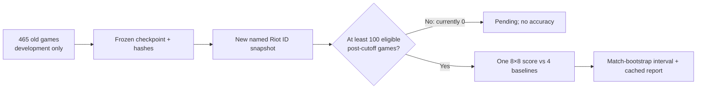

# Prospective benchmark protocol v1

Registered on 2026-10-09 **after** exploratory analysis of the existing 465 matches and **before** viewing any post-cutoff match outcome. This registration does not convert earlier results into independent evidence.

The [historical accuracy chart](RESULTS.md) is background for this registration. Its pooled gains are exploratory; the diagram's future lockbox is the independent check.

## Frozen candidate and population

- Candidate: the compact calibrated transformer selected on development validation. The frozen local checkpoint SHA-256 is `869c468880650a556ad4f31d1297daba410e842fb06ff38bc6b80e9e81c780f7`.
- Frozen metadata SHA-256: `1b36d118fa41297eea86d55029a06a81f2a65bd254c607c4ef8d36a45326e71f`; source split signature: `8b439d9c476907a60341b2dfe8867f087c16c36ce274c0b740654e633cd3615c`.
- Source corpus: 465 usable KR queue-420 matches of the account resolved as `Hide on bush#KR1`. Account-v1 verifies the account identifier, not the human player's identity.
- Prospective eligibility: the same PUUID, KR match ID, queue 420, duration at least five minutes, valid timeline, no overlap with the frozen 465 matches, and `gameStartTimestamp` or `gameCreation` **strictly greater than 2026-10-01 13:22:43.462 UTC**.
- Minimum sample: **100 usable new matches**. Until then the script returns `pending` and computes no outcome metric. The first named match-ID snapshot on 2026-10-09 found 0/100.

## Primary analysis, fixed before new data

1. Pool the frozen model's 16×16 region logits into 8×8 cells by summing their probabilities (log-sum-exp). Predict the highest-probability 8×8 cell for the next one-minute position.
2. Compute four baselines from the **frozen training data** or current state: most frequent 8×8 train cell, current 8×8 cell, central 8×8 cell, and the frozen train-only role/phase prior pooled to 8×8. Use the strongest baseline observed on the prospective set.
3. Report per-observation top-1 accuracy, model-minus-strongest-baseline gain in percentage points, and a paired bootstrap interval that resamples **whole matches** 2,000 times. Each resample takes the strongest of the four baselines again.
4. The prespecified pass condition is the **lower 95% bootstrap bound above zero**. There is one primary metric. Report all values even if the condition fails.

Secondary results: exact 16×16 and coarse 4×4 top-1, top-5, item and skill metrics, by role/patch/phase, and model-vs-baseline spatial distance. These do not replace the primary result. The original requirement to beat 16×16 baselines remains unmet unless separately demonstrated on the future matches.

## One-shot rule and data boundaries

`scripts/run_prospective.py` copies the model and metadata to ignored local files, verifies their SHA-256 hashes, accumulates only post-cutoff matches, and writes a cached `score.json` on first eligible evaluation. Later invocations return that score without recomputing it. Raw match data, model weights and local score files are excluded from Git. New snapshots refresh only ID pages; cached matches and timelines are reused. A newly trained model requires a **separate protocol and later untouched matches**. The current lockbox cannot be used repeatedly to tune candidates.

This benchmark tests **prediction of observed movement**. The timeline still has a proxy of vision and no team voice. Passing does not prove that the policy helps teammates, wins more games, or plays above Faker's level. Those claims require the separate steps in [SHADOW_PLUS.md](SHADOW_PLUS.md).
