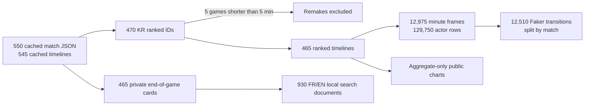

# Corpus atlas — what is indexed, and what it can answer


The local archive contains **465 usable KR ranked games** from the resolved `Hide on bush#KR1` PUUID, at the 2026-10-10 snapshot. This account link is verified by Riot account-v1; the API alone does not prove a person's real-world identity. The match cards above are produced from locally cached Riot match JSON and are **not committed**. The screenshot is UI evidence, not a released match-data export.




| Source | Count | Resolution | Allowed use |
|---|---:|---|---|
| KR ranked IDs | 470 | IDs only | Deduplicate, fetch, check queue and duration |
| Eligible KR ranked | 465 | Riot match + timeline | Spatial model and aggregate analysis |
| Other KR queues in cache | 49 | Match + timeline | Local archive; excluded from ranked model |
| Historically attributed EUW alias | 31 | Ranked timelines | Auxiliary event research, identity caveat |
| Professional mirror | 671 | Final summaries, unverified | Find VOD leads, never infer a trajectory |
| Winning Worlds final games | 25 | Sourced series cards | Historical case studies; no movement labels |

The state warehouse holds **12,975 frames**, **129,750 player observations**, **12,510 adjacent-frame transitions** and **353,409 typed events**. Only **33,329 events (9.4%)** have a recorded coordinate. Many purchases, skill points and wards have none; a positioned kill may identify the victim's location. The 320,080 unpositioned events remain useful as time/type context but cannot be drawn as spatial observations. See [the aggregate inventory](docs/data/public_corpus_inventory.json) for category counts and domains.

The [event-by-event validation](EVENT_VALIDATION.md) reconciles **563,198 raw events** with the warehouse: **353,409/353,409** indexed rows match their source fields. It exposes 1,288 purchases/skill points with source actor 0, 62 champion deaths without a player killer and 23,610 tower plates outside the old index. This checks transcription, not Faker's vision or motives.

### Exact account names and event provenance

The [public aggregate source inventory](docs/data/public_corpus_inventory.json) now lists the exact Riot IDs and regions without publishing PUUIDs: `Hide on bush#KR1` (470 ranked IDs, 465 usable), `Hide on bush#61151` on EUW (31/31, [historical external attribution](https://www.sheepesports.com/de/all/articles/lol-2024-worlds-players-accounts-on-euw-server/en)), and three community-attributed historical IDs with **zero** currently available ranked matches: `silent silence#08022`, `wincg#84926` (EUW), `Neo Hide on bush#NA1` (NA). Resolving a Riot ID confirms an account lookup, not the human behind it. Only the first account supplies spatial Faker labels.

The same inventory breaks down indexed event counts, how many have coordinates, and whether actor/item/skill fields are present. For example, **115,245 `ITEM_PURCHASED`** and **67,282 `SKILL_LEVEL_UP`** events are time-stamped but unpositioned; **110,666 `ward_placed`** events are also unpositioned in this indexed cohort. It additionally counts **4,739 sales, 110,087 destruction and 4,207 undo events** directly in raw local timelines. Those three categories were outside the older 353,409-event SQLite tally, so they are shown separately and are **not added twice** to that total. The new [IoC parser](IOC_VISION.md) uses them to reconstruct *held items at t*; it never uses the completed match's item slots as past knowledge.

Official [Riot Data Dragon](https://developer.riotgames.com/docs/lol#data-dragon) item catalogs are fetched and cached for the **12 played patches** to describe items tracked by events at each state. The separate icon atlas for the UI remains pinned to a recent art version. This event-derived inventory is incomplete: a [retrospective quality audit](docs/data/public_ioc_quality.json) exactly matches 1,351 of 4,650 final item-ID sets and flags 3,132 of 129,750 actor frames with more than seven distinct item IDs. Final slots are used for audit only. [U.GG](https://u.gg/lol/champions/azir/build) and [Google search](https://developers.google.com/custom-search/v1/overview) are leads for historical source checking, not automatically scraped item labels or evidence of Faker's view. The item ablation and exact accuracy are in [RESULTS.md](RESULTS.md#item-aware-index-of-context--development-only-2026-10-10).

## Ranked match cards

Each private card shows the UTC start, patch, duration, champion, Blue/Red side, win/loss, K/D/A, CS, damage to champions, vision score, final seven item slots and both champion compositions. Search can match date, patch, match ID, champions and item names. The labels come from [Riot Data Dragon](https://developer.riotgames.com/docs/lol#data-dragon). `scripts/build_sprites.py` builds **two local atlases** from Data Dragon version `16.20.1`: 169 observed champions and 160 observed item IDs. The selected art/name version is pinned for repeatability; a historical patch may have different names or appearances. An unmatched icon must show `?`, not an invented match.

The SQLite index at `data/processed/game_facts.sqlite` is **private and rebuildable**. It records a hash of each source JSON and skips unchanged files; one bad match is logged and does not stop the rest. The public Git repository holds only a count ledger, icon atlases, a sprite coordinate manifest and screenshots. There are no raw match JSON, PUUIDs or per-game cards in the published aggregate JSON. The dashboard server binds to loopback and exposes the cards only through the local `/api/games` route.

**Temporal firewall:** K/D/A, damage, outcome and final items are known after the game. They are browser/search fields. They are never joined to the model's state at time `t`. The causal training input is built independently from past and current frames, with labels in the next frame and train/validation/test split by match.

## Rebuild and inspect

```bash
.venv/bin/python scripts/refresh_catalog.py
.venv/bin/python scripts/serve_dashboard.py
```

The refresh pilots five games, resumes the 465-card index, rebuilds the 930 FR/EN summaries and static icon atlases, then writes the aggregate corpus inventory. It uses cached Riot files; Data Dragon static art is cached under the ignored `data/raw/ddragon/` directory. If the cache lacks an asset and the CDN is unavailable, the existing atlas remains usable but the rebuild reports the network failure. The end-to-end ranked pipeline also invokes these steps.

**Next information gate:** a legally sourced replay paired to one known match ID and a verified clock/player-visible state. Pilot five matches before scaling. More indexed final scores cannot create sub-minute movement labels or prove why a player moved. [Research gates](NEXT_RESEARCH.md) · [Pressure measurements](PRESSURE.md).
