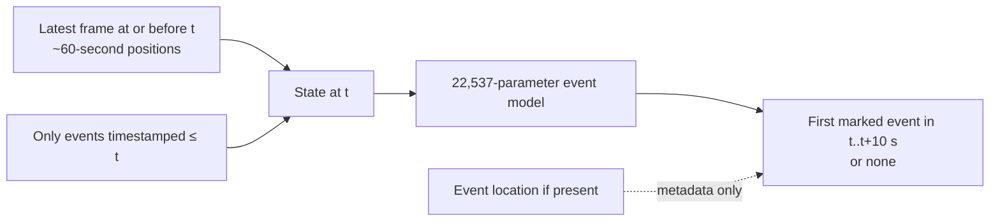

# More games, a faster question


The 2026-10-10 Riot refresh returned the same **470 KR ranked IDs** for `Hide on bush#KR1`; five remakes leave **465 usable timelines**. More pages of the same endpoint cannot manufacture older matches. A historically attributed EUW account and a separate professional match summary source expand the *catalog* without pretending that all sources contain the same observations.

| Domain | Games | New ten-second windows | What is actually observed | Use |
|---|---:|---:|---|---|
| KR `Hide on bush#KR1`, queue 420 | 465 | 73,482 | ~60-second player frames and timestamped match events | Original spatial model; new event model train/validation |
| EUW `Hide on bush#61151`, queue 420 | 31 | 5,383 | Same type of Riot timeline, 2024-10/11 | Optional **training** supplement for event model; KR validation kept fixed |
| Professional game summaries, 2022–2026 mirror | 671 | **0** | Final scoreboard, champion, patch, league, result | Historical catalog and source discovery only; no frame-level training |

These are **1,167 game records across separate domains**, not 1,167 interchangeable Faker decision trajectories. A cross-source game identity audit has not been completed, so this sum is not asserted as 1,167 unique played games. The EUW account was [identified as Faker's Worlds 2024 bootcamp account by Sheep Esports](https://www.sheepesports.com/de/all/articles/lol-2024-worlds-players-accounts-on-euw-server/en). Riot account-v1 resolved its own PUUID, match-v5 returned 31 `EUW1_` queue-420 matches and 31 timelines, and the sampled dates and champions align with that historical attribution. This remains an attribution, not identity proof from Riot. The other [community-listed accounts](https://www.leagueofgraphs.com/fr/summoner/euw/Hide%2Bon%2Bbush-61151)—`silent silence#08022`, `wincg#84926` and `Neo Hide on bush#NA1`—resolved by account-v1 but returned **0 available ranked IDs** on their regional routes in this snapshot; none entered training. Riot's [regional routing documentation](https://developer.riotgames.com/docs/lol) is followed: EUW → `europe`, NA → `americas`, KR → `asia`.

The professional catalog is built from a [public third-party mirror](https://github.com/twodotone/finalLOL/tree/main/data/csv) labelled as a copy of [Oracle's Elixir match data](https://oracleselixir.com/match-data/). Each local input file is hashed and its provenance status is `unverified_public_mirror`; the 2026 mirror stops on **2026-04-10** and is therefore stale. Exact `playername=Faker`, `teamname=T1` and `position=mid` yielded 144/134/176/187/30 game rows for 2022/23/24/25/26. The local SQLite catalog stores rows and source hashes under ignored `data/processed/`. A future provider-original or [Riot/GRID LoL Esports Data Portal](https://riotesportsdata.com/en-us/) feed must be crosschecked before it supplies training features. No raw third-party CSV or Riot JSON is committed.

## Ten-second prediction target



The new label is **which event happens first in the next ten seconds**, among Faker kill/death, ally/enemy kill, objective, building, ward placement/clearance, or no event. The target is not Faker's next click, path or position. A kill location can be the victim's location; a monster objective point is the monster's location; wards often have no coordinates. `event_clock.py` preserves `event_cell64=-1` when absent. The same match split remains **373 train / 46 validation / 46 historical test**. The 46 historical test matches were untouched during this experiment.

The input uses the last available frame's own economy and geometry, distances to the ten-player roles, and counts/ages of events **with timestamp ≤ t**. It does not use a later frame or event. These are full-match timeline observations, not Faker's exact fog-of-war or voice communications. Ten-second windows overlap in context and are correlated; the match, not the window, is the uncertainty unit.

| 46 KR validation matches, 7,480 ten-second windows | Log loss ↓ | Top-1 ↑ | Macro F1 ↑ |
|---|---:|---:|---:|
| Train-only phase frequency | 1.4472 | 52.59% | 7.66% |
| KR train only | 1.3923 | 53.98% | 12.33% |
| KR + EUW auxiliary train | **1.3847** | **54.44%** | **13.16%** |

The model's **0.00765** log-loss gain from EUW has a 95% match-bootstrap interval **[0.00294, 0.01264]** on this same development validation set. We used that validation set to choose epochs and compare variants, so the interval describes sampling variability here, **not independent confirmation**. Ward placements are **37,171/73,482 (50.6%)** KR windows; the train-only phase prior reaches 52.59% validation accuracy. Log loss and per-class F1 matter more than a headline 54%. A future frozen-date cohort and phase/patch audit are needed before promotion.

## Why biology and point-process mathematics help

- [Joint modeling of events and time series](https://arxiv.org/abs/1703.08524) motivates keeping irregular event timestamps beside slower player-state frames. The present implementation is a **discrete ten-second risk model**, not a fitted continuous-time Hawkes process.
- [Baboons tracked during collective movement](https://www.nature.com/articles/srep27704) show why an individual's relevant neighbors can vary with space, relationships and time horizon. We encode distance to jungle, support, bot and opponents as *candidate predictive context*. LoL roles and visibility differ from animal movement; no biological result proves a Faker mechanism.
- The [When Agents Rule testbed](https://github.com/asp67/when-agents-rule) suggests fixed conditions, explicit action budgets, full transcripts and separate judgment of real-time latency versus decision quality. For Shadow Faker, those ideas inform a future **counterfactual challenge harness** with frozen scenario seed, observable state, legal actions, opponent response and event log. Our current five-lane challenges are synthetic hypotheses, not a playable LoL simulator; this repository's 10-second event model is offline prediction and is not presented as an RTS agent.

## Reproduce locally

The Riot key stays in `.env`. The alias fetch is checkpointed and obeys the shared 1.3-second pacer, retries and `Retry-After` handling. The source mirror CSVs remain under ignored `data/raw/pro/` and can be replaced with provider-verified CSVs of the same schema. Start with five games for each new target, then scale:

```bash
.venv/bin/python -m shadowfaker.fetch --limit 1000 --id-snapshot 20261010_expansion
.venv/bin/python -m shadowfaker.alias_fetch --snapshot 20261010_alias_probe --pilot 5
.venv/bin/python -m shadowfaker.alias_fetch --snapshot 20261010_alias_probe
.venv/bin/python -m shadowfaker.event_clock --limit 5
.venv/bin/python -m shadowfaker.event_clock
.venv/bin/python -m shadowfaker.event_clock --alias
.venv/bin/python -m shadowfaker.pro_catalog data/raw/pro/oracle_mirror_20*.csv
.venv/bin/python -m shadowfaker.event_model --pilot
.venv/bin/python -m shadowfaker.event_model
.venv/bin/python -m shadowfaker.event_model --with-euw
.venv/bin/python scripts/render_expansion.py
```

The local warehouse, cached JSON/CSV, model checkpoints, individual windows, and validation predictions are ignored by Git. The published [aggregate JSON](docs/data/public_expansion.json) and chart contain counts and scores only. Repeated runs reuse match JSON and versioned window files.
