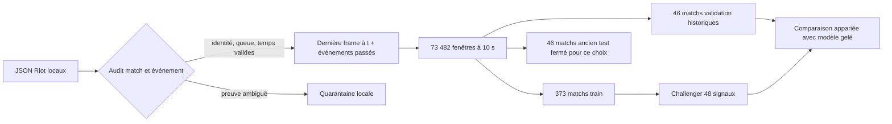

# Shadow Faker — données assainies, prédiction à dix secondes


## Ce que l'on protège

À `t`, Shadow prédit si Faker aura un **achat, point de compétence, ward posée ou ward détruite** dans `(t,t+10 s]`. Kill, mort et assistance restent trois sorties **d'issue**, présentées séparément. La cible est un événement explicitement relié au PUUID du compte Riot ; elle ne contient ni clic, ni choix d'objet/skill, ni position mesurée à la seconde. Les neuf autres joueurs contribuent au contexte, avec la limite majeure d'une timeline omnisciente.



Le contrôle accepte seulement une partie ranked solo queue 420 d'au moins cinq minutes, avec dix IDs 1–10 uniques, un PUUID cible unique, les mêmes identifiants de match dans le JSON match et la timeline, des frames strictement croissantes et une fin cohérente avec la durée. Un événement pouvant être un label doit avoir un temps valide dans la partie et un acteur attribuable. Un champ manquant ambigu met la partie en quarantaine au lieu de convertir l'événement en **absence d'action**. L'acteur `0` désigne des événements système et n'est jamais Faker. Les positions absentes sont masquées dans les nouvelles variables et ne font pas planter le parseur.

Les enregistrements textuellement identiques sont **signalés, pas effacés**. Riot peut enregistrer plusieurs achats du même consommable au même instant ; les wards sans lieu peuvent aussi avoir des champs identiques. Comme le label demande seulement « au moins un événement », leur multiplicité ne modifie pas `y`. Une déduplication automatique pourrait retirer des faits légitimes. Les JSON, fingerprints, motifs par match et NPZ restent locaux sous `data/` ; Git ne reçoit que ces agrégats.

## Contrôle effectué

| Étape | Parties | Fenêtres | Résultat |
|---|---:|---:|---|
| Pilote, 3 train + 2 validation | 5 | 737 | 0 quarantaine |
| Corpus entier, split inchangé | 465 | 73 482 | 0 quarantaine |
| Train | 373 | 58 974 | labels historiques conservés |
| Validation historique | 46 | 7 480 | mêmes `t`, `y` et 37 anciennes variables pour les deux modèles |
| Ancien test | 46 | 7 028 | préparé, **non évalué pour ce challenger** |

L'audit compte **563 198 événements bruts**, dont **344 595** de familles potentiellement attribuables, **7 578** avec acteur système `0`, et **11 196** enregistrements textuellement identiques dans leur match. Aucun horodatage ciblable invalide, aucun acteur ciblable manquant, aucun match incohérent n'ont nécessité une quarantaine dans cette cohorte. Cela valide le **contrat de parsing** ; ce n'est pas un certificat de qualité de la télémétrie Riot ni une preuve que Faker a vu chaque ennemi.

Le cache est atomique et par match. Son SHA-256 porte sur les deux JSON source ; un changement de match ou timeline régénère les fenêtres. Les états de base sont recalculés directement depuis ces JSON, puis les onze nouveaux signaux sont ajoutés. Une relance identique réutilise les 465 NPZ et conserve le même split. Le constructeur compte les erreurs par match et poursuit le reste du corpus.

## Onze signaux supplémentaires connus à `t`

Le modèle M16 lisait 37 variables. Le challenger garde exactement les mêmes sorties et la même architecture MLP, avec **48 entrées** et **14 983 paramètres**. Les ajouts décrivent Faker : or disponible, part non dépensée de son or total, CS lane/jungle, fraction de santé, masque de position présente, gains or/XP/CS et déplacement **entre la frame actuelle et la précédente**, distance à sa base. Ces onze ajouts sont calculés avec la dernière frame `≤ t` et éventuellement sa prédécesseure ; ils ne lisent ni résultat ni objets finaux. Une position tenue entre deux frames reste une observation ancienne, pas une trajectoire à la seconde. Le modèle voit encore les dix joueurs via les 37 anciennes variables, donc une vue plus complète que la vision réelle de Faker.

**Limite relevée lors de M19 :** dix distances par rôle dans ces 37 anciennes variables utilisent `teamPosition` du JSON de match achevé. Même si les coordonnées employées sont celles d'avant `t`, l'étiquette de rôle peut être une inférence rétrospective de Riot. Les scores M16/M18 restent des résultats historiques avec ce risque de métadonnée future, pas une validation d'une politique strictement disponible en direct. Le nouvel [export IoC pour modèles futurs](IOC_LEDGER.md) retire ces dix champs et le rôle des acteurs ; une ablation avec rôle dérivé uniquement du passé reste à entraîner et comparer sur une cohorte future.

## Comparaison appariée sur l'ancienne validation

| Mesure, 46 matchs / 7 480 fenêtres | Règle par phase train | M16 gelé | Challenger assaini |
|---|---:|---:|---:|
| Perte log, **quatre actes** ↓ | 0,24309 | 0,22992 | **0,22309** |
| AP moyenne, **quatre actes** ↑ | 8,05 % | 14,93 % | **17,40 %** |
| Perte log, sept familles ↓ | 0,20481 | 0,19427 | **0,19007** |
| AP moyenne, sept familles ↑ | 6,60 % | 12,11 % | **13,60 %** |
| AP moyenne, trois issues de combat ↑ | — | 8,35 % | 8,52 % |

Le gain en perte log des **actes** face au modèle gelé est **0,00683** ; bootstrap apparié par match à 95 % **[0,00566 ; 0,00796]**. Les fenêtres d'un match se chevauchent, d'où le rééchantillonnage par match. Le gain d'AP vient surtout de l'achat : **24,09 → 31,21 %**. Le point de compétence bouge peu (**18,54 → 18,62 %**), la ward posée **10,52 → 12,30 %** et la ward détruite **6,57 → 7,50 %**. Kill **7,67 → 7,89 %** : le challenger ne sait toujours pas annoncer un kill fiable.

Cette validation historique a servi à choisir l'époque et à concevoir le challenger. L'intervalle de confiance décrit la variation entre matchs **dans cette cohorte**, pas une preuve indépendante de généralisation. Le checkpoint M16 reste conservé pour la comparaison. Le nouveau checkpoint est le candidat de développement retenu selon deux critères préannoncés : perte log des actes plus basse et AP moyenne des actes plus haute. Une cohorte plus récente, figée avant examen, est nécessaire pour une affirmation prospective. **90 % d'accuracy binaire « aucun événement » serait trompeur** : elle manquerait tous les cas positifs. La cible de recherche à long terme est une politique de décision de Faker, puis sa valeur en jeu ; ce modèle d'événements en est un proxy limité.

## Reproduction locale

```bash
PYTHONPATH=src .venv/bin/python scripts/run_faker_actions.py
PYTHONPATH=src .venv/bin/python scripts/train_faker_actions.py
PYTHONPATH=src .venv/bin/python scripts/run_action_sanitation.py --pilot-only
PYTHONPATH=src .venv/bin/python scripts/run_action_sanitation.py
PYTHONPATH=src .venv/bin/python scripts/challenge_faker_actions.py --pilot-only
PYTHONPATH=src .venv/bin/python scripts/challenge_faker_actions.py
.venv/bin/python scripts/render_action_sanitation.py
```

Le pipeline général `PYTHONPATH=src .venv/bin/python scripts/run_next_level.py --limit 1000 --epochs 25` inclut ces étapes après M16. Le modèle et les métriques par match sont locaux ; [l'agrégat public](docs/data/public_faker_actions_sanitation.json) suffit à reproduire le graphique. La prochaine étude doit obtenir de nouvelles parties et, pour la prédiction de mouvements/clics à la seconde, des observations replay/POV alignées dont la provenance et les droits sont établis.

Le **11 octobre 2026**, une requête live de l'ID ranked KR le plus récent a de nouveau reçu **HTTP 401**. La nouvelle cohorte prospective n'a donc pas été collectée ; le pipeline local reste relançable depuis son cache. Après renouvellement de `RIOT_API_KEY` dans `.env`, la collecte peut reprendre sans republier cette clé.
