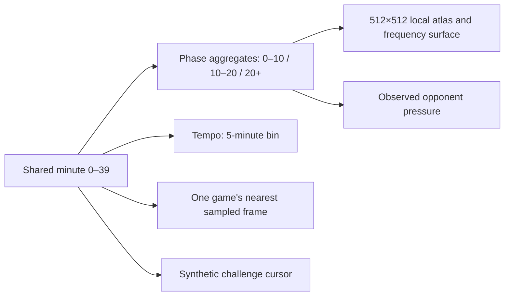
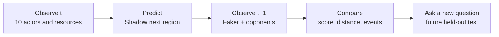

# Five Star Research Edition — visual system

The dashboard and README share one fan-made identity: five stars for the user's T1-era inspiration; black-plum ground, scarlet motion and warm gold for evidence markers. It is **not official T1 or Riot branding**. The stars express fandom, never a claim of five titles, affiliation, or access to team data. The README hero is generated as SVG by `scripts/render_identity.py`, using the same colours and typography as `dashboard/style.css`.

| Token | Colour | Meaning |
|---|---|---|
| Ground | `#100c13` | stage, low visual noise |
| Scarlet | `#ff536b` | Shadow, action, opponent proximity or alert depending on chart legend |
| Rose | `#ff9bb6` | observed arrival in replay |
| Gold | `#ffd895` | Faker focus and evidence worth inspecting |
| Blue | `#70a8ff` | other allies in the ten-player ecosystem |
| Turquoise | `#62e4d8` | Faker's current position and historical trajectory |

Colour alone never identifies a player: figures also use labels, rings and line styles. A title and caption state whether height means aggregate probability or observed player level. Challenge charts identify synthetic units and never present a win probability. Exact-cell scores, baseline, near-cell score and calibrated set area sit together because any one number can mislead.

## Shared chronology and readable colours

The sticky scrubber is the temporal navigation spine. Minute 0–39 selects the atlas/surface/pressure phase, the matching five-minute tempo bin, the closest available frame of the open replay, and the nearest sampled point of the synthetic challenge. An individual atlas phase, tempo slider, replay slider or notable-event shortcut also moves the shared scrubber. Mouse wheel works only while hovering the scrubber, leaving ordinary page scroll intact. The legend stays visible while reading any section: turquoise marks Faker's state at `t`, rose the observed arrival at `t+1`, a white ring the replay model choice, blue allies, red opponents, and gold objectives. Each atlas layer also shows its own swatch; the aggregate surface explicitly labels turquoise observed versus rose Shadow.

The linked views **do not share one cohort**: 46 **development validation** games produce the local 512×512 Faker/Shadow destination densities (460, 443, 372 transitions by phase); 465 ranked games produce player, event and pressure aggregates; replay is one local game with the **legacy 16×16 model**; challenge is an explicit hypothetical. Its adjacent-cell metric field is the separately labelled historical 64×64 view. The 16×16 comparison and the 64×64 test score remain fixed historical summaries. The older public 64×64 JSON is still available for its archived 460/437/300 test-phase histograms. The 512 canvas draws exact sparse cells and a low-opacity display halo for visibility; hover reads the exact cell count. The public event figure groups exact cells into 16×16 bins and hides bins with fewer than three events before smoothing. Nothing in the scrubber interpolates seconds between Riot timeline frames or creates unseen player POV.

Visual QA targets: desktop and narrow screens; French and English; all selectable atlas layers and phases; 3D angle and mode; every replay frame; per-match picker; case search; five challenge tabs and both parameters. The local server uses an allowlist and loopback binding because replay images contain match-level Riot-derived detail.
