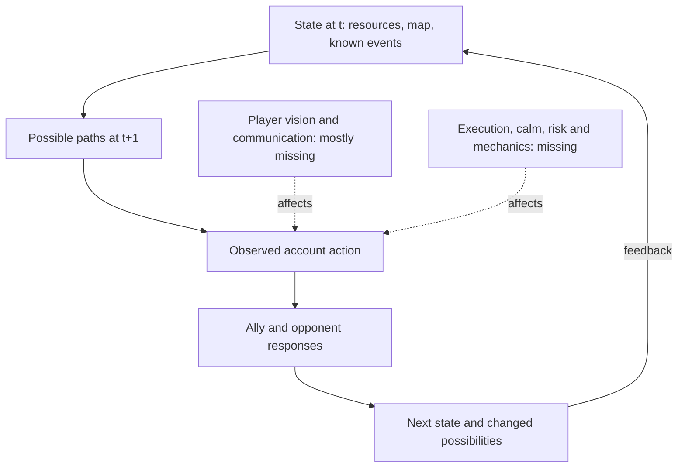

# Faker's decision diamond

The working question is not only **where this account goes next**, but how a player's choice changes teammates' and opponents' possible next states. A single map heatmap is one projection of that problem. This document names the other facets and, crucially, which ones the current evidence can actually observe.

This graph is a **research model**, not a measured second-by-second causal chain. Riot timelines here sample roughly once every 60 seconds. The public 3D [surface](docs/figures/probability_surface_3d.png) adds height for **observed frequency**, not physical terrain or the true number of reachable states.

| Facet | Question | Current signal | Next source or test |
|---|---|---|---|
| Space | Where does the account move next? | 16×16 one-minute region and broader pooled grids. | Better calibrated spatial policy; future-game test. |
| Tempo | When does a rotation become urgent? | Five-minute trend of one-minute movement tags; gold/XP changes. | Higher-frequency aligned replay or POV event clock. |
| Team field | Which teammate changes the action? | Distances and movement toward jungle, bot, support, mid, top. | State-dependent role interactions and ablations. |
| Economy | Which resources make a path valuable? | Gold, XP, CS, levels, objective events. | Action-conditioned resource accounting with opponent response. |
| Vision | Which paths can the player actually see? | Proximity-based minimap proxy only; aggregate gold/XP still omniscient. | Replay/POV alignment, ward coverage and visible-state labels. |
| Execution | Can the player realize a planned move? | Not measured; item/skill timing is a weak proxy. | Licensed video/replay annotation of execution, timing and failure. |
| Risk and composure | Does the player choose a difficult path under pressure? | Outcome and gold-state slices are descriptive only. | Predeclared pressure states, repeated comparable decisions, independent reviewers. |
| History | How did the style change across patches and teams? | Ranked patch and champion slices only. | Verified LCK/Worlds match and VOD index with patch, roster and POV provenance. |
| Consequence | Did the move help win? | Observational associations and an outcome head, no causal estimate. | State-only control, support-aware offline evaluation, then matched played games. |

## From a minute to a moving possibility field

1. **Keep the current minute-scale benchmark frozen.** It is the measured base. Its original 16×16 gate remains unmet; pooled 8×8/4×4 gains are exploratory.
2. **Align legal replay or POV material with the Riot match clock.** Verify timestamp drift and perspective; never infer hidden team voice or exact fog from an edited broadcast.
3. **Annotate events at several temporal scales.** A one-second state requires evidence sampled that often. Video frame rate alone does not make positions, intent or communications available.
4. **Predict a distribution of near-term paths**, with uncertainty and an explicit observation mask, then compare to simple last-position, lane and role/phase priors on later matches.
5. **Test the consequences separately.** A forecasted move or attractive path does not establish that taking it increases wins. Opponent adaptation and repeated played games are the eventual gate.

The ambition to find an unexpected, game-changing move is recorded as a hypothesis program in [GAME_THEORY_LAB.md](GAME_THEORY_LAB.md). Professional broadcasts, public commentary and other games can suggest features or tests, but only match-linked evidence can validate a claim about this account. The [roadmap](ROADMAP.md) tracks the sequence; [RESULTS.md](RESULTS.md) states the current score.
