# Faker Memory: a database of decisions and a challenger that learns


The question is useful: instead of storing only forecasts, store **what the observed account did in each situation**, then ask another policy to predict from similar cases. This is now an executable local experiment, not a language-model fine-tune or a claim that a retrieved move is optimal.

```mermaid
flowchart LR
  A["Riot timeline<br/>~60 s frames"] --> B["Causal state at t<br/>75 core + 50 item IoC fields"]
  B --> C["Private SQLite episode<br/>match, frame, state, next destination"]
  C --> D["Training-only memory<br/>373 matches / 10,038 episodes"]
  D --> E["Match-disjoint calibration<br/>75 train matches"]
  E --> F["Frozen retrieval rule<br/>15 weighted neighbours"]
  F --> G["46 reused validation matches<br/>1,275 decisions"]
  G --> H["Compare simple rule + Shadow IoC<br/>log errors and limits"]
```



## What is stored

`data/processed/faker_memory.sqlite` is a private, checkpointed SQLite database. `matches` records split, patch, role and source stamp. `episodes` stores match/frame identifiers, a 125-float **state at t**, Faker's observed current coordinates, the **next observed coordinates**, 8×8 / 64×64 / 512×512 destination cells and the prior coarse cell. `challenge_runs` records selected settings and scores. The 75 core fields include minute, economy, objectives, recent events, ten players' last-observed positions and visibility proxies; 50 item IoC fields summarize timestamped inventories and patch catalog coverage. Future destinations are **labels**, never query fields. The current context has roughly minute resolution even though the destination is quantized on a 512×512 grid.

The five-game pilot writes **5 train + 5 validation matches / 260 episodes**. The full build writes **373 train matches / 10,038 episodes** and **46 validation matches / 1,275 episodes**, with per-match stamps so reruns skip unchanged data. No historical test match enters this memory or challenge. Raw Riot payloads, row-level state vectors, match IDs and case evidence stay in ignored local files; only aggregate scores and a figure are committed. A small, anonymous set of validation cases is served by the *local* dashboard for a quiz; its answers never feed training.

## How the challenger learns

The 373 training matches are split again **by match**: 298 matches form a temporary memory and 75 calibrate its configuration. A grid search tries core versus core+IoC, absolute destination versus transferred displacement, current-position weights, same-champion bonus and `k=1,7,15`. Every feature is standardized using only the temporary memory. Neighbours vote for a next 8×8 cell with rank-decaying weights. The selected configuration is then rebuilt from all 373 train matches and scored once on the 46 validation matches. It uses no validation answer to update its weights.

| Reused validation, 46 matches / 1,275 decisions | Exact next 8×8 cell |
|---|---:|
| Episodic retrieval challenger | **11.53%** |
| Train-only role / phase rule | **15.29%** |
| Existing Shadow IoC transformer, separate run | **17.41%** |

The selected retriever uses 15 neighbours, absolute-cell voting and 4× position weight; the IoC channels did **not** win the calibration search. Best calibration with IoC was **13.31%**, versus **13.41%** without it. Its nearest-case exact 64×64 destination is **0.63%** and exact 512×512 destination is **0%**. These are descriptive validation results, not a new test or evidence of 90% predictability. This candidate is **not promoted**. Validation has already shaped earlier work, so even the transformer comparison is exploratory.

## Why not fine-tune a general LLM on this table?

The primary target is a structured, spatial action conditioned on a numeric state and an incomplete vision proxy. A text model would first need a faithful serialization, an action grammar and evaluation showing it beats the spatial baselines on **future matches**. With 10,038 training decisions, memorizing champion/phase narratives would be easy and misleading. A language model can later help **retrieve and explain sourced cases** from VOD commentary or multilingual transcripts, but those explanations must cite their evidence and remain separate from the action policy. The existing transformer learns the spatial prediction; this memory supplies inspectable precedents and a distinct challenger.

The next useful learning loop is: collect a new match cohort or a timestamp-aligned player-view replay; freeze its labels before design; measure calibration, top-1 and distance against the same simple rules; inspect where retrieval helps Shadow; then retrain on new training matches only. A click in the dashboard quiz is feedback to the reader, not a new label for the model. Similarity is association: it does not prove Faker saw the same information, faced the same pressure or caused a win.

## Reproduce

```bash
.venv/bin/python scripts/train_faker_memory.py
.venv/bin/python scripts/render_faker_memory.py
```

The full `scripts/run_ioc_challenge.py` invokes both after the event audit and IoC ablations. `scripts/run_next_level.py` invokes that runner. On a machine without the private cached data, the included aggregate chart and documentation remain viewable; training requires the locally fetched Riot corpus. The server serves only an anonymous local quiz from `/api/memory/cases`, while `/faker-memory.json` serves the committed aggregate score.
