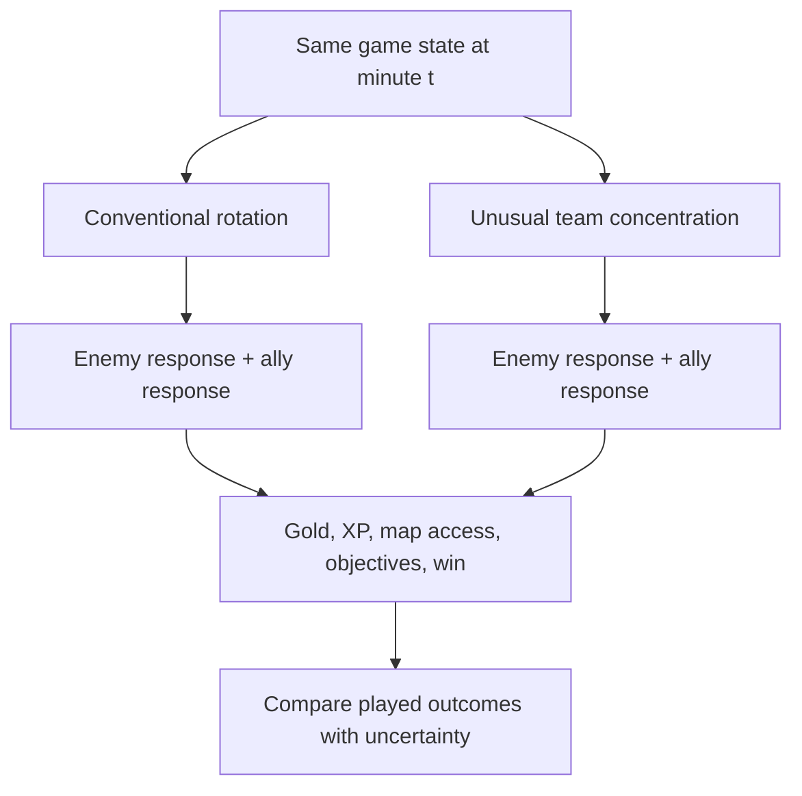

# Shadow Faker strategy lab: unusual moves, testable claims

The goal is to learn the **decision structure** behind a great mid player's rotations, then investigate actions conventional play might overlook. An unusual move is interesting because it changes the other nine players' options, not because it looks surprising. The "five players bot" example is a research prompt; this project has **not** shown that five Silver players could beat a professional team.

The match timeline only records the branch that actually occurred. It cannot reveal what the same ten players would have done under the other branch. This is why a replay action classifier, or a correlation between a rotation and winning, cannot by itself discover an "AlphaGo move" for League.

## First coverage audit: five allies near bot carry

On the 465 ranked matches of the resolved account, a five-person cluster within **2,500 units of the allied bot carry** appeared in only **one early frame from one match**, out of **3,255 eligible frames from minutes 3–10**. Four-person clusters appeared in 46 early frames. This proxy does **not** establish that those players were in bot lane, following a five-bot strategy, or maintaining that formation. The current corpus has almost no support for estimating its outcome. The [aggregate counts](docs/data/public_summary.json) and [reproducible parser](src/shadowfaker/formations.py) make that absence of evidence visible.

## Hypothesis register

| ID | Hypothesis to test | Evidence available now | Evidence needed next | Failure condition |
|---|---|---|---|---|
| H1 | Faker changes which teammate he moves toward as game state and time change. | [Five-minute tempo](RESULTS.md) and role tags from ranked timelines. | Hold-out role-conditioned prediction and matched video checks of apparent rotations. | Time-only or simple role priors explain the same movement. |
| H2 | An early concentrated formation can create a local gain that outweighs resources and map access conceded elsewhere. | Early five-person clusters are essentially absent here. | Patch-specific resource accounting, opponent-response model, then authorized played trials of explicit formations. | The gains disappear after accounting for lost XP/gold/objectives or opponent adaptation. |
| H3 | The "magnet" around jungle, support and bot is a state-dependent interaction, not a fixed 20% contribution per role. | Current movement tags and ally distance features. | Interaction ablations on development validation and later fresh-game tests. | A simpler independent-role model performs as well on untouched games. |
| H4 | A policy can improve outcomes while retaining recognizable Faker movement. | Current behavioral prior; outcome head is associative only. | Calibrated state-only and action-conditioned comparison, support-aware offline evaluation, then comparable games played. | No reliable outcome gain when tested against state-only controls or in played games. |

For every experiment, log its patch, region, queue or professional domain, team strength, observation perspective, action definition, baseline, game-level uncertainty, and whether the hypothesis was written before the result. A surprising clip is a hypothesis generator; it is not a population estimate.

## Expansion without losing Faker as the target

1. **Account evidence:** refresh named Riot match-ID snapshots; never treat a returned 470 IDs as every game in a career. Only an account verified by Riot ID and PUUID can enter the current target corpus. Other possible accounts need separate provenance before any merge.
2. **Professional evidence:** index official LCK/Worlds VODs, public edited team communications and verified match records by game and timestamp. Annotate Faker's visible movement and the source perspective; keep this domain distinct from ranked solo queue. [Register](PUBLIC_GAME_ANALYSIS.md).
3. **Replay/POV evidence:** when locally obtainable, align legal replay or player-view footage to a match timeline, measure actual visible minimap information and annotation reliability. [Feasibility](REPLAY_FEASIBILITY.md).
4. **Other players and games:** use high-level patterns or pretraining only when they improve held-out *Faker* predictions. Transfer learning references and limits are in [OTHER_GAMES_RESEARCH.md](OTHER_GAMES_RESEARCH.md).
5. **Playable evaluation:** before claiming a novel team strategy wins, test it in a valid environment with opponent adaptation, matched team strength and repeated games. Source code, replay fit and offline metrics cannot substitute for this gate.

This register is updated with the [roadmap](ROADMAP.md) and [progress log](PROGRESS.md). New analyses must say which rung of the evidence ladder they reach. A future model is selected on development validation and gets its **own** later lockbox; the current [frozen prospective test](BENCHMARK_PROTOCOL.md) belongs to the existing checkpoint.
