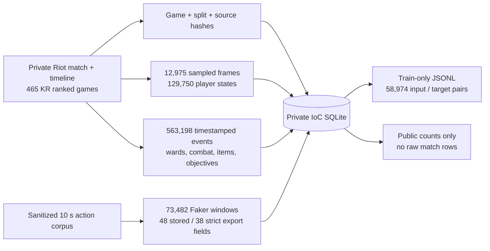

# Faker IoC ledger — evidence before language-model training

The **Index of Context (IoC)** now has a concrete local database: `data/processed/faker_ioc.sqlite`. It joins a Faker-centred game clock to the ten players and every timestamped Riot timeline event. **Gold is one field**, alongside position, level, XP, CS, jungle CS, current health, item-event inventory, wards, fights and objectives. `match_id`, `frame_index`, `event_index` and source hashes allow every derived row to be checked against the private raw cache. The complete database, raw files and per-window JSONL are ignored by Git.



## What a single window means

At time `t`, the input contains the latest sampled frame **at or before `t`**, the ten actors with their snapshot age, event-derived item counts updated through `t`, all timestamped events in the previous 60 seconds, and **38 strictly exported numeric features**. The database retains all 48 fields of the earlier audited action dataset for reproducibility. Ten role-distance fields are withheld from JSONL because Riot's `teamPosition` comes from completed-match metadata and might use future information; the same retrospective role tag is retained only in SQLite for audit. The target is a separate set of seven Faker-attributed labels for **`(t,t+10 s]`**: purchase, skill point, ward placed, ward cleared, kill, death and assist. The last three are combat **outcomes**, not proof of a chosen action. A Riot event location is an event location, never an inferred Faker click or one-second player position.

| Table | Private key | Current rows | Meaning |
|---|---|---:|---|
| `games` | match ID | 465 | Split by whole match, patch, Faker participant/team/champion, raw and action-cache SHA-256 |
| `snapshots` | match + frame | 12,975 | Actual frame timestamp; positions arrive roughly every 60 s |
| `actors` | match + frame + participant | 129,750 | Ten-player sampled state and event-derived inventory *at the frame* |
| `events` | match + source frame + source index | 563,198 | Original type, timestamp, participants, coordinates when present, item/skill/objective details, Faker relation |
| `windows` | match + 10 s index | 73,482 | 48 historical fields at `t` (38 in strict export); future labels and first delay stored separately |

The window split is **58,974 train / 7,480 validation / 7,028 historical test**. The export function refuses to include validation or test and streams from SQLite into private JSONL. A five-game pilot produced 737 windows (three train and two validation games), then the full build covered all 465 matches without errors. Re-running the builder validates file hashes and skips all 465 unchanged matches. The [aggregate JSON](docs/data/public_ioc_ledger.json) contains counts, schema and event-family totals only.

Item IDs at `t` are reconstructed from timestamped purchases, sales, destruction and undo events. They are an **incomplete inventory proxy**: the earlier final-inventory audit found only 29.05% of ten-player end sets exactly matching the completed-match item IDs. `items_at_snapshot` and `items_at_t` are therefore evidence from the event ledger, never an exact client inventory. Health and positions also come from the omniscient Riot timeline. This is **not Faker's true minimap**, voice chat, attention, clicks or judgment.

## Build, inspect and export locally

```bash
PYTHONPATH=src .venv/bin/python scripts/build_ioc_corpus.py
PYTHONPATH=src .venv/bin/python -m shadowfaker.ioc_corpus export --limit 5
PYTHONPATH=src .venv/bin/python -m shadowfaker.ioc_corpus export
```

The first command pilots five games, builds/resumes the full local SQLite, and updates only the public aggregate. The second writes a five-line **private** sample to `data/processed/faker_ioc_train.jsonl`; the third writes all 58,974 train examples, potentially a large file. Each JSONL line contains `input` and `target` as distinct keys. `input.source` identifies the private match and frame; `input.snapshot_age_ms` exposes temporal uncertainty; `input.past_60s_events` contains only `timestamp_ms <= t`; `target` holds observed Faker event labels and first delays in the next ten seconds. The input includes no finished-game K/D/A, result, final items or future timeline row. This build is also part of `scripts/run_next_level.py` after action sanitation.

The multilingual [text index](src/shadowfaker/text_index.py) currently holds **988 documents**: generated post-game summaries plus sourced cases. Those summaries can mention final-game facts. They **must not** be concatenated with `input` to train a time-`t` predictor. External articles, professional games and unverified aliases are separate source domains until a human matches the correct game, patch, clock, rights and player perspective. The [episode memory](FAKER_MEMORY.md) is likewise a separate spatial retrieval experiment, not an LLM fine-tune.

## Next model gate

This is a usable evidence database and supervised export **for later experiments**, not a trained LLM or a new 90% result. A first text or sequence challenger should define an action grammar, train on the 373 train matches, calibrate only on the 46 validation matches, and compare against the current seven-label predictor plus trivial frequency/phase rules on a **new future-match lockbox**. The old 46 test games were already inspected in other experiments. A language model used for explanation must cite `match_id`, source event and time and keep interpretation separate from observation. We still need matched player-view replay annotations to learn Faker's visible-information policy rather than a god-view imitation.
