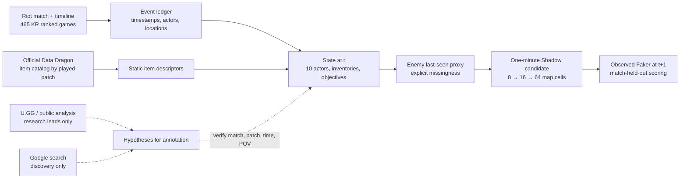
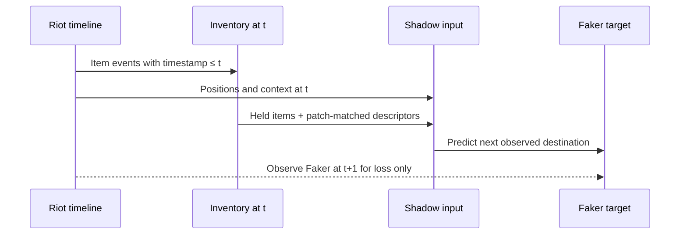

# Index of context: what Shadow can know at time `t`

Shadow Faker's **IoC** is an *index of context*: a time-stamped, Faker-centred account of the other nine players, their movements, objectives, recent events and items. It is not a claim to have recovered Faker's clicks, attention, voice communication or exact fog of war. The prediction target remains **the next observed action of the account**, never an action of another player.

The new [private causal IoC ledger](IOC_LEDGER.md) materializes these observations and the audited 10-second Faker windows together in SQLite. Its train-only JSONL export is a future model input contract, not an LLM result. The 617-channel item experiment below remains a separate, one-minute spatial model.

The separate [event validation](EVENT_VALIDATION.md) confirms the **raw-to-index transcription** of all 353,409 older warehouse rows and lists exclusions and source attribution gaps. It does not validate the inferred held-item inventory or the meaning of a move.

## What the local matrix actually contains

Each supervised row is keyed privately by `(match_id, timestamp_t)`. The public repository contains only aggregate counts, diagrams, validation summaries and code. The local match NPZ stores a window of state vectors, a Faker destination label at the next Riot frame, and split membership **by match**. All 465 KR games yield 12,510 minute transitions. Ten-player positions are available at 12,975 state frames; those positions are Riot's complete timeline view and can include an enemy Faker could not see. A `last-seen` approximation hides stale enemy item knowledge until an opponent is close to an observed ally (1,600 map units). This heuristic is not exact player vision.

| Added layer | Channels per frame | Source and interpretation | Time rule |
|---|---:|---|---|
| Existing state + interaction | 147 | Gold/XP, positions, objectives, events, role distances and enemy response proxies | Existing `x` context at `t` |
| Item lifecycle | 350 | 32 compact item-ID bins, item count, last-frame changes and history mask for each of ten players | `ITEM_PURCHASED`, `ITEM_SOLD`, `ITEM_DESTROYED`, `ITEM_UNDO` only if `timestamp ≤ t` |
| Item properties | 120 | Catalog price, catalog coverage and ten static tags for held items, matched to the game's patch | Static [Riot Data Dragon](https://developer.riotgames.com/docs/lol#data-dragon) descriptors × inventory at `t` |
| **Total candidate** | **617** | Each match saved separately for streaming | No completed-game items, score or result in the input |

An **event-derived inventory proxy** is rebuilt by replaying item events in time order, not read from the match's final `items0..6`. `ITEM_DESTROYED` may mean a consumed or transformed component, so it is removed from held items. `ITEM_UNDO` reverses before/after IDs. Missing fields are tolerated. The historical feature name `item_slots` is a clipped *quantity count from events*, not literal item slots; `item_history_known` says the ledger was processed, not that every held item is known. The UI sprite atlas is a separate display asset; its version can differ from the played patch. The *model's* Data Dragon descriptors use the played patch.

### Audit of the inventory proxy

The reproducible [quality audit](scripts/audit_item_inventory.py) compares the **last** event-derived ID set with the finished match's seven item IDs. Across **4,650 actor comparisons**, **1,351 (29.05%)** are exact and mean ID-set Jaccard overlap is **0.839**. Across **129,750 actor frames**, **3,132 (2.41%)** proxy sets contain more than seven distinct IDs and **6,120 (4.72%)** contain more than seven item quantities. Starting trinkets, automatic upgrades, stackable consumables and end-clock differences help explain mismatches; this audit does not identify a single cause for each row. Final items are used **only** for this retrospective audit, never for state `t`. [Aggregate counts](docs/data/public_ioc_quality.json) are published without match IDs. The model's uncertain ablation lift must be read in light of this input noise.

## External sources and their trust boundary

- **Fetched and used as static model context:** official Riot Data Dragon item catalogs for the **12 played patches** in the current corpus. Requests are cached under ignored `data/raw/ddragon/`; reruns do not fetch the same catalog. Catalog properties are not retrospective win rates.
- **Public build pages such as [U.GG](https://u.gg/lol/champions/azir/build):** useful to formulate patch and matchup questions, but current build pages do not describe a historical player's knowledge at a past minute. Direct automated access returned HTTP 403 in the audit. No bypass or U.GG-derived training feature is claimed.
- **Google Search:** a discovery aid to locate original broadcasts, interviews and match accounts. The official [Custom Search JSON API](https://developers.google.com/custom-search/v1/overview) requires credentials and is closed to new customers; there is no Google crawler in this pipeline. Search snippets and AI overviews are not match annotations.
- **Historical aliases, Worlds broadcasts and commentary:** kept with exact Riot ID, region, date, source, game and perspective when known. An alias attributed by a publication is not cryptographic proof of a player. Pro results and finished-match stats cannot enter `state_t`.

Only a source matched to a **specific match, timestamp, played patch and player-visible perspective** may become an observation label. Commentary saying Faker "absorbed pressure" is a hypothesis; enemy positions and item purchases are observations; influence and reaction remain learned variables to test, not facts inferred from a K/D/A.

## The 90% ambition has three different denominators

1. **Exact action:** one correct 8×8 destination among 64 after about a minute. This is the current coarse spatial top-1 benchmark; finer 16×16, 64×64 and 512×512 are harder. A 90% claim here requires future unseen matches and a strong baseline win.
2. **Prediction set:** naming many cells can cover 90% of destinations. It measures uncertainty only; coverage must always be reported with the fraction of the map named.
3. **Played advantage:** winning more or helping a team more than Faker would require action-conditioned outcomes and actual played evaluation. Offline imitation accuracy cannot establish it.

The item experiments use the same 373/46 train/validation matches, capacity, seeds and calibration sweep for a full candidate and controlled item ablations. Their development validation is already reused for design, so any lift is exploratory. The previously frozen model and future-game lockbox remain separate. Read the measured numbers in [RESULTS.md](RESULTS.md); code in [src/shadowfaker/ioc.py](src/shadowfaker/ioc.py), [src/shadowfaker/external_ioc.py](src/shadowfaker/external_ioc.py) and [scripts/run_ioc_challenge.py](scripts/run_ioc_challenge.py).

The 147-channel ablation retains older signals such as unspent gold and a recent-purchase count. “Item off” means the **new** 350 lifecycle and 120 catalog channels are masked; it does not remove all knowledge related to purchases.

## Next evidence gate

Acquire a lawful, match-aligned replay or player-view sample; verify timestamps, patch, ward/vision semantics and annotation error on **five** games. Compare a truly player-visible sequence model with this minute-spaced proxy. Add future ranked games as a separate prospective cohort. Keep spectacular professional moments as sourced cases, not synthetic solo-queue labels.
