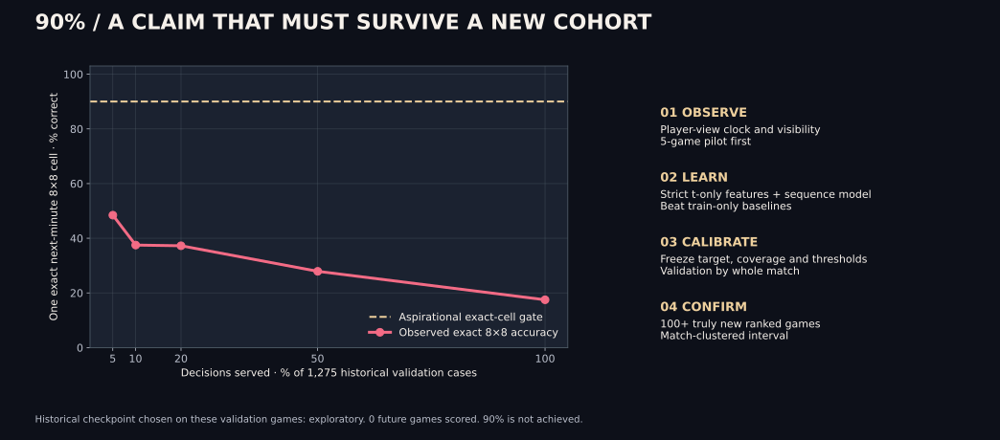
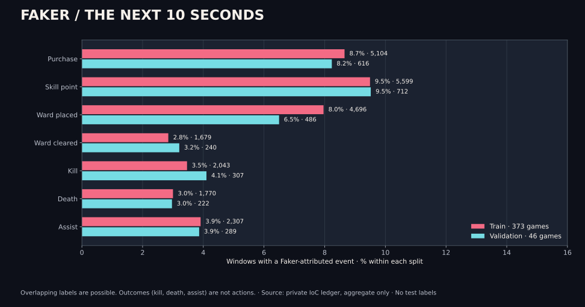
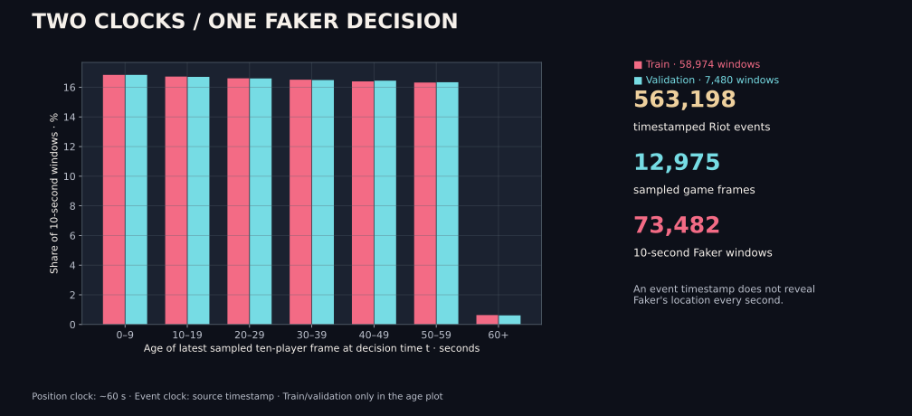
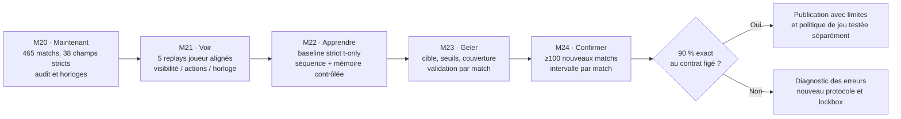

# Shadow Faker — route mesurable vers « 90 % »

> **État au 11 octobre 2026.** Le registre de contexte est opérationnel ; aucun modèle ne prédit les mouvements de Faker à la seconde ni n'atteint 90 % de décision exacte. Ce document est un contrat d'expériences, pas une annonce de performance. **English summary:** the 90% claim is a prospective, pre-registered gate on a named target and served coverage; current historical scores are exploratory.



## Une cible à la fois

Une prédiction s'écrit `P(action, délai, lieu | état disponible à t)`. Le compte **Hide on bush#KR1** est le sujet à prédire ; les neuf autres joueurs, les objectifs, les wards et les objets forment le contexte dynamique. La timeline Riot est omnisciente : ses positions adverses et événements ne décrivent pas exactement la minimap ou les communications vues par Faker. Le dernier snapshot de position date souvent de plusieurs dizaines de secondes. Le système doit transmettre cet âge et l'incertitude au modèle.

| Contrat | Ce qui est observable maintenant | Mesure recevable | État actuel |
|---|---|---|---|
| **Archive spatiale** | Prochaine **case unique 8×8 à la frame suivante**, environ une minute | Top-1 exact contre copie, fréquence et prior rôle/phase ; couverture servie et intervalle groupé par match | **17,49 %** sur 1 275 transitions de validation déjà utilisées ; **48,44 %** sur les 5 % les plus confiantes ; aucun seuil qualifié à 90 % |
| **Actes à 10 s** | Achats, points de compétence, wards posées/détruites attribués à Faker dans `(t,t+10 s]` | AP, log loss, rappel à une précision préfixée, calibration ; une ligne par acte | AP macro quatre actes **17,40 %**, contre **8,05 %** pour la fréquence par phase, sur 46 matchs historiques de validation |
| **Issues à 10 s** | Kill, mort, assistance attribués à Faker | AP et calibration **séparées** des actes ; jamais présentées comme intentions | AP faible ; la mort est une issue, pas une action de Faker |
| **Politique à la seconde** | Action, délai et position continue conditionnés à une source joueur synchronisée | Détection d'action + erreur temporelle + couverture spatiale dans un rayon **fixé avant** le test | **Non mesurable** avec les seules positions Riot à ~60 s ; aucun score annoncé |

Le **90 % exact 8×8** de l'archive reste une porte explicite : borne inférieure Wilson 95 % ≥ 90 %, au moins **10 % des transitions servies** et **50 cas servis**, sur calibration et évaluation de matchs séparés. Sur l'ancienne validation, aucune des deux moitiés de 23 matchs ne trouve un seuil admissible. Le checkpoint et ses seuils y ont déjà été choisis : même un nouveau 90 % sur ces matchs ne serait pas une confirmation indépendante. [Audit du seuil historique](NINETY_GATE.md).

Pour un futur slogan « Shadow Faker prédit à 90 % », la **cible à la seconde**, les actions éligibles, l'abstention, le rayon spatial et la couverture seront figés *avant* de regarder une nouvelle cohorte. Une grande zone couvrant 90 % de la carte, la prédiction systématique « pas d'action », un top-5 ou une précision sur seulement quelques cas faciles ne satisfont pas le contrat. Une amélioration d'AP de détection et une politique de jeu gagnante sont deux revendications différentes. [Critères de jeu plus fort](SHADOW_PLUS.md).

## Ce que le laboratoire possède réellement



| Source / objet | Volume vérifié | Usage permis | Limite |
|---|---:|---|---|
| IDs KR ranked solo du compte résolu par account-v1 | 470 IDs disponibles | Inventaire de collecte, pagination dédupliquée | Ce n'est pas 470 timelines entraînables |
| Matchs KR utilisables | 465, répartis en **373 train / 46 validation / 46 ancien test** | Entraîner et auditer sur les matchs train ; choisir sur validation | Ancien test déjà consulté ; jamais un nouveau lockbox |
| Frames / états des dix joueurs | **12 975 / 129 750** | État observé à ou avant `t`, avec âge explicite | Cadence ~60 s ; le nombre d'états = 10 × frames |
| Événements Riot horodatés | **563 198** | Historique `≤ t`, labels futurs séparés | Événement ≠ clic ou position exacte de Faker |
| Fenêtres IoC Faker à 10 s | **73 482**, dont **58 974 train / 7 480 val / 7 028 ancien test** | Export privé train-only, cible multilabel séparée | Fenêtres corrélées au sein d'un match ; split et bootstrap par match |
| Entrées numériques IoC | 48 historiques, **38 exportables strictement** | Modèle de contexte sans les dix distances de rôle issues de métadonnées de fin de match | La vision réelle, les pings et les communications manquent |
| EUW attribué et résumés professionnels | 31 timelines ranked EUW ; 671 résumés pro | Recherche de transfert et corpus séparés | Identité, patch, domaine et horloge à vérifier avant tout mélange |
| Résumés EN/FR, articles et VOD | Index documentaire local, provenance dans [CORPUS.md](CORPUS.md) | Recherche, annotation, explication sourcée | Texte rétrospectif et résultats finaux interdits dans l'état `t` |

Le pilote de **cinq** parties donne **420 fenêtres train + 317 validation**. L'agrégat complet, calculé sans étiquettes test, donne sur validation **616 achats (8,24 %)**, **712 points de compétence (9,52 %)**, **486 wards posées (6,50 %)** et **240 wards détruites (3,21 %)**. Les sept labels peuvent coexister dans une fenêtre : 2 498 des 7 480 fenêtres de validation ont au moins un label ; **4 982 n'en ont aucun**. Dire « 94,5 % de précision » en répondant *non* à chaque question binaire manquerait tous les événements positifs. [Scores par famille](DATA_SANITATION.md).

| Prochaines 10 s · 46 matchs de validation | Positifs / 7 480 | Fréquence | AP challenger assaini | AP fréquence train par phase |
|---|---:|---:|---:|---:|
| Achat · acte | 616 | 8,24 % | **31,21 %** | 8,68 % |
| Point de compétence · acte | 712 | 9,52 % | **18,62 %** | 12,14 % |
| Ward posée · acte | 486 | 6,50 % | **12,30 %** | 6,74 % |
| Ward détruite · acte | 240 | 3,21 % | **7,50 %** | 4,64 % |
| Kill · issue | 307 | 4,10 % | **7,89 %** | 5,01 % |
| Mort · issue | 222 | 2,97 % | **8,00 %** | 3,65 % |
| Assistance · issue | 289 | 3,86 % | **9,67 %** | 5,35 % |

Les AP sont l'aire sous la courbe précision–rappel. La fréquence des positifs fournit une référence importante mais **ne représente pas une accuracy top-1**. Le challenger et la règle de phase sont comparés sur les mêmes fenêtres de validation **déjà utilisées pour le développement** ; les chiffres ne constituent pas un test indépendant. [JSON des scores](docs/data/public_faker_actions_sanitation.json).



Chaque barre de gauche utilise uniquement les 58 974 fenêtres train ou 7 480 validation. Une fenêtre ouverte 50 secondes après une frame de position ne reçoit pas magiquement un déplacement observé de Faker. Les **563 198 événements** peuvent aider à décrire la partie, mais seuls leurs champs publiés avant `t` entrent en entrée. Les **12 975 frames** sont les instants où les dix positions ont réellement été échantillonnées. L'agrégat régénérable est [public_roadmap90.json](docs/data/public_roadmap90.json) ; la SQLite, les exports JSONL et les identifiants de match restent privés.

## Feuille de route avec sorties et portes d'arrêt



| Étape | Expérience concrète | Sortie attendue | Critère de passage / arrêt |
|---|---|---|---|
| **M21 · Mesurer ce que Faker pouvait voir** | Aligner **cinq** replays/VOD/POV autorisés à la timeline ; annoter au moins actions, caméra, minimap visible, wards, pings disponibles, incertitude de temps et acteur | Schéma d'annotations versionné + contrôle humain de l'alignement ; domaine solo/pro séparé | Si aucune source POV fiable n'est disponible, conserver « vision inconnue » et **ne pas** entraîner une fausse trajectoire à 1 s |
| **M22 · Construire les challengers** | Refaire d'abord la règle de fréquence, copie, phase et modèle actuel sur les mêmes matchs ; puis 38 entrées strictes, séquence d'événements/états, masques de visibilité, contexte jungle/bot/support, objets et interactions ennemies | Ablations appariées, calibration, AP et log loss par acte, erreur délai/lieu si labels réels | Un modèle qui n'améliore pas les baselines ou seulement les négatifs rares ne passe pas ; pas de promotion pour une différence dont l'intervalle par match couvre zéro |
| **M23 · Verrouiller l'épreuve** | Figer résolution ou rayon, horizon exact, classes positives, seuils d'abstention, fraction servie, seed, versions et code ; garder validation pour choisir **une seule** politique | Contrat, empreintes du modèle et des données, protocole de bootstrap groupé par match | Aucun ajustement après ouverture du futur lockbox ; nouveau modèle = nouveau verrouillage |
| **M24 · Tester dans le futur** | Acquérir au moins **100 matchs ranked réellement nouveaux** du compte et vérifier identité, queue, patch et intégrité ; annoter les POV séparément si présents. Un nouveau modèle a besoin de sa **propre cohorte future**, distincte du lockbox M0 déjà figé | Scorecard prospectif par patch/champion/phase avec nombre de matchs, cas servis et intervalle | La revendication 90 % exige le seuil exact préenregistré, **borne basse** ≥90 % et couverture requise ; sinon résultat négatif publié honnêtement |
| **Après** | Scénarios contrefactuels via simulateur calibré, puis épreuves d'utilité et de sécurité contre politique de référence | Regret, robustesse à l'adversaire, taux de victoire en simulation *validée* | Le simple comportement cloné n'est pas une preuve que Shadow joue mieux que Faker |

### Ablations qui peuvent apprendre quelque chose

1. **Temps et visibilité.** Même architecture et budget, comparer dernière frame seule, âge de la frame, événements passés, puis vraie vue joueur si disponible. L'écart mesure une contribution prédictive sur le jeu de développement, pas l'effet causal du talent.
2. **Écosystème à dix joueurs.** Ajouter successivement alliés, jungle/bot/support et adversaires avec leurs états observables et masques de vision. Ne pas introduire `teamPosition` d'après match, scores finaux ou événements `>t`.
3. **Mémoire Faker.** Comparer un rétriever de situations train-only au modèle neural sur le même horizon. Le [premier essai](FAKER_MEMORY.md) est derrière la règle simple : **11,53 %** exact 8×8 contre **15,29 %** ; il faut prouver un gain avant d'augmenter l'index.
4. **Pré-entraînement / texte.** Des milliers d'autres parties peuvent apprendre une représentation du jeu ; l'adaptation Faker est évaluée à part. Un LLM d'explication doit citer événements et temps, jamais injecter un résumé de fin de match dans une prédiction passée. Une plus grosse base n'annule pas le biais de domaine ou la perte de vision.
5. **Erreur structurée.** Couper les résultats par phase, champion, patch, voie, pression adverse et âge du snapshot. La baisse historique de 8×8 à **7,53 % après 20 minutes** désigne une sous-population à étudier, pas une opportunité de l'exclure du score global.

**Dépendance extérieure actuelle.** La dernière requête account-v1 avec la clé locale a reçu HTTP 401 ; l'acquisition de nouveaux matchs est bloquée jusqu'à renouvellement effectif de la clé Riot. Les expériences sur les caches et l'annotation de sources autorisées peuvent continuer. Les limites Riot (**20/s et 100/2 min**) restent appliquées au collecteur ; ni scraping sauvage ni redistribution de JSON bruts. La cohorte prospective est à **0/100** au dernier [rapport de porte](docs/data/public_ninety_gate.json).

## Reproduire les figures sans publier le corpus

```bash
# Avec la base privée déjà construite ; lecture seule, aucune requête Riot.
PYTHONPATH=src .venv/bin/python scripts/render_roadmap_evidence.py

# Si elle manque, reconstruire depuis le cache local avec pilote cinq parties.
PYTHONPATH=src .venv/bin/python scripts/build_ioc_corpus.py
```

Le script vérifie le pilote **737 fenêtres**, le nombre de matchs par split et les comptes train/validation du [registre IoC](IOC_LEDGER.md). Il écrit trois SVG et un JSON **agrégé uniquement**. Les données brutes Riot, la base ligne par ligne et les exports d'entraînement sont ignorés par Git. [Plan technique](PLAN.md) · [Journal des étapes](PROGRESS.md) · [Résultats détaillés](RESULTS.md).
