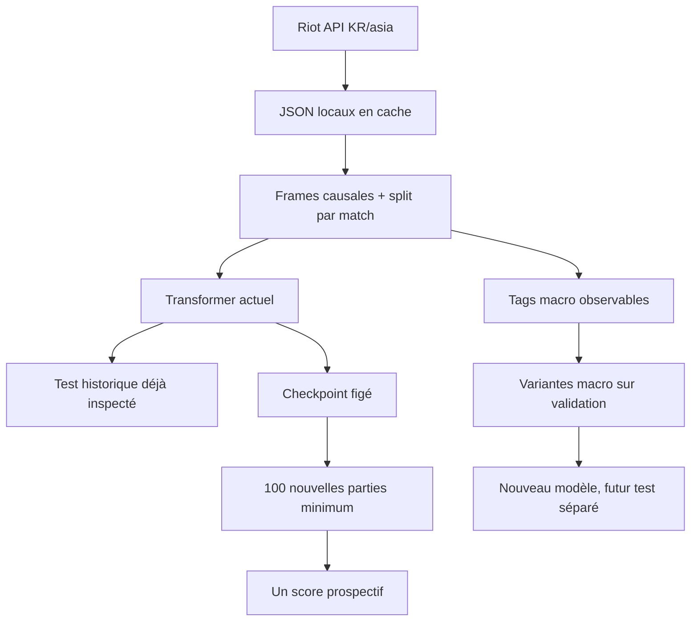

# Shadow Faker — plan d'exécution

Les [graphiques de résultats](RESULTS.md) et la [roadmap M0–M5](ROADMAP.md) rendent visibles les étapes réellement terminées. Le futur test du modèle figé et les variantes d'entraînement restent deux expériences distinctes.

## Architecture

1. `src/shadowfaker/riot.py` : client Riot avec quota conservateur persistant, cache JSON atomique, reprise, erreurs explicites.
2. `fetch.py` : résolution Riot ID, pagination de l'historique ranked solo (queue 420), contrôle du match et de la timeline, manifeste des parties utilisables.
3. `features.py` : échantillons à chaque frame de ~60 s, fenêtre causale, vue macro complète et proxy de minimap, trois labels d'action de Faker, issue du match comme label auxiliaire, fichiers par match et manifeste train/val/test.
4. `model.py` et `train.py` : petit transformer multi-têtes, entraînement MPS/CPU mesuré, early stopping et checkpoints.
5. `evaluate.py`, `analyze.py` et `demo.py` : métriques sur matches jamais vus, baselines, associations descriptives des rotations de Faker avec l'issue et GIF d'une partie test.
6. `scripts/run_pipeline.py` : une commande, reprise automatique de chaque phase.
7. `RESEARCH_NOTES.md`, `OTHER_GAMES_RESEARCH.md`, `PUBLIC_GAME_ANALYSIS.md`, `REPLAY_FEASIBILITY.md` et `SHADOW_PLUS.md` : provenance des méthodes et des analyses publiques multilingues, puis chemin expérimental allant du clone à une éventuelle politique meilleure, avec conditions de preuve distinctes.
8. `macro_actions.py`, `prospective.py` et `scripts/render_results.py` : tags de mouvement avec masques, collecte/score futurs figés, puis graphiques agrégés reproductibles sans publier les JSON Riot.

## Invariants

- Aucun secret ni JSON brut dans Git ; les données Riot restent locales.
- Chaque observation utilise uniquement les frames et événements connus avant le label.
- La séparation train/validation/test se fait par match et est figée par seed.
- Les fichiers JSON et les échantillons sont écrits atomiquement ; une reprise ne retélécharge pas les succès.
- Le chargeur lit un match à la fois ; le corpus complet n'est jamais chargé en RAM.
- Les erreurs isolées d'une partie sont journalisées et n'arrêtent pas les autres parties.
- Les sources médiatiques doivent conserver langue, perspective, match et horodatage ; aucun commentaire rétrospectif ne devient une feature à l'instant `t`.

## Risques et limites

- Une clé Riot valide est nécessaire aux nouveaux appels. Le premier instantané réel a réussi ; les clés de développement expirent et doivent être renouvelées pour un rafraîchissement ultérieur.
- Un historique peut contenir moins de 1 000 ranked solo disponibles. Le nombre collecté sera documenté exactement.
- Le débit de développement annoncé (100 requêtes/120 s) impose au minimum ~40 min pour 2 000 requêtes, hors retries et entraînement.
- Le compte « hide on bush » doit être vérifié par account-v1, puis confirmé par la région KR des match IDs ; le nom seul ne prouve pas l'identité de Faker.
- La timeline est une vue omnisciente. Les résultats mesurent la prédiction one-step hors ligne, pas le jeu réel ni les décisions sous brouillard de guerre.
- Le proxy de minimap masque les positions adverses éloignées des alliés mais ne reconstruit pas la vision réelle : Riot ne fournit ni visibilité exacte, ni positions des wards, ni communication/pings. Les champs macro d'or et d'XP restent omniscients, même dans le proxy.
- Le signal de victoire est un label futur auxiliaire, jamais une entrée. Sa trajectoire estimée décrit l'association état/issue à une minute, pas la valeur causale d'une action.
- Les actions achat et compétence sont rares ; des métriques conditionnelles et le taux d'événements seront affichés en plus de l'accuracy globale.
- La supériorité sur Faker ne peut pas être établie par une accuracy de replay ni par une tête de victoire associative. Il faut une valeur d'action validée et des parties comparables en environnement jouable ; le présent pipeline fournit le prior comportemental et les analyses descriptives.
- La nouvelle mesure 8×8 a été choisie après examen du test historique. Le [protocole prospectif](BENCHMARK_PROTOCOL.md) attend 100 nouvelles parties ; **0** étaient disponibles au premier rafraîchissement. Un modèle de développement différent exigera un autre futur jeu de confirmation.

## Ordre de validation

Phase 0 plan → setup → résolution et cinq parties → parsing cinq parties → mini-entraînement → évaluation et GIF → collecte cible → entraînement final → vérification et publication sur `main`.

Suite : gel du candidat actuel → tags macro sur cinq puis 465 parties → variantes macro entraînées sur train, choisies sur validation → collecte des nouvelles parties pour le score unique du modèle figé → validation jouée, si un environnement fiable existe. Les comptes rendus effectifs sont dans [PROGRESS.md](PROGRESS.md).
