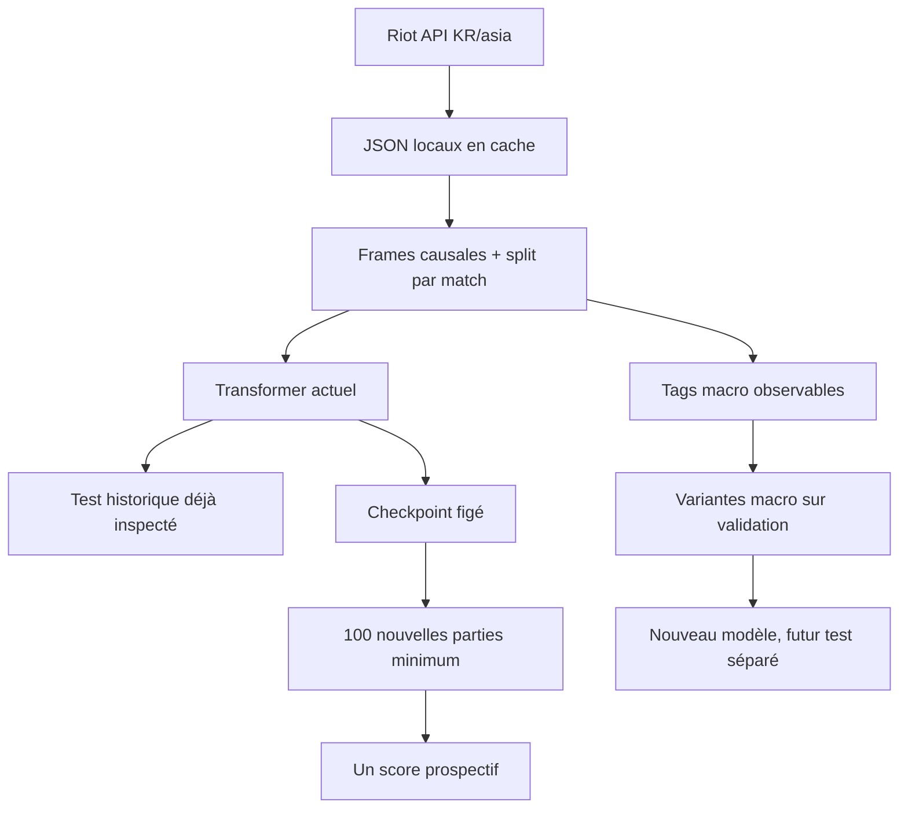

# Shadow Faker — plan d'exécution

Les [graphiques de résultats](RESULTS.md) et la [roadmap M0–M5](ROADMAP.md) rendent visibles les étapes réellement terminées. Le futur test du modèle figé et les variantes d'entraînement restent deux expériences distinctes.

## Architecture

1. `src/shadowfaker/riot.py` : client Riot avec quota conservateur persistant, cache JSON atomique, reprise, erreurs explicites.
2. `fetch.py` : résolution Riot ID, pagination de l'historique ranked solo (queue 420), contrôle du match et de la timeline, manifeste des parties utilisables.
3. `features.py` : échantillons à chaque frame de ~60 s, fenêtre causale, vue macro complète et proxy de minimap, trois labels d'action de Faker, issue du match comme label auxiliaire, fichiers par match et manifeste train/val/test.
4. `model.py` et `train.py` : petit transformer multi-têtes, entraînement MPS/CPU mesuré, early stopping et checkpoints.
5. `evaluate.py`, `analyze.py` et `demo.py` : métriques sur matches jamais vus, baselines, associations descriptives des rotations de Faker avec l'issue et GIF d'une partie test.
6. `scripts/run_pipeline.py` : une commande, reprise automatique de chaque phase.
7. `RESEARCH_NOTES.md`, `OTHER_GAMES_RESEARCH.md`, `PUBLIC_GAME_ANALYSIS.md`, `REPLAY_FEASIBILITY.md` et `SHADOW_PLUS.md` : provenance des méthodes et des analyses publiques multilingues, puis chemin expérimental allant du clone à une éventuelle politique meilleure, avec conditions de preuve distinctes.
8. `macro_actions.py`, `prospective.py` et `scripts/render_results.py` : tags de mouvement avec masques, collecte/score futurs figés, puis graphiques agrégés reproductibles sans publier les JSON Riot.

## Invariants

- Aucun secret ni JSON brut dans Git ; les données Riot restent locales.
- Chaque observation utilise uniquement les frames et événements connus avant le label.
- La séparation train/validation/test se fait par match et est figée par seed.
- Les fichiers JSON et les échantillons sont écrits atomiquement ; une reprise ne retélécharge pas les succès.
- Le chargeur lit un match à la fois ; le corpus complet n'est jamais chargé en RAM.
- Les erreurs isolées d'une partie sont journalisées et n'arrêtent pas les autres parties.
- Les sources médiatiques doivent conserver langue, perspective, match et horodatage ; aucun commentaire rétrospectif ne devient une feature à l'instant `t`.

## Risques et limites

- Une clé Riot valide est nécessaire aux nouveaux appels. Le premier instantané réel a réussi ; les clés de développement expirent et doivent être renouvelées pour un rafraîchissement ultérieur.
- Un historique peut contenir moins de 1 000 ranked solo disponibles. Le nombre collecté sera documenté exactement.
- Le débit de développement annoncé (100 requêtes/120 s) impose au minimum ~40 min pour 2 000 requêtes, hors retries et entraînement.
- Le compte « hide on bush » doit être vérifié par account-v1, puis confirmé par la région KR des match IDs ; le nom seul ne prouve pas l'identité de Faker.
- La timeline est une vue omnisciente. Les résultats mesurent la prédiction one-step hors ligne, pas le jeu réel ni les décisions sous brouillard de guerre.
- Le proxy de minimap masque les positions adverses éloignées des alliés mais ne reconstruit pas la vision réelle : Riot ne fournit ni visibilité exacte, ni positions des wards, ni communication/pings. Les champs macro d'or et d'XP restent omniscients, même dans le proxy.
- Le signal de victoire est un label futur auxiliaire, jamais une entrée. Sa trajectoire estimée décrit l'association état/issue à une minute, pas la valeur causale d'une action.
- Les actions achat et compétence sont rares ; des métriques conditionnelles et le taux d'événements seront affichés en plus de l'accuracy globale.
- La supériorité sur Faker ne peut pas être établie par une accuracy de replay ni par une tête de victoire associative. Il faut une valeur d'action validée et des parties comparables en environnement jouable ; le présent pipeline fournit le prior comportemental et les analyses descriptives.
- La nouvelle mesure 8×8 a été choisie après examen du test historique. Le [protocole prospectif](BENCHMARK_PROTOCOL.md) attend 100 nouvelles parties ; **0** étaient disponibles au premier rafraîchissement. Un modèle de développement différent exigera un autre futur jeu de confirmation.

## Ordre de validation

Phase 0 plan → setup → résolution et cinq parties → parsing cinq parties → mini-entraînement → évaluation et GIF → collecte cible → entraînement final → vérification et publication sur `main`.

Suite : gel du candidat actuel → tags macro sur cinq puis 465 parties → variantes macro entraînées sur train, choisies sur validation → collecte des nouvelles parties pour le score unique du modèle figé → validation jouée, si un environnement fiable existe. Les comptes rendus effectifs sont dans [PROGRESS.md](PROGRESS.md).
# Extension 64×64 et atlas des événements (2026-10-09)

Le modèle 16×16, son checkpoint et son benchmark prospectif restent figés comme point de comparaison. La nouvelle branche de recherche travaille dans des dossiers locaux séparés : labels 64×64 dérivés des mêmes positions, entraînement et évaluation propres, vues 64×64 et événements horodatés. Les scores 64×64 doivent être comparés à des baselines calculées sur les matches d'entraînement uniquement, par match de validation/test et par domaine de queue.

1. Rafraîchir la liste Riot avec un instantané nommé. Explorer aussi les matches du **même PUUID** sans filtre de queue, mais garder ranked solo, autres parties éligibles et sources professionnelles dans des domaines distincts. Conserver chaque réponse en cache, sous quota. Un compte différent exige une provenance vérifiée avant fusion.
2. Déduire des timelines les destinations 64×64 et les événements passés/présents (kills, morts du compte, Dragon, Baron, Herald, Void Grubs `HORDE`, bâtiments, wards). Si un événement n'a pas de coordonnées, le montrer dans la bande temporelle et non inventer une position.
3. Entraîner une tête spatiale 64×64 avec aide 16×16 sur un split par match ; bench CPU/MPS, val d'abord, test séparé. Ne pas remplacer le modèle figé sans preuve.
4. Donner à l'interface une carte et une surface 64×64, une colorimétrie par type d'événement et un rejeu horodaté. La timeline Riot reste à ~60 s pour les positions ; les événements ont leur propre timestamp milliseconde. Préserver cette distinction dans les légendes.
5. Publier code, visuels **agrégés**, résultats et limites sur `main`. Garder les JSON Riot, les traces par partie, les poids et la clé hors Git.

Risques : forte sparsité de 4 096 classes pour ~12 510 observations initiales ; attention au surapprentissage et à la concentration centrale. Les historiques Riot peuvent ne pas fournir plus de ranked solo pour ce PUUID. Les queues non classées sont un autre domaine et peuvent contenir d'autres modes/cartes ; ne pas les appeler ranked. Les événements sont visibles dans la timeline omnisciente ; ils ne prouvent pas la vision du joueur. Les résultats déjà consultés restent exploratoires.

## Axe actuel : interaction entraînable et produit lisible

L'unité d'analyse est la transition observée **Faker à t → Faker à t+1** dans un état des dix joueurs. En parallèle, on conserve les réactions adverses observées entre les deux états pour l'analyse rétrospective. Les 13 canaux ennemis/alliés entrant dans le candidat neural sont calculés seulement depuis l'état passé et présent. Le champ géométrique coloré autour de Faker est une autre hypothèse explicative et ne doit pas être confondu avec la sortie probabiliste du modèle.

La base SQLite locale garde états, acteurs, événements et transitions ; la matrice 64×64→64×64 reste sparse. Les vecteurs d'état servent au rapprochement de contextes, les vecteurs de match terminé seulement à la recherche rétrospective. Les résumés TXT français/anglais et les notes professionnelles vérifiées sont indexés avec provenance, langue, statut et domaine. Aucune narration ou archive terminée n'entre automatiquement comme feature à t.

La livraison publique comprend quatre agrégats JSON, plusieurs figures calculées, un README cohérent avec l'interface et un serveur local borné à `127.0.0.1`. Le tableau de bord expose atlas, projection 3D de dix acteurs, pression adverse, moments de partie, recherche, cinq scénarios synthétiques et métriques 64×64 avec **couverture + surface couverte**. Les visuels par match et le corpus Riot restent ignorés par Git. Un test UI doit parcourir au moins 100 transitions de contrôles avec lectures d'état avant publication.

## Navigation temporelle commune

La frise de 0 à 39 minutes pilote chaque vue interactive selon la résolution disponible : atlas/surface/pression par phase, tempo par cinq minutes, rejeu sur la frame la plus proche d'une seule partie, scénario sur son point simulé le plus proche. Les légendes rappellent les cohortes distinctes et les codes couleur. Les figures de résultat et l'ancien modèle 16×16 sont identifiés comme archives fixes, faute de prédictions par phase sauvegardées. Test de cohérence : trois histogrammes de phase dont la somme doit reproduire exactement l'histogramme public initial pour chacune des 4 096 cases, observées et prédites ; parcours UI de 40 positions sans erreur console.

## M3 : décision macro et ablations du contexte (2026-10-10)

Objectif de développement : tester si la structure des dix joueurs améliore la prédiction de la prochaine action du compte, sans consulter le test historique pour sélectionner un modèle. Même split 373/46/46 par match ; train et validation seulement pour ce candidat. Les données d'entrée sont les fenêtres `x` proxy déjà calculées, enrichies des 13 interactions causales à `t` ; les destinations 64×64 et les tags macro observés à `t+1` sont uniquement des cibles.

1. Définir cinq classes mutuellement exclusives **observables** : rester proche, retour base, approche Dragon vivant, approche Baron vivant, autre déplacement. Priorité explicite retour > Dragon > Baron > rester > autre ; l'absence de position courante masque cette tête. Les huit tags macro existants restent une tête auxiliaire multilabel avec masques de validité. Aucun label ne prétend décrire le clic, l'intention ou la communication.
2. Partager un encodeur <5 M paramètres, puis factoriser la position en `8×8 → 16×16 → 64×64` avec probabilités conditionnelles normalisées. Trois modèles de même capacité et même seed reçoivent respectivement : Faker seul, Faker + alliés, état complet avec adversaires/objectifs. Le masque porte uniquement sur les colonnes d'entrée ; architecture, split et budget restent identiques.
3. Pilote cinq matches avant corpus, benchmark CPU/MPS, caches par match limités en mémoire, checkpoints et logs locaux ignorés. Comparer la validation 8×8 contre fréquence, copie et prior rôle/phase issus du train ; rapporter aussi 16×16, 64×64, décisions et tags, par phase/champion et bootstrap par match. Choisir au plus un candidat sur validation, sans promotion du checkpoint M0 et sans score sur le test ancien.

Risques : 12 510 paires corrélées et seulement 46 matches de validation ; les tags objectifs sont rares ; l'état proxy n'est pas la vision réelle ; certaines features globales restent omniscientes même si les positions ennemies sont masquées. Dans ce plan, « complet » signifie **tous les canaux de `x`**, pas `x_oracle` : les positions ennemies restent celles du proxy de dernière vue. Les ablations donnent une contribution prédictive, pas une influence causale. Un meilleur score validation n'est pas une confirmation indépendante.

## M3b : audit du plafond prédictif et visibilité (2026-10-10)

Objectif : comprendre pourquoi l'exactitude 8×8 reste vers 17 % avant d'augmenter la capacité du modèle ou de viser 90 %. Vérifier l'alignement de chaque position `t`/`t+1`, la densité des déplacements et les informations réellement disponibles au joueur. Garder le test historique hors de la sélection et M0 gelé.

1. Définir des références de transition conditionnées par la case actuelle, l'heure, la direction passée et le rôle. Calculer leurs comptes sur les matches train, choisir le lissage sur un sous-ensemble interne de train, puis mesurer une fois sur la validation de développement. Rapporter exactitude top-1, top-5 et concentration ; ne pas masquer une faible précision sous une catégorie grossière.
2. Documenter le statut de chaque famille de features : état propre, alliés/minimap, proxy de vision adversaire, informations globales de la timeline. Entraîner une variante conservatrice sans chiffres adverses ni ressources globales invisibles, à budget et split identiques au modèle M3. Quantifier ce que coûte l'information omnisciente.
3. Diagnostiquer les décisions tardives et les déplacements rares par phase/événement. Mesurer la masse maximale d'un choix 8×8 à état géométrique similaire. Une accuracy de 90 % ne peut être annoncée que pour une cible clairement spécifiée et évaluée sur des parties futures ; la minute suivante exacte 8×8 reste la cible publiée actuelle.

Tous les artefacts par partie restent locaux. Le résultat autorisé ici est un diagnostic reproductible et, si une variante gagne, un candidat de développement ; pas un nouveau score prospectif.

## M3c : expert spatial dépendant de la phase (2026-10-10)

Le diagnostic M3b montre une forte baisse après 20 minutes avec 2 751 observations tardives dans le train. Tester **un seul** candidat à entrée `x`/147 identique : encodeur partagé et ajout d'un résidu spatial 8×8 conditionné par la phase 0–10, 10–20 ou 20+ minutes. Entraîner sur les mêmes 373 matches, avec pilote cinq parties, seed et budget identiques. Choisir l'époque sur la moyenne des exactitudes par phase sur validation, puis reporter exactitude globale, par phase et macro F1 décision. Comparer au M3 complet par bootstrap apparié par match ; ne lire ni le vieux test ni le lockbox. L'expert de phase peut accroître le surapprentissage ; sa capacité supplémentaire sera rapportée et il ne remplace pas le candidat gelé M0.
# Extension 512×512 — 2026-10-10

Objectif : passer l'atlas de recherche à **512×512 positions** (262 144 cases) sans présenter l'ancien classifieur 64×64 comme un modèle 512. Les coordonnées Riot restent échantillonnées environ une fois par minute ; une case 512 n'apporte aucune observation temporelle supplémentaire. Conserver les modèles 16/64, leurs scores historiques et le lockbox M0 comme archives figées.

1. Pilote sur cinq ranked : calculer les labels 512 depuis les coordonnées normalisées sauvegardées, vérifier l'alignement exact avec les parents 64/16 et les frames, journaliser les valeurs absentes. Puis préparer le corpus entier en streaming par match.
2. Entraîner un petit adaptateur conditionnel `64 → 8×8` sur le train seulement, avec encodeur 64 gelé et une tête de 64 sous-cases. Le coût de sortie est constant plutôt qu'une tête dense de 262 144 classes. Choisir sur les 46 matches de validation, sans consulter les 46 matches du vieux test. Comparer à copie de position et fréquence du train ; publier les scores uniquement comme développement.
3. Agréger les destinations 512 de validation et les événements horodatés ranked en compteurs *sparse*. Ne publier aucun match ID, trace ou JSON Riot. Le serveur local peut lire les cellules exactes depuis un artefact ignoré par Git ; la figure publique d'événements regroupe les cellules en 16×16 blocs, masque les blocs de fréquence inférieure à trois et lisse seulement pour l'affichage. Garder localement les totaux et le nombre non placé.
4. Faire de la grille 512 l'atlas interactif principal et une surface 3D agrégée, avec légende indiquant validation pour les destinations, 465 ranked pour les événements et environ 60 s pour les positions. Garder la vue 64 et ses métriques comme archive nommée ; aucune interpolation ne doit se faire passer pour une mesure.
5. Tests de projection, conservation des masses, masquage, API locale, curseur et rendu navigateur. Mettre README FR/EN, RESULTS, ROADMAP et PROGRESS à jour ; publier sur `main` après vérification.

Risques : forte sparsité (12 510 transitions pour 262 144 cases), exactitude attendue faible, corrélation des frames d'une partie, visibilité ennemie approximative, coûts mémoire/DOM. Utiliser un modèle factorisé et des tableaux sparse ; rapporter les limites sans cible de 90 % artificielle.
