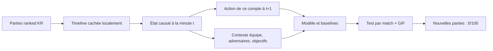

# Shadow Faker

[**Ouvrir le tableau de bord**](#tableau-de-bord-visuel) · [**Explorer la surface 3D**](#le-paysage-des-prochains-mouvements) · [**Lire les résultats**](RESULTS.md) · [**English**](README.md)

La [documentation anglaise](README.md) est la version internationale de référence pour les résultats et la calibration les plus récents.

Pipeline de recherche local visant à modéliser **les décisions macro de Faker à moins d'une minute** à partir du compte Riot ID « Hide on bush#KR1 ». **Aujourd'hui, les données Riot disponibles ici sont échantillonnées à environ 60 secondes : le modèle validé prédit donc la minute suivante, pas encore une décision sous la minute.** Atteindre cette résolution demandera des replays ou vidéos alignés, des labels plus fréquents et un nouveau benchmark. Les actions cibles appartiennent uniquement au joueur de ce PUUID ; les neuf autres joueurs fournissent un contexte de partie. Le code récupère des parties ranked solo KR (queue 420), transforme les timelines en observations causales, entraîne un petit transformer multi-têtes et compare ses prédictions à quatre baselines régionales. Le clone fidèle est le premier étage d'un objectif plus ambitieux : rechercher une politique meilleure en jeu, selon les étapes et critères de [SHADOW_PLUS.md](SHADOW_PLUS.md). **L'identité réelle du joueur ne peut pas être établie par l'API seule.**

### Nouveau laboratoire de décision


Un modèle séparé prédit à la fois la destination `8×8 → 16×16 → 64×64` et cinq **types de déplacement observables** : rester proche, retour base, approche Dragon/Baron, autre. Sur **46 parties de validation**, le proxy avec champs globaux atteint **17,49 %** de cases 8×8 exactes contre **15,29 %** pour la meilleure règle simple. Sans les ressources globales, il atteint **16,86 %** ; l'écart apparié ne permet pas de conclure. L'intervalle par partie du gain contre la règle simple contient aussi zéro ; choix d'époque, variante et calibrage proviennent de cette même validation. Le F1 macro des cinq types vaut **44,9 %** contre **16,5 %** pour la classe majoritaire, mais le retour base reste très mal reconnu. Les positions ennemies des deux variantes sont un **proxy de dernière position vue**, pas la vision réelle de Faker ni l'oracle complet. [Détails et limites](RESULTS.md#new-development-experiment--a-decision-shaped-shadow-2026-10-10).


La prédiction de la prochaine **case unique** sur 64 est exacte à **17,49 %**. Sur cette validation déjà utilisée, proposer **41 cases sur 64** couvre **90,12 %** des arrivées, soit **64,1 % de la carte** : ce n'est pas 90 % de précision exacte. Après la minute 20, l'exactitude 8×8 tombe à **7,5 %**. L'audit géométrique ne trouve aucun décalage de case entre position actuelle et label précédent sur train/validation. [Audit complet de visibilité et de prédictibilité](VISIBILITY.md).

Un modèle avec trois têtes spécialisées début/milieu/fin a aussi été entraîné. Il tombe à **16,39 %** globalement et **5,91 %** en fin de partie, contre **17,49 %** et **7,53 %** pour le modèle plus simple. Cette expérience négative est conservée ; les prochaines étapes portent sur la qualité des observations et des parties futures.

## Ce qui est mesuré aujourd'hui

### Atlas 64×64 et écosystème des dix joueurs


La nouvelle variante 64×64 ne devine la case exacte que **1,09 %** du temps sur les 1 197 décisions du test historique déjà vu, contre **1,92 %** pour la meilleure règle simple. Elle se trouve à quatre cases de l'arrivée dans **22,89 %** des cas, contre **16,88 %** en copiant la position actuelle. Une zone calibrée sur validation contient **91,9 %** des destinations du test, mais occupe en moyenne **43,7 % de la carte**, soit 1 791 cases sur 4 096. Ce dernier chiffre n'est pas une précision de 90 %.


Le dépôt indexe localement **12 975 états**, **12 510 transitions** et **353 409 événements** de 465 parties ranked : Faker reste la cible, tandis que les neuf autres joueurs forment l'état autour de lui. Le tableau de bord montre les dix joueurs en projection 3D, leur transition observée, les adversaires proches et les moments notables. Les **13 variables de réaction ennemie et de couverture alliée** alimentent aussi une variante d'entraînement distincte. Cette variante obtient **8,71 %** en 16×16 sur validation contre **10,59 %** pour le modèle gelé ; elle n'est donc ni promue ni évaluée sur test. Proximité et trajectoire ne prouvent pas une influence causale. La matrice de transitions, les vecteurs et les résumés par match restent locaux. Voir [STATE_ECOSYSTEM.md](STATE_ECOSYSTEM.md) et [DESIGN.md](DESIGN.md).


L'exploration du même PUUID a trouvé **519 IDs toutes queues**, dont les **470 IDs ranked solo déjà connus** et **49 autres modes**. Ces 49 parties ont été archivées localement, mais n'ont pas été ajoutées aux données ranked ni présentées comme nouvelles parties comparables. Le test prospectif reste à **0/100** nouvelles ranked éligibles. Le but sous la minute demeure un chantier de données distinct.

**465 parties exploitables, 12 510 observations.** La région exacte suivante (grille 16×16) est prédite dans **11,28 %** des observations du test déjà examiné, contre **11,61 %** pour la meilleure baseline rôle/phase. La condition initiale « battre nettement les baselines » n'est donc **pas remplie**. Après regroupement des probabilités en zones plus larges, le modèle atteint **17,54 % en 8×8** contre **15,37 %**, et **23,64 % en 4×4** contre **19,80 %**. Ces deux diagnostics ont été choisis après consultation du test : ils demandent une confirmation sur des parties futures.

### Le paysage des prochains mouvements


Le plan horizontal représente les **256 cases de la carte** ; la hauteur indique la **part des positions à la minute suivante** dans chaque case, agrégée sur 46 parties du test historique. Ce n'est ni le relief de la carte, ni le replay d'une partie, ni l'ensemble des futurs possibles. Le pic central de Shadow révèle surtout un biais à corriger. Le [tableau de bord local](#tableau-de-bord-visuel) permet d'orienter une vue isométrique, de lire les cases, de suivre le tempo et de rejouer une partie test minute par minute.


La différence saute aux yeux : les positions réelles sont plus dispersées, alors que Shadow place **39,43 % de ses prédictions** dans une seule case centrale, qui ne représente que **11,28 % des vraies positions**. C'est une piste concrète pour corriger sa tendance à « rester au milieu ». Cette carte agrège 46 matches du test historique ; elle ne reproduit pas l'écran ou la vision du joueur.




Les **huit tags de mouvement** suivent notamment l'approche du jungler, du bot et du support. Ils montrent comment le contexte d'équipe varie selon la phase ; un rapprochement géométrique n'établit ni intention, ni communication, ni aide causale à la victoire.


Pour explorer des idées vraiment nouvelles, on mesure aussi ce que les données **ne couvrent pas**. L'exemple « cinq joueurs autour du bot carry » apparaît une seule fois en début de partie, sur une seule minute, parmi 3 255 frames éligibles. Être proche du carry ne signifie pas jouer volontairement bot lane.


Le [laboratoire de stratégies](GAME_THEORY_LAB.md) transforme l'idée « cinq bot » en hypothèse à évaluer face aux ressources abandonnées ailleurs et aux réponses adverses. Ces parties classées ne permettent pas de conclure qu'une telle stratégie gagnerait aux Worlds. [RESULTS.md](RESULTS.md) raconte les graphiques pas à pas.

Les graphiques et bannières proviennent de [résultats agrégés publics](docs/data/public_summary.json), sans JSON Riot brut. Régénérer les premiers visuels avec `.venv/bin/python scripts/render_results.py --from-summary`, l'ablation avec `.venv/bin/python scripts/render_hierarchical.py --from-summary` et l'audit de couverture avec `.venv/bin/python scripts/render_predictability.py --from-summary`. Voir [RESULTS.md](RESULTS.md) pour les intervalles et [ROADMAP.md](ROADMAP.md) pour la suite.

## Tableau de bord visuel

Après installation, lancer le serveur local et ouvrir [http://127.0.0.1:8008/](http://127.0.0.1:8008/). L'interface FR/EN compare **Faker observé, Shadow et niveau de preuve**, avec carte interactive, surface 3D, tempo et hypothèses de stratégie. Le rejeu d'une partie du test et le GIF apparaissent si le pipeline a déjà produit ses fichiers locaux.

```bash
.venv/bin/python scripts/serve_dashboard.py
# Facultatif : exporter le rejeu local avant d'ouvrir la page.
.venv/bin/python -m shadowfaker.demo --max-frames 30
```

Une **frise commune** reste visible pendant le défilement de la page. Son curseur (ou les flèches du clavier et la molette sur ce curseur) synchronise l'atlas 64×64, la surface 3D, le tempo, la pression adverse, la minute du rejeu et le repère du scénario synthétique. Le code couleur reste affiché. Les cartes Faker/Shadow agrègent **46 parties du test** par phase : **460 destinations entre 0 et 10 min, 437 entre 10 et 20 min, 300 après 20 min**. Les couches de joueurs et événements agrègent **465 ranked** ; le rejeu correspond à **une partie** et s'arrête à sa dernière frame. Les anciens visuels 16×16 et les scores historiques sont signalés comme fixes, car leur évolution par minute n'a pas été conservée. Le curseur ne crée pas de positions intermédiaires à la seconde.

Le serveur écoute sur `127.0.0.1` et ne sert que les visuels publics et les fichiers de rejeu locaux autorisés. Les traces par partie restent exclues de Git. [Code de l'interface](dashboard/), [générateur des visuels](scripts/render_results.py), [analyse des résultats](RESULTS.md).

### D'où viennent les 470, 465 et 12 510 ?

L'API a renvoyé **470 identifiants** de ranked solo KR (queue 420) pour ce PUUID, en cinq pages de **100 + 100 + 100 + 100 + 70**. Ce n'est pas la totalité supposée des parties jouées par Faker au cours de sa carrière, seulement ce que cet historique renvoie à la date du contrôle. Après vérification de chaque partie, **5 duraient moins de cinq minutes** et ont été exclues comme remakes ; les **465 autres** possédaient une timeline utilisable.

Dans une partie de `F` frames à environ une minute d'intervalle, le parseur construit `F − 1` exemples : l'état à la minute `t` sert à prédire l'action observée à `t+1`. La somme sur les 465 parties donne **12 510 paires de frames**, toutes avec une position cible disponible. Chaque partie apporte 13 à 47 exemples (médiane 27). La fenêtre d'entrée de huit frames est complétée au début de la partie, donc elle ne retire pas les premières minutes. **12 510 observations ne sont pas 12 510 parties indépendantes** : le découpage et les intervalles d'incertitude sont calculés par match.

## Démarrage

macOS Apple Silicon, Python 3.11+ et une clé Riot valide sont requis. La clé de développement expire sous 24 h. L'installation vérifiée ici utilise Python 3.12 :

```bash
python3.12 -m venv .venv
.venv/bin/python -m pip install -r requirements.txt -e .
cp .env.example .env
# Remplacer la valeur de RIOT_API_KEY dans .env par la clé actuelle du portail Riot.
.venv/bin/python scripts/run_next_level.py --limit 1000 --epochs 25
```

Si `pip` n'est pas disponible dans le venv, utiliser `uv pip install --python .venv/bin/python -r requirements.txt -e .`. La commande unique exécute d'abord **toutes les phases sur cinq parties**, puis la collecte cible, le parsing, l'entraînement, l'évaluation et le GIF. Elle construit ensuite l'atlas 64×64, la matrice des dix joueurs, les variables d'interaction entraînables, l'index vectoriel, les résumés bilingues et les visuels. Elle reprend les JSON, les NPZ et les checkpoints déjà écrits. On peut la relancer après une interruption ou après avoir remplacé une clé expirée dans `.env`. Le test 64×64 historique est documenté comme déjà examiné ; la nouvelle variante d'interaction n'est évaluée que sur validation.

Pour un essai réel limité à cinq parties :

```bash
.venv/bin/python scripts/run_pipeline.py --limit 5 --epochs 3
```

Pour préciser un autre compte : `--game-name "Nom" --tag-line TAG`. Il faut un dossier `data/raw/` distinct si le PUUID change.

## Fonctionnement

| Phase | Entrée | Sortie |
|---|---|---|
| Fetch | account-v1 puis match-v5 sur le routage `asia` | `data/raw/` et manifeste local |
| Parse | match + timeline, une frame par minute | `data/processed/matches/*.npz`, `meta.json` |
| Train | fenêtres causales de 8 frames | `models/best.pt`, `models/training.json`, `runs/` TensorBoard |
| Évaluation | matches de test jamais vus | `artifacts/evaluation.json`, matrice de confusion PNG/NPY |
| Analyse | positions de Faker, rôles alliés, issue du match | `artifacts/faker_rotations.json` et `.png` |
| Démo | premier match du test | `artifacts/predicted_vs_actual.gif` avec heatmap et trajectoire de victoire estimée |

Les entrées comprennent champion et rôle de Faker, minute, or individuel et des deux équipes, or non dépensé, proximité de la base, niveau, XP, CS lane + jungle, positions normalisées des dix joueurs, distances de Faker aux rôles alliés et aux pits Dragon/Baron, écart d'XP entre équipes, disponibilité approximative des objectifs, wards alliés et événements récents. Les slots alliés donnent priorité à jungle, bot et support ; le modèle peut modifier leur poids selon la minute et l'état de la partie. Les variations d'écarts or/XP représentent le tempo ou « snowball » à la résolution d'une minute. Les sorties sont la prochaine région sur une grille 16×16, le premier achat de la minute suivante, la prochaine compétence améliorée et une estimation auxiliaire de l'issue finale. **La victoire est un label futur, jamais une feature d'entrée.** La classe 0 signifie qu'aucun achat ou point de compétence n'a été observé dans cet intervalle ; la classe 1 d'achat signifie un objet absent du vocabulaire d'entraînement. Les régions rares conservent un poids de perte modéré. La séparation train/validation/test est faite par **match**, avec seed fixe 42 ; le vocabulaire d'items et les poids de classe sont calculés sur le train uniquement.

Deux vues sont sauvegardées par match. `x_oracle` contient les positions complètes de la timeline. `x`, utilisé **par défaut**, cache les positions adverses à plus de 1 600 unités d'un champion allié, retient la dernière position vue et son âge. C'est uniquement un **proxy de minimap** : pas de terrain, unités alliées, vision exacte ni coordonnées des wards. Les agrégats macro d'or/XP restent omniscients dans les deux vues. Un entraînement d'ablation sur la vue complète est possible avec `.venv/bin/python -m shadowfaker.train --view oracle`, dans un dossier de modèles séparé si l'on veut conserver le checkpoint proxy.

Le client respecte un intervalle local de 1,3 s entre requêtes, persistant entre processus. C'est plus conservateur que 100 requêtes/2 min ; il traite `Retry-After`, les timeouts et les erreurs transitoires. À environ deux requêtes par partie, 1 000 parties demandent **au moins ~43 minutes** de collecte, plus les pages d'IDs, retries et le temps d'entraînement. Le nombre réel de ranked solo disponibles peut être inférieur à 1 000. Une erreur de clé 401/403 arrête la collecte avec un message explicite.

## Lire les résultats

`evaluation.json` donne top-1/top-5 région, accuracy achat et compétence, taux d'actions, accuracy conditionnelle quand un événement survient, Brier score pour l'issue finale, résultats par champion, patch, phase de jeu, rôle de Faker et avance/retard d'or. Il compare quatre baselines régionales : région la plus fréquente du train, copie de la région courante, centre de la carte et prior rôle/phase calculé sur le train. La matrice de confusion est indexée par les 256 régions. `faker_rotations.json` décrit, par phase et victoire/défaite, la proximité de Faker aux alliés et objectifs ainsi que la variation descriptive d'avance or/XP les deux minutes suivantes. Ces associations **ne prouvent pas** qu'une rotation a causé la victoire ou le gain d'or. Trois variantes supplémentaires ont été comparées sur validation ; le modèle compact calibré a été retenu. Le test existant a déjà influencé l'analyse et ne constitue plus un jeu de confirmation intact.

Le [protocole prospectif figé](BENCHMARK_PROTOCOL.md) attend au moins **100 nouvelles parties** après le 1er octobre 2026 pour évaluer une seule fois le modèle actuel en 8×8 face aux quatre baselines. Premier contrôle réel : **0/100**, donc résultat `pending` et aucun score futur inventé. La collecte se relance avec un nouvel instantané nommé :

```bash
.venv/bin/python scripts/run_prospective.py --offline
.venv/bin/python scripts/run_prospective.py --snapshot 20261010
```

## Limites et données

- Les timelines donnent une vue omnisciente des positions adverses. Faker n'a pas cette vision sous le brouillard de guerre ; cela rend l'évaluation plus facile que la décision réelle.
- Le proxy de proximité masque une partie de cette omniscience mais ne reconstitue pas la vision réelle. Les événements de wards n'ont pas de coordonnées ; les pings, la voix, les intentions et la communication ne sont pas disponibles. La valeur de « flair » ou « talent » n'est pas observable directement : le modèle n'apprend qu'une régularité statistique des actions de ce compte.
- Les positions sont échantillonnées à environ 60 s. Des changements instantanés et les possibilités contrefactuelles entre deux frames ne sont pas observables. La courbe de probabilité de victoire estime l'issue à partir de l'état, sans mesurer l'effet causal d'une action de Faker.
- Le modèle fait une prédiction à un pas. Il ne mesure pas l'accumulation d'erreurs d'un agent qui jouerait une partie entière et ne modélise pas le micro-jeu.
- La disponibilité des objectifs est approximée par les horodatages d'événements ; elle peut varier selon les patches. Les champs absents des timelines sont remplacés par zéro ou ignorés selon leur rôle ; les labels sans position sont sautés.
- Les achats et compétences sont rares. L'accuracy brute peut être dominée par « aucun événement » ; consulter aussi les métriques conditionnelles.
- Le Riot ID résolu et la présence du PUUID dans les matches prouvent seulement que les parties appartiennent à ce compte, pas qu'il appartient personnellement à Faker.
- `data/raw/`, `data/processed/`, `models/`, `runs/`, `artifacts/` et `.env` sont exclus de Git. **Ne redistribuez pas les JSON Riot bruts.** Usage personnel/recherche uniquement, sous les conditions applicables de Riot.

Le projet lui-même est sous la licence AGPL-3.0 du dépôt. Consulter [README.md](README.md) pour la documentation internationale à jour, [PLAN.md](PLAN.md) pour l'architecture, [PROGRESS.md](PROGRESS.md) pour les validations, [RESEARCH_NOTES.md](RESEARCH_NOTES.md) pour les trois PDF, [OTHER_GAMES_RESEARCH.md](OTHER_GAMES_RESEARCH.md) pour les autres jeux, [PUBLIC_GAME_ANALYSIS.md](PUBLIC_GAME_ANALYSIS.md) pour les analyses de matchs publiques, [BENCHMARK_PROTOCOL.md](BENCHMARK_PROTOCOL.md) pour le test futur figé, [DIAMOND.md](DIAMOND.md) pour les facettes de décision et [SHADOW_PLUS.md](SHADOW_PLUS.md) pour la voie vers une politique plus forte.

Sources API : [référence Riot](https://developer.riotgames.com/apis) et [clés, codes HTTP, rate limits](https://developer.riotgames.com/docs/portal).
