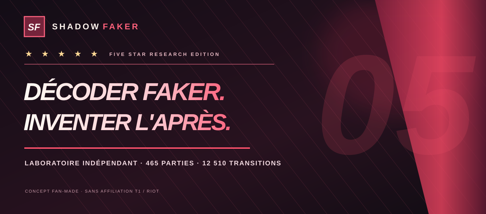
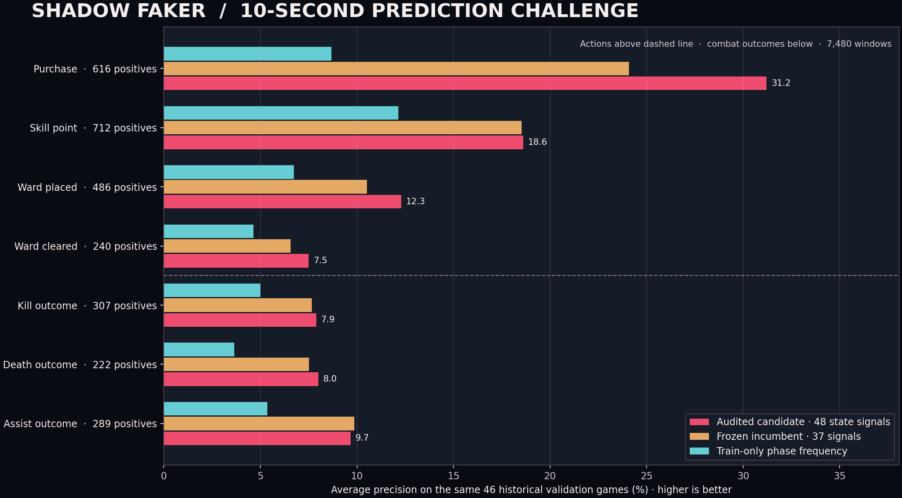
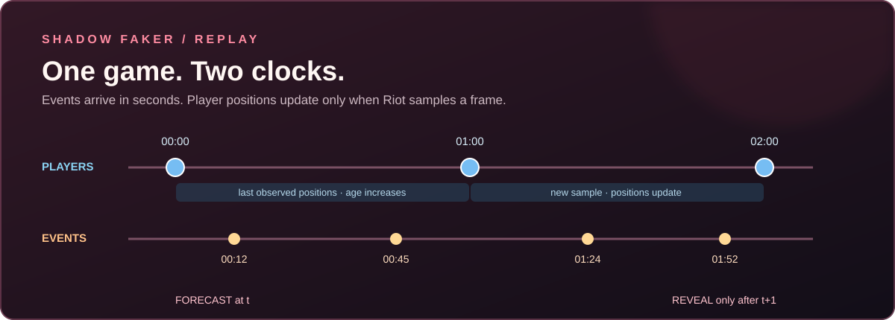
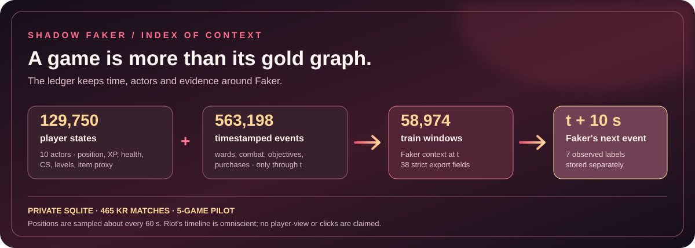
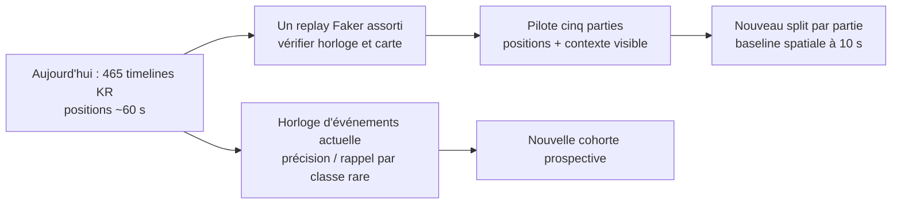
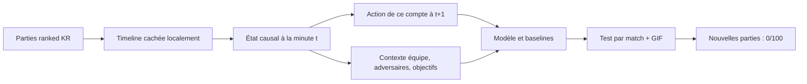

# Shadow Faker

[**Ouvrir le tableau de bord**](#tableau-de-bord-visuel) · [**Rejouer une partie**](REPLAY.md) · [**Cible à la seconde**](SECOND_SCALE.md) · [**Explorer l'atlas 512×512**](#atlas-512512--résultat-mesuré) · [**English**](README.md)

La [documentation anglaise](README.md) est la version internationale de référence pour les résultats et la calibration les plus récents.

Pipeline de recherche local visant à modéliser **les décisions macro de Faker à l'échelle de la seconde** à partir du compte Riot ID « Hide on bush#KR1 ». La cible est une distribution sur **l'action, son délai et son lieu continu éventuel** ; les matrices 16/64/512 ne sont que des représentations ajustables. Les positions Riot disponibles restent échantillonnées à environ **60 secondes** : le modèle spatial existant prédit encore la frame suivante, tandis que deux modèles distincts prédisent des événements à dix secondes, dont sept familles explicitement attribuées à Faker. **Aucun score de déplacement de Faker à la seconde n'existe encore.** Les actions cibles du modèle spatial appartiennent uniquement au joueur de ce PUUID ; les neuf autres joueurs fournissent un contexte de partie. Le code récupère des ranked solo KR (queue 420), transforme les timelines en observations causales et compare ses prédictions à des baselines. Le clone fidèle est le premier étage d'un objectif plus ambitieux : rechercher une politique meilleure en jeu, selon [SHADOW_PLUS.md](SHADOW_PLUS.md). **L'API seule ne peut établir l'identité réelle du joueur.** [Horloge, observations et nouveau protocole](SECOND_SCALE.md).

**Nouveau : les dix prochaines secondes de Faker, par famille d'événement.** Un modèle de 13 575 paramètres prédit sept événements explicitement attribués au compte : achat, compétence, ward posée/détruite, kill, mort et assistance. Sur 46 parties de validation historiques (7 480 fenêtres), sa perte log vaut **0,1943** contre **0,2048** pour une règle de fréquence par phase ; la précision moyenne des sept courbes précision–rappel vaut **0,121** contre **0,066**. Achat : **24,1 %** ; issue kill : seulement **7,7 %**. Dire toujours « rien » ferait **94,51 % d’accuracy binaire** en ratant les 2 872 cas positifs : nous mesurons donc la perte log et la précision moyenne. Ces valeurs ne sont ni des positions à la seconde, ni une preuve de meilleur jeu. [Labels, résultats complets et reproduction](FAKER_ACTIONS.md).


**Étape suivante : décisions de Faker sur données assainies.** Un audit avec empreinte des sources a contrôlé les **465 parties ranked / 73 482 fenêtres de dix secondes**, sans quarantaine. Les acteurs système et les événements Riot répétés sont signalés plutôt que convertis en faux labels « rien ». Un **challenger à 48 signaux** ajoute l'or disponible de Faker, ses CS, sa santé et les variations depuis la frame précédente. Sur les **mêmes 46 parties de validation historique**, l'AP moyenne des quatre actes observables monte de **14,93 % à 17,40 %**, et leur perte log baisse de **0,22992 à 0,22309**. L'AP achat monte de **24,09 % à 31,21 %** ; les issues kill restent faibles. C'est une amélioration exploratoire, ni 90 % de prédiction ni une mesure de sa vision réelle. [Audit, comparaison et reproduction](DATA_SANITATION.md).



## Le site, en images

La page fonctionne désormais par **onglets dynamiques** : une vue à la fois, avec une chronologie commune. Les six étoiles évoquent le sixième titre mondial de T1 en 2025, [confirmé par son copropriétaire Comcast Spectacor](https://comcastspectacor.com/news/2025/12/t1-entertainment-sports-wins-2025-league-of-legends-world-championship/). Shadow Faker est un laboratoire de fans indépendant ; ces étoiles ne représentent ni la précision du modèle ni une affiliation à T1.

| Onglets du site | Équivalent dans ce README |
|---|---|
| **Atlas 512×512** | Cases et événements observés, puis [échec de la case exacte](#atlas-512512--résultat-mesuré) |
| **16×16 historique / 3D** | [Carte observée contre prédite et surface](#le-paysage-des-prochains-mouvements) |
| **Rejouer / Tempo / Pression** | [Horloge d'une partie](REPLAY.md), [fonctionnement](#fonctionnement), [zone adverse réglable](PRESSURE.md) et dix positions échantillonnées |
| **Scores / Recherche / Preuves** | [Horloge à la seconde et trous d'observation](SECOND_SCALE.md), baselines et [prochains tests](NEXT_RESEARCH.md) |
| **Stratégies / Challenge** | Hypothèses de composition et [quiz de la mémoire Faker](FAKER_MEMORY.md) |
| **Stratégies / Challenge** | [Hypothèses et critères d'un jeu meilleur](SHADOW_PLUS.md) ; composition libre de cinq postes dans la simulation illustrative |
| **Faker × équipe** | [Historique de jeu commun et matrices de ressources à 10→15 minutes](TEAM_MATRIX.md) |
| **Finales BO5 / Corpus / Archives** | [Six finales sourcées, 25 manches](WORLD_FINALS.md), [matrice IoC](IOC_VISION.md) et fiches ranked privées |

La barre d'onglets reste accessible sur mobile : [capture à 390 pixels](DESIGN.md#dynamic-chapter-tabs). La chronologie commune synchronise des vues de cohortes différentes ; elle n'invente pas de positions entre les frames Riot espacées d'environ une minute.




**La carte, puis les choix possibles.** L'atlas 512×512 colore les destinations et événements agrégés. Dans la vue 3D, la hauteur indique une fréquence observée, pas le relief de LoL ni une stratégie gagnante.


**Une zone de pression qu'on peut changer.** De 1 000 à 5 000 unités autour de Faker, la carte d'une partie montre maintenant les dix positions observées, les champions et objets détenus **à la minute choisie**. Faker, alliés, adversaires, couloirs, objets et rôle sont filtrables. Les barres recalculent adversaires proches, entrées nettes et états 0/1 ou 0/2 pour les 465 parties. Ce sont des observations espacées d'environ une minute ; des adversaires affichés pouvaient être cachés à Faker. [Définitions, unités et limites](PRESSURE.md).


**Le corpus devient lisible.** L'onglet Corpus distingue 470 IDs ranked KR de 465 parties utilisables, liste les Riot IDs exacts et les types d'événements, puis explique pourquoi seuls 33 329 des 353 409 événements indexés portent une coordonnée. L'onglet Archives montre date UTC, compositions, K/D/A, dégâts, vision et objets finaux avec des sprites locaux pour les 169 champions et 160 objets observés. Ces statistiques finales ne sont jamais des entrées au temps `t`. [Inventaire détaillé](CORPUS.md).


**Les preuves, puis l'histoire.** L'onglet recherche montre les événements que le modèle reconnaît mal. Le nouvel [atlas des finales BO5](WORLD_FINALS.md) contient **25 manches réparties sur les six finales mondiales gagnées**, plus trois demi-finales marquantes et sourcées. Chaque manche a son résultat, sa durée et un lien vers la source ; ce corpus professionnel reste séparé des données ranked d'entraînement.


**Faker × équipe.** Un index professionnel séparé suit, avant chaque manche, les parties déjà jouées avec Doran, Oner et Keria. L'onglet permet de choisir l'année, un cumul ou une exposition décroissante sur 90 jours, la matrice de cojeu, l'évolution des écarts or/XP des cinq rôles de 10 à 15 minutes et une matrice 5×5 de corrélation de ces variations. Le miroir disponible contient 671 manches avec cinq lignes T1, dont 645 photos complètes ; son fichier 2026 s'arrête au 10 avril. Jouer ensemble ouvre des occasions de se connaître, mais **ne mesure ni confiance, ni communication, ni influence causale de Faker**. Ces résumés pro restent hors du modèle spatial ranked. [Méthode et provenance](TEAM_MATRIX.md).

**Le passé commun aide-t-il à prédire un score ultérieur ?** Une épreuve chronologique sur 534/39/72 manches train/validation/test prédit l'écart d'or de Faker mid à 15 minutes depuis le contexte à 10 minutes. Sur les 72 manches test, copier le score de 10 minutes donne **412,64 or** d'erreur absolue moyenne, le modèle de contexte **442,17**, et le contexte plus historique **441,88**. La différence liée à l'historique n'est que **−0,29 or**, intervalle 95 % **[−2,89 ; +2,10]**. Le signal n'est pas confirmé et la baseline de copie gagne. Cette épreuve de score pro **n'améliore pas la prédiction de mouvement de Shadow**. [Protocole et limites](TEAM_PROBE.md).

**La cible corrigée : des secondes et des actions.** L'audit des **465 parties** trouve **563 198 événements horodatés**, mais seulement **12 975 positions observées de Faker**, espacées d'une médiane de **60,02 s**. Sur les fenêtres de 1, 5, 10 et 30 secondes après une frame, **aucune nouvelle position** n'est enregistrée. Un lieu d'événement n'est pas une position du joueur. Le nouveau panneau Scores permet de changer l'horizon ; ses nombres sont de la **disponibilité de données, pas une précision du modèle**. [Protocole continu et chemin vers des labels à la seconde](SECOND_SCALE.md).


**Archive de développement à la minute.** Sur les 46 parties de validation déjà utilisées pour choisir le modèle, la prochaine case 8×8 unique est juste dans **17,49 %** des 1 275 transitions ; les **5 % les plus confiants** font **31/64 = 48,44 %**. Cette mesure n'est plus la cible principale de Shadow. [Audit historique et limites](NINETY_GATE.md).


[Direction visuelle et capture mobile](DESIGN.md) · [Sources des finales](WORLD_FINALS.md) · [Résultats chiffrés](RESULTS.md).

### Nouveau : l'index de contexte et l'itemisation à l'instant t


À chaque minute observée, l'**IoC** local estime les objets des dix joueurs à partir des achats, ventes, destructions et annulations horodatés. **350 canaux** décrivent cette chronologie ; **120 autres** décrivent les objets suivis avec le catalogue officiel Data Dragon **du patch joué**. Ils s'ajoutent aux 147 canaux d'état et d'interaction. Pilote sur cinq parties, puis **465 parties / 12 510 transitions** reconstruites depuis le cache sans erreur. Les matrices par partie restent locales. Un audit rétrospectif ne retrouve exactement que **29,05 %** des sets d'IDs d'objets finaux (Jaccard moyen **0,839**) : certains trinkets initiaux et améliorations automatiques manquent. Les objets finaux servent uniquement à cet audit, jamais d'entrée à `t`.

Sur les **46 mêmes parties de validation déjà utilisées**, le candidat à 617 canaux atteint **17,41 %** de prochaine case 8×8 exacte, contre **17,18 %** sans propriétés du patch, **16,94 %** sans les **nouveaux** canaux d’objets et **15,29 %** pour la meilleure règle simple. Le gain apparié contre cette dernière ablation est de **+0,47 point**, intervalle bootstrap par partie à 95 % **[−0,16 ; +1,13] point** : il est incertain. Le précédent candidat à 147 canaux atteignait **17,49 %** ; celui-ci ne le dépasse donc pas. Pour couvrir **90,75 %** des destinations, il faut proposer **40 cases sur 64**, soit **62,5 % de la carte**. Ce n'est pas 90 % de précision exacte.

Le Corpus affiche les sources externes : [Data Dragon Riot](https://developer.riotgames.com/docs/lol#data-dragon) alimente les caractéristiques statiques du patch ; [U.GG](https://u.gg/lol/champions/azir/build) sert de référence de builds, mais l'accès automatisé direct a été refusé et un build actuel ne peut décrire une minute historique ; [Google Custom Search](https://developers.google.com/custom-search/v1/overview) servirait à découvrir des sources, avec identifiants requis et inscription fermée aux nouveaux clients. Aucun extrait de recherche, taux de victoire actuel ou objet final n'est injecté dans l'état passé. [Vision et provenance détaillées](IOC_VISION.md).

### La base IoC de Faker, prête pour les prochaines expériences



L'or n'est qu'un champ. La **base privée** `data/processed/faker_ioc.sqlite` relie **465 parties ranked**, **129 750 états échantillonnés des dix joueurs** et **563 198 événements horodatés** à **73 482 fenêtres de dix secondes centrées sur Faker**. Chacune archive 48 champs historiques ; l'export strict retire dix distances par rôle issues de métadonnées de fin de match, soit **38 entrées numériques**, avec une cible de sept événements futurs séparée. **58 974 fenêtres appartiennent aux parties d'entraînement**. Positions, vie, XP, CS et objets déduits des événements côtoient wards, combats, objectifs et achats. L'onglet Corpus montre maintenant ce registre et ses deux horloges. Le [schéma, les commandes et le contrat JSONL limité au train](IOC_LEDGER.md) sont publics ; les lignes et l'export restent locaux. Aucun LLM textuel n'a encore été entraîné sur cette base et cette indexation ne change pas les scores de prédiction.


Une [validation indépendante des événements](EVENT_VALIDATION.md) rapproche **563 198 événements Riot bruts** de la base locale : **353 409/353 409 lignes indexées** reproduisent les champs de leur source. Elle signale **1 288 achats/points de compétence sans ID joueur**, **62 morts sans tueur joueur** et **23 610 plaques de tourelle hors de l'ancien index**. Une transcription exacte ne prouve ni que Faker a vu l'événement ni pourquoi il a agi.


### Nouveau : une mémoire des décisions de Faker


La [mémoire locale des décisions](FAKER_MEMORY.md) indexe **10 038 épisodes d'entraînement** : état de la partie à `t`, contexte des dix joueurs et destination de Faker à la frame suivante. Un challenger par cas similaires calibre ses choix sur des parties de train distinctes puis obtient **11,53 %** de cases 8×8 exactes sur 46 parties de validation réutilisées, contre **15,29 %** pour la règle rôle/phase et **17,41 %** pour Shadow IoC. Sa case 512×512 exacte est à **0 %**. L'onglet Challenge permet de deviner une destination puis de révéler le choix observé ; les clics ne réentraînent pas le modèle. Les épisodes détaillés restent locaux et aucune partie de test historique n'a été consultée.


Une commande relance cette expérience depuis les caches locaux : `.venv/bin/python scripts/run_ioc_challenge.py`. Elle pilote cinq parties, reprend les fichiers par partie, valide les événements, entraîne les ablations et reconstruit les graphiques et le rejeu. [Scores exacts](RESULTS.md#item-aware-index-of-context--development-only-2026-10-10).


L'onglet Challenge permet maintenant de répartir librement cinq présences entre top, mid, jungle et bot et de faire varier le délai de réponse adverse. Le visuel « cinq bot » montre le coût en ressources et couverture dans des **unités arbitraires, non calibrées**. [Hypothèses et conditions d'un vrai test de jeu](GAME_THEORY_LAB.md#interactive-five-role-composition-with-explicit-opponent-response).

### Nouveau : plus de parties, une cible à dix secondes


Le dernier rafraîchissement Riot garde **465 timelines ranked KR**. L'alias EUW attribué à Faker lors des Worlds 2024 ajoute **31 timelines ranked** ; une copie publique de données professionnelles ajoute **671 résumés de parties sans trajectoires**, avec provenance incertaine et saison 2026 incomplète. La base sépare ces **1 167 enregistrements** en domaines. Un second modèle prédit le **premier événement macro dans les dix secondes suivantes** à partir du dernier état et des événements passés : **73 482 fenêtres KR** et **5 383 fenêtres EUW d'entraînement**. Sur 46 parties de validation KR, sa perte log atteint **1,3847** avec l'appoint EUW contre **1,4472** pour une règle de fréquence par phase. Ce n'est **pas** un suivi de position de Faker toutes les dix secondes ; le résultat spatial 512×512 ne change pas. [Sources, alias, méthode et limites](DATA_EXPANSION.md).

Prochaine étape vérifiable : [pilote de replay aligné, détection des événements rares et évaluation de la vision réellement disponible](NEXT_RESEARCH.md). L'ablation du contexte des rôles est terminée.


À capacité égale, les distances alliées/adverses échantillonnées à la minute n'ont **pas amélioré** la prédiction globale de l'événement suivant à dix secondes sur la validation actuelle. Le modèle complet obtient **F1 = 0** pour les kills de Faker, ses morts et les objectifs : l'accuracy globale reflète surtout les wards. Cela ne mesure pas l'importance stratégique de ces rôles. [Scores et limites](NEXT_RESEARCH.md#first-completed-experiment-role-context-ablation).



Le [panneau de recherche du site](#tableau-de-bord-visuel) montre **les neuf classes d'événements**, dont 3 934 wards posées sur 7 480 fenêtres de validation KR. Il charge uniquement [les agrégats publiés](docs/data/public_event_ablation.json). Aucun replay Faker assorti d'une partie n'a encore été acquis.

Une commande relance cette extension après la préparation du pipeline local : `.venv/bin/python scripts/run_expansion.py`. Elle reprend les caches, teste cinq parties, entraîne les variantes, construit la [matrice Faker × équipe](TEAM_MATRIX.md) séparée et recrée les graphiques agrégés.

### Nouveau laboratoire de décision


Un modèle séparé prédit à la fois la destination `8×8 → 16×16 → 64×64` et cinq **types de déplacement observables** : rester proche, retour base, approche Dragon/Baron, autre. Sur **46 parties de validation**, le proxy avec champs globaux atteint **17,49 %** de cases 8×8 exactes contre **15,29 %** pour la meilleure règle simple. Sans les ressources globales, il atteint **16,86 %** ; l'écart apparié ne permet pas de conclure. L'intervalle par partie du gain contre la règle simple contient aussi zéro ; choix d'époque, variante et calibrage proviennent de cette même validation. Le F1 macro des cinq types vaut **44,9 %** contre **16,5 %** pour la classe majoritaire, mais le retour base reste très mal reconnu. Les positions ennemies des deux variantes sont un **proxy de dernière position vue**, pas la vision réelle de Faker ni l'oracle complet. [Détails et limites](RESULTS.md#new-development-experiment--a-decision-shaped-shadow-2026-10-10).


La prédiction de la prochaine **case unique** sur 64 est exacte à **17,49 %**. Sur cette validation déjà utilisée, proposer **41 cases sur 64** couvre **90,12 %** des arrivées, soit **64,1 % de la carte** : ce n'est pas 90 % de précision exacte. Après la minute 20, l'exactitude 8×8 tombe à **7,5 %**. L'audit géométrique ne trouve aucun décalage de case entre position actuelle et label précédent sur train/validation. [Audit complet de visibilité et de prédictibilité](VISIBILITY.md).

Un modèle avec trois têtes spécialisées début/milieu/fin a aussi été entraîné. Il tombe à **16,39 %** globalement et **5,91 %** en fin de partie, contre **17,49 %** et **7,53 %** pour le modèle plus simple. Cette expérience négative est conservée ; les prochaines étapes portent sur la qualité des observations et des parties futures.

## Ce qui est mesuré aujourd'hui

### Atlas 512×512 : résultat mesuré


La grille principale contient **512×512 vraies cases**, soit 262 144 destinations possibles. Une tête conditionnelle de 25 280 paramètres choisit une des 64 sous-cases d'un parent 64×64 gelé. Un pilote de cinq parties a validé l'alignement des labels. Sur **46 parties / 1 275 transitions de validation**, elle obtient **0,00 % de case exacte**, contre **0,63 %** en copiant la position précédente et **0,31 %** pour la case la plus fréquente du train. À 16 cases fines de distance, Shadow atteint **8,94 %** contre **7,29 %** pour la copie. L'intervalle bootstrap par match du gain exact contre la meilleure règle simple est **−1,04 à −0,32 point**. Ce modèle reste un candidat de développement : ni l'ancien test ni le futur lockbox ne sont évalués. Chaque case mesure environ 29 unités de jeu de côté ; les positions restent observées à ~60 s.


L'atlas interactif local conserve les comptes *sparse* 512 des destinations, des dix joueurs et des événements pour **465 ranked**. La figure publique regroupe les événements rares en blocs **16×16**, masque les blocs contenant moins de trois événements, puis les lisse pour l'affichage. Le JSON d'atlas local, les parties, les poids et les traces restent exclus du dépôt. [Protocole et diagnostic](RESULTS.md#512512-development-atlas-and-prediction).

### Archive 64×64 et écosystème des dix joueurs


La nouvelle variante 64×64 ne devine la case exacte que **1,09 %** du temps sur les 1 197 décisions du test historique déjà vu, contre **1,92 %** pour la meilleure règle simple. Elle se trouve à quatre cases de l'arrivée dans **22,89 %** des cas, contre **16,88 %** en copiant la position actuelle. Une zone calibrée sur validation contient **91,9 %** des destinations du test, mais occupe en moyenne **43,7 % de la carte**, soit 1 791 cases sur 4 096. Ce dernier chiffre n'est pas une précision de 90 %.


Le dépôt indexe localement **12 975 états**, **12 510 transitions** et **353 409 événements** de 465 parties ranked : Faker reste la cible, tandis que les neuf autres joueurs forment l'état autour de lui. Le tableau de bord montre les dix joueurs en projection 3D, leur transition observée, les adversaires proches et les moments notables. Les **13 variables de réaction ennemie et de couverture alliée** alimentent aussi une variante d'entraînement distincte. Cette variante obtient **8,71 %** en 16×16 sur validation contre **10,59 %** pour le modèle gelé ; elle n'est donc ni promue ni évaluée sur test. Proximité et trajectoire ne prouvent pas une influence causale. La matrice de transitions, les vecteurs et les résumés par match restent locaux. Voir [STATE_ECOSYSTEM.md](STATE_ECOSYSTEM.md) et [DESIGN.md](DESIGN.md).


L'exploration du même PUUID a trouvé **519 IDs toutes queues**, dont les **470 IDs ranked solo déjà connus** et **49 autres modes**. Ces 49 parties ont été archivées localement, mais n'ont pas été ajoutées aux données ranked ni présentées comme nouvelles parties comparables. Le test prospectif reste à **0/100** nouvelles ranked éligibles. Le but sous la minute demeure un chantier de données distinct.

**465 parties exploitables, 12 510 observations.** La région exacte suivante (grille 16×16) est prédite dans **11,28 %** des observations du test déjà examiné, contre **11,61 %** pour la meilleure baseline rôle/phase. La condition initiale « battre nettement les baselines » n'est donc **pas remplie**. Après regroupement des probabilités en zones plus larges, le modèle atteint **17,54 % en 8×8** contre **15,37 %**, et **23,64 % en 4×4** contre **19,80 %**. Ces deux diagnostics ont été choisis après consultation du test : ils demandent une confirmation sur des parties futures.

### Le paysage des prochains mouvements


Le plan horizontal représente les **256 cases de la carte** ; la hauteur indique la **part des positions à la minute suivante** dans chaque case, agrégée sur 46 parties du test historique. Ce n'est ni le relief de la carte, ni le replay d'une partie, ni l'ensemble des futurs possibles. Le pic central de Shadow révèle surtout un biais à corriger. Le [tableau de bord local](#tableau-de-bord-visuel) permet d'orienter une vue isométrique, de lire les cases, de suivre le tempo et de [rejouer chaque partie classée locale indexée](REPLAY.md) avec les événements horodatés.


La différence saute aux yeux : les positions réelles sont plus dispersées, alors que Shadow place **39,43 % de ses prédictions** dans une seule case centrale, qui ne représente que **11,28 % des vraies positions**. C'est une piste concrète pour corriger sa tendance à « rester au milieu ». Cette carte agrège 46 matches du test historique ; elle ne reproduit pas l'écran ou la vision du joueur.




Les **huit tags de mouvement** suivent notamment l'approche du jungler, du bot et du support. Ils montrent comment le contexte d'équipe varie selon la phase ; un rapprochement géométrique n'établit ni intention, ni communication, ni aide causale à la victoire.


Pour explorer des idées vraiment nouvelles, on mesure aussi ce que les données **ne couvrent pas**. L'exemple « cinq joueurs autour du bot carry » apparaît une seule fois en début de partie, sur une seule minute, parmi 3 255 frames éligibles. Être proche du carry ne signifie pas jouer volontairement bot lane.


Le [laboratoire de stratégies](GAME_THEORY_LAB.md) transforme l'idée « cinq bot » en hypothèse à évaluer face aux ressources abandonnées ailleurs et aux réponses adverses. Ces parties classées ne permettent pas de conclure qu'une telle stratégie gagnerait aux Worlds. [RESULTS.md](RESULTS.md) raconte les graphiques pas à pas.

Les graphiques et bannières proviennent de [résultats agrégés publics](docs/data/public_summary.json), sans JSON Riot brut. Régénérer les premiers visuels avec `.venv/bin/python scripts/render_results.py --from-summary`, l'ablation avec `.venv/bin/python scripts/render_hierarchical.py --from-summary` et l'audit de couverture avec `.venv/bin/python scripts/render_predictability.py --from-summary`. Voir [RESULTS.md](RESULTS.md) pour les intervalles et [ROADMAP.md](ROADMAP.md) pour la suite.

## Tableau de bord visuel

Après installation, lancer le serveur local et ouvrir [le lecteur Rejouer](http://127.0.0.1:8008/#replay). On peut choisir toute partie classée indexée, suivre ses événements horodatés avec une horloge en secondes et lire la carte à 1×–60×. Les dix joueurs ne changent de position qu'aux frames Riot (~60 s) ; l'âge de la dernière observation est indiqué. La prévision historique de Shadow et l'arrivée réelle à la minute suivante sont dans une analyse rétrospective pliée. Ce lecteur de timeline n'est ni une vidéo, ni la vision de Faker, ni une trajectoire par seconde. [Contrat et commandes du rejeu](REPLAY.md).

L'ouverture directe de [dashboard/index.html](dashboard/index.html) en `file://` sert désormais de **lanceur** : redirection vers le serveur local s'il tourne, sinon commande de démarrage visible. Les graphiques interactifs ont besoin de ce serveur pour les JSON agrégés autorisés et le rejeu privé facultatif. Le nouveau panneau de recherche rend visibles les échecs par classe et les prochaines preuves à obtenir.

```bash
.venv/bin/python scripts/serve_dashboard.py
# Facultatif : pré-générer l'analyse rétrospective historique.
.venv/bin/python -m shadowfaker.demo --max-frames 30
```

Une **frise commune** reste visible pendant le défilement de la page et synchronise les vues agrégées. L'horloge de **Rejouer** parcourt séparément la partie choisie à la seconde. Les destinations Faker/Shadow de l'atlas agrègent **46 parties de validation** par phase : **460 destinations entre 0 et 10 min, 443 entre 10 et 20 min, 372 après 20 min**. Les couches de joueurs et événements agrègent **465 ranked** ; le rejeu ouvre une seule partie locale à la fois. Le champ géométrique local garde sa grille historique 64×64. Sans l'atlas local, l'interface indique son repli 64×64 historique. Les anciens scores restent fixes. Aucun curseur ne crée de positions intermédiaires à la seconde.

Dans « Ce qu'on sait vraiment prédire », le panneau 512 donne le résultat exact et ses baselines. Le panneau **8×8 de validation** montre la précision exacte, le coût spatial de 90 % de couverture et trois candidats par phase. Les barres suivent la frise commune. Ces métriques de développement ne doivent pas être mélangées aux **46 parties du test historique** affichées dans les archives 16/64.

Le serveur écoute sur `127.0.0.1` et ne sert que les visuels publics, les fiches privées indexées et les fichiers de rejeu locaux autorisés. Les traces par partie restent exclues de Git. Les sprites et noms d'objets proviennent des données statiques [Riot Data Dragon](https://developer.riotgames.com/docs/lol#data-dragon), version épinglée et expliquée dans [CORPUS.md](CORPUS.md). [Code de l'interface](dashboard/), [générateur des visuels](scripts/render_results.py), [analyse des résultats](RESULTS.md).

### D'où viennent les 470, 465 et 12 510 ?

L'API a renvoyé **470 identifiants** de ranked solo KR (queue 420) pour ce PUUID, en cinq pages de **100 + 100 + 100 + 100 + 70**. Ce n'est pas la totalité supposée des parties jouées par Faker au cours de sa carrière, seulement ce que cet historique renvoie à la date du contrôle. Après vérification de chaque partie, **5 duraient moins de cinq minutes** et ont été exclues comme remakes ; les **465 autres** possédaient une timeline utilisable.

Dans une partie de `F` frames à environ une minute d'intervalle, le parseur construit `F − 1` exemples : l'état à la minute `t` sert à prédire l'action observée à `t+1`. La somme sur les 465 parties donne **12 510 paires de frames**, toutes avec une position cible disponible. Chaque partie apporte 13 à 47 exemples (médiane 27). La fenêtre d'entrée de huit frames est complétée au début de la partie, donc elle ne retire pas les premières minutes. **12 510 observations ne sont pas 12 510 parties indépendantes** : le découpage et les intervalles d'incertitude sont calculés par match.

## Démarrage

macOS Apple Silicon, Python 3.11+ et une clé Riot valide sont requis. La clé de développement expire sous 24 h. L'installation vérifiée ici utilise Python 3.12 :

```bash
python3.12 -m venv .venv
.venv/bin/python -m pip install -r requirements.txt -e .
cp .env.example .env
# Remplacer la valeur de RIOT_API_KEY dans .env par la clé actuelle du portail Riot.
.venv/bin/python scripts/run_next_level.py --limit 1000 --epochs 25
```

Si `pip` n'est pas disponible dans le venv, utiliser `uv pip install --python .venv/bin/python -r requirements.txt -e .`. La commande unique exécute d'abord **toutes les phases sur cinq parties**, puis la collecte cible, le parsing, l'entraînement, l'évaluation et le GIF. Elle construit ensuite les atlas 64×64 et **512×512**, la matrice des dix joueurs, les variables d'interaction entraînables, l'IoC d'objets, l'index vectoriel, les résumés bilingues et les visuels. Après entraînement du parent 64, elle teste l'adaptateur 512 sur cinq parties avant de passer à 373 parties de train et 46 de validation. Elle reprend les JSON, les NPZ et les checkpoints déjà écrits. On peut la relancer après une interruption ou après avoir remplacé une clé expirée dans `.env`. Le test 64×64 historique est déjà examiné ; les variantes 512, interaction et IoC ne sont évaluées que sur validation.

Pour refaire uniquement les **fiches privées, la recherche, les sprites locaux et l'inventaire agrégé** depuis les caches existants : `.venv/bin/python scripts/refresh_catalog.py`. Le pilote cinq parties passe d'abord ; les checkpoints du modèle ne sont pas modifiés. Les images statiques Data Dragon sont téléchargées uniquement si leur cache local est vide.

Pour un essai réel limité à cinq parties :

```bash
.venv/bin/python scripts/run_pipeline.py --limit 5 --epochs 3
```

Pour préciser un autre compte : `--game-name "Nom" --tag-line TAG`. Il faut un dossier `data/raw/` distinct si le PUUID change.

## Fonctionnement

| Phase | Entrée | Sortie |
|---|---|---|
| Fetch | account-v1 puis match-v5 sur le routage `asia` | `data/raw/` et manifeste local |
| Parse | match + timeline, une frame par minute | `data/processed/matches/*.npz`, `meta.json` |
| Train | fenêtres causales de 8 frames | `models/best.pt`, `models/training.json`, `runs/` TensorBoard |
| Évaluation | matches de test jamais vus | `artifacts/evaluation.json`, matrice de confusion PNG/NPY |
| Analyse | positions de Faker, rôles alliés, issue du match | `artifacts/faker_rotations.json` et `.png` |
| Démo | premier match du test | `artifacts/predicted_vs_actual.gif` avec heatmap et trajectoire de victoire estimée |

Les entrées comprennent champion et rôle de Faker, minute, or individuel et des deux équipes, or non dépensé, proximité de la base, niveau, XP, CS lane + jungle, positions normalisées des dix joueurs, distances de Faker aux rôles alliés et aux pits Dragon/Baron, écart d'XP entre équipes, disponibilité approximative des objectifs, wards alliés et événements récents. Les slots alliés donnent priorité à jungle, bot et support ; le modèle peut modifier leur poids selon la minute et l'état de la partie. Les variations d'écarts or/XP représentent le tempo ou « snowball » à la résolution d'une minute. Les sorties sont la prochaine région sur une grille 16×16, le premier achat de la minute suivante, la prochaine compétence améliorée et une estimation auxiliaire de l'issue finale. **La victoire est un label futur, jamais une feature d'entrée.** La classe 0 signifie qu'aucun achat ou point de compétence n'a été observé dans cet intervalle ; la classe 1 d'achat signifie un objet absent du vocabulaire d'entraînement. Les régions rares conservent un poids de perte modéré. La séparation train/validation/test est faite par **match**, avec seed fixe 42 ; le vocabulaire d'items et les poids de classe sont calculés sur le train uniquement.

Deux vues sont sauvegardées par match. `x_oracle` contient les positions complètes de la timeline. `x`, utilisé **par défaut**, cache les positions adverses à plus de 1 600 unités d'un champion allié, retient la dernière position vue et son âge. C'est uniquement un **proxy de minimap** : pas de terrain, unités alliées, vision exacte ni coordonnées des wards. Les agrégats macro d'or/XP restent omniscients dans les deux vues. Un entraînement d'ablation sur la vue complète est possible avec `.venv/bin/python -m shadowfaker.train --view oracle`, dans un dossier de modèles séparé si l'on veut conserver le checkpoint proxy.

Le client respecte un intervalle local de 1,3 s entre requêtes, persistant entre processus. C'est plus conservateur que 100 requêtes/2 min ; il traite `Retry-After`, les timeouts et les erreurs transitoires. À environ deux requêtes par partie, 1 000 parties demandent **au moins ~43 minutes** de collecte, plus les pages d'IDs, retries et le temps d'entraînement. Le nombre réel de ranked solo disponibles peut être inférieur à 1 000. Une erreur de clé 401/403 arrête la collecte avec un message explicite.

## Lire les résultats

`evaluation.json` donne top-1/top-5 région, accuracy achat et compétence, taux d'actions, accuracy conditionnelle quand un événement survient, Brier score pour l'issue finale, résultats par champion, patch, phase de jeu, rôle de Faker et avance/retard d'or. Il compare quatre baselines régionales : région la plus fréquente du train, copie de la région courante, centre de la carte et prior rôle/phase calculé sur le train. La matrice de confusion est indexée par les 256 régions. `faker_rotations.json` décrit, par phase et victoire/défaite, la proximité de Faker aux alliés et objectifs ainsi que la variation descriptive d'avance or/XP les deux minutes suivantes. Ces associations **ne prouvent pas** qu'une rotation a causé la victoire ou le gain d'or. Trois variantes supplémentaires ont été comparées sur validation ; le modèle compact calibré a été retenu. Le test existant a déjà influencé l'analyse et ne constitue plus un jeu de confirmation intact.

Le [protocole prospectif figé](BENCHMARK_PROTOCOL.md) attend au moins **100 nouvelles parties** après le 1er octobre 2026 pour évaluer une seule fois le modèle actuel en 8×8 face aux quatre baselines. Premier contrôle réel : **0/100**, donc résultat `pending` et aucun score futur inventé. La collecte se relance avec un nouvel instantané nommé :

```bash
.venv/bin/python scripts/run_prospective.py --offline
.venv/bin/python scripts/run_prospective.py --snapshot 20261010
```

## Limites et données

- Les timelines donnent une vue omnisciente des positions adverses. Faker n'a pas cette vision sous le brouillard de guerre ; cela rend l'évaluation plus facile que la décision réelle.
- Le proxy de proximité masque une partie de cette omniscience mais ne reconstitue pas la vision réelle. Les événements de wards n'ont pas de coordonnées ; les pings, la voix, les intentions et la communication ne sont pas disponibles. La valeur de « flair » ou « talent » n'est pas observable directement : le modèle n'apprend qu'une régularité statistique des actions de ce compte.
- Les positions sont échantillonnées à environ 60 s. Des changements instantanés et les possibilités contrefactuelles entre deux frames ne sont pas observables. La courbe de probabilité de victoire estime l'issue à partir de l'état, sans mesurer l'effet causal d'une action de Faker.
- Le modèle fait une prédiction à un pas. Il ne mesure pas l'accumulation d'erreurs d'un agent qui jouerait une partie entière et ne modélise pas le micro-jeu.
- La disponibilité des objectifs est approximée par les horodatages d'événements ; elle peut varier selon les patches. Les champs absents des timelines sont remplacés par zéro ou ignorés selon leur rôle ; les labels sans position sont sautés.
- Les achats et compétences sont rares. L'accuracy brute peut être dominée par « aucun événement » ; consulter aussi les métriques conditionnelles.
- Le Riot ID résolu et la présence du PUUID dans les matches prouvent seulement que les parties appartiennent à ce compte, pas qu'il appartient personnellement à Faker.
- `data/raw/`, `data/processed/`, `models/`, `runs/`, `artifacts/` et `.env` sont exclus de Git. **Ne redistribuez pas les JSON Riot bruts.** Usage personnel/recherche uniquement, sous les conditions applicables de Riot.

Le projet lui-même est sous la licence AGPL-3.0 du dépôt. Consulter [README.md](README.md) pour la documentation internationale à jour, [PLAN.md](PLAN.md) pour l'architecture, [PROGRESS.md](PROGRESS.md) pour les validations, [RESEARCH_NOTES.md](RESEARCH_NOTES.md) pour les trois PDF, [OTHER_GAMES_RESEARCH.md](OTHER_GAMES_RESEARCH.md) pour les autres jeux, [PUBLIC_GAME_ANALYSIS.md](PUBLIC_GAME_ANALYSIS.md) pour les analyses de matchs publiques, [BENCHMARK_PROTOCOL.md](BENCHMARK_PROTOCOL.md) pour le test futur figé, [DIAMOND.md](DIAMOND.md) pour les facettes de décision et [SHADOW_PLUS.md](SHADOW_PLUS.md) pour la voie vers une politique plus forte.

Sources API : [référence Riot](https://developer.riotgames.com/apis) et [clés, codes HTTP, rate limits](https://developer.riotgames.com/docs/portal).
