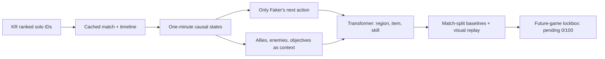
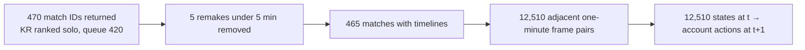

# Shadow Faker

[**Open the visual dashboard locally**](#visual-dashboard) · [**Explore the 64×64 atlas**](#a-higher-resolution-but-harder-question) · [**Read the evidence**](RESULTS.md) · [**Français**](README.fr.md)

**A reproducible, local research pipeline for Faker-style macro decisions in League of Legends.** It currently predicts the next 16×16 map region, first item purchase, and skill upgrade from ranked solo-queue timelines sampled roughly **once per minute**. The research target is prediction at **less than a minute**, which requires higher-frequency replay or player-view evidence and a new benchmark. Only actions of the account resolved as `Hide on bush#KR1` are targets; the other nine players provide context. Riot account-v1 confirms the Riot ID and PUUID, but cannot establish a person's identity by itself.

The longer-term goal is a **Shadow Plus** policy that could improve on this behavioral prior. Prediction accuracy on old matches does not establish stronger play. [SHADOW_PLUS.md](SHADOW_PLUS.md) defines the evidence needed for that claim. [Version française](README.fr.md).

**Measured status:** 465 usable ranked matches and 12,510 observations were collected from the available 470 match IDs. The selected model predicts the exact next 16×16 region in 11.28% of held-out test observations, versus 11.61% for a train-only role/phase prior. The requested clear exact-region baseline win has **not** been demonstrated. An exploratory pooling of predictions into 8×8 and 4×4 macro regions shows a positive signal that requires a fresh confirmatory test. Purchases and skill upgrades exceed their no-event baselines after validation calibration. Exact figures and limits are in [RESULTS.md](RESULTS.md).

### New: predicting the kind of move


A separate **development-only** policy predicts a coherent broad-to-fine destination and whether the account stays nearby, returns to base, approaches Dragon/Baron, or makes another observed move. The `x` proxy plus global timeline fields reaches **17.49%** next-region accuracy at 8×8 versus a **15.29%** simple role/phase rule on 46 validation games. Removing the global resource fields yields **16.86%**, with no reliable paired difference. The match-level interval for the gain over the simple rule still includes zero, and the same validation set chose the model and calibration. Its five-class macro F1 is **44.9%** versus **16.5%** for always choosing the common class, but reset detection remains weak. The enemy positions in both variants are a heuristic last-seen proxy, not complete oracle positions or Faker POV. [See the full ablation and limitations](RESULTS.md#new-development-experiment--a-decision-shaped-shadow-2026-10-10).


The exact next **one** of 64 broad cells remains **17.49%**. On this already-used validation set, naming **41 of 64 cells** reaches **90.12% coverage**—an answer covering **64.1% of the map**, not 90% exact accuracy. The 8×8 exact score falls to **7.5% after minute 20**. An independent current-position audit found no saved-cell misalignment across train and validation. [Read the visibility and predictability audit](VISIBILITY.md).

A targeted three-head model for early, middle and late game was also trained. It scored **16.39% overall and 5.91% late**, below the simpler model's **17.49% overall and 7.53% late**; it was kept as a documented negative experiment. This is why the next work focuses on better observation and fresh matches, not a larger phase head.

### A higher resolution, but harder question


The new **64×64** candidate scores **1.09% exact cell** on 1,197 previously inspected test decisions; the strongest simple baseline scores **1.92%**. Within four cells, Shadow scores **22.89%** versus **16.88%** for copying the current location. A validation-calibrated prediction set covers **91.9%** of actual test destinations, but contains **1,791 of 4,096 cells on average: 43.7% of the entire map**. This is uncertainty disclosure, not 90% pinpoint accuracy or stronger play. No result in this historical set is prospective confirmation.


The event atlas distinguishes Faker kills and deaths, allies, opponents, Dragon, Baron, Herald, Void Grubs, buildings and wards. Events without positions remain counted but unplaced. A separate local state warehouse holds **12,975 frames, 12,510 transitions and 353,409 indexed events** across the 465 ranked games, with all ten players at each frame. The dashboard follows one game's ten-player ecosystem in an isometric **3D projection** and displays a Faker-centred transition matrix and an anisotropic adjacent-cell field. Its 13 enemy-reaction and ally-cover variables are also **inputs to a separate training candidate**, not merely decoration. That candidate scores **8.71% exact 16×16 on validation**, below the frozen model's **10.59%**, so it is not promoted or tested. Read [STATE_ECOSYSTEM.md](STATE_ECOSYSTEM.md), [DESIGN.md](DESIGN.md) and the measured [RESULTS.md](RESULTS.md).


The account's **519 all-queue IDs** include the same 470 ranked-solo IDs plus **49 different-mode matches**. Those 49 timelines were cached locally but were not added to the ranked training set or relabeled as new ranked evidence. The first fresh ranked snapshot still contains **0/100** eligible new games for the frozen prospective test. Expanding to hundreds or thousands of comparable decisions requires verified new games or a separately sourced domain, never invented samples. [Roadmap and acquisition gates](ROADMAP.md).

### The landscape of next moves


The horizontal plane is the **16×16 legacy map grid**; bar height is the **share of next-minute locations** in a cell, aggregated over 46 historical test matches. It is not game terrain, an individual replay, or a set of counterfactual futures. The model's dominant central spike is a measurable failure mode, not a discovered strategy. The [interactive local dashboard](#visual-dashboard) lets you rotate an isometric version, inspect cells, scrub team tempo, and replay one held-out match minute by minute.

### Faker on the map, Shadow on the map


In the historical test, the account's next position lands in the most common cell **11.28%** of the time. Shadow predicts that same cell **39.43%** of the time. This visible overconcentration is one reason the exact-region baseline remains hard to beat. These are aggregate distributions from 46 matches, not a single game replay or player POV. [Read the map and diagnosis](RESULTS.md).

### What we score


The 8×8 and 4×4 gains were examined **after** the old test was seen. They suggest a direction; they are not a new independent win. The [prospective protocol](BENCHMARK_PROTOCOL.md) freezes that question for future games. Its first refresh found **0 of the required 100 new matches**.

## The project at a glance



The model asks **where this account moves next**, given the evolving game and team positions. The additional movement tags describe approaches toward allies and objectives; they do not measure intent or prove that a rotation helped win.


The lines follow *observed* movement toward jungle, bot carry and support in five-minute bins. They are not estimates of a teammate's fixed contribution to winning. For the broader phase view and top-lane comparison:


### A radical formation needs evidence


Only **one early minute in one match** places all five allied champions within 2,500 units of the bot carry. This proximity audit cannot tell whether a deliberate five-bot lane would work; it says the current corpus gives almost no examples of that shape. [GAME_THEORY_LAB.md](GAME_THEORY_LAB.md) turns unconventional strategies into testable questions with explicit costs and played-game evidence.

The public figures and README banners use [published aggregate counts and metrics](docs/data/public_summary.json), so they can be read without downloading or distributing Riot match data. Regenerate the original figures with `.venv/bin/python scripts/render_results.py --from-summary`, the model ablation with `.venv/bin/python scripts/render_hierarchical.py --from-summary`, and the 90% coverage audit with `.venv/bin/python scripts/render_predictability.py --from-summary`.

## Visual dashboard

Run the local dashboard after setup, then open [http://127.0.0.1:8008/](http://127.0.0.1:8008/). It shows the **observed account, Shadow and evidence side by side** in French or English. It uses the published aggregates for its public views. If the full pipeline has run, a held-out match replay and GIF are served locally from ignored files.

```bash
.venv/bin/python scripts/serve_dashboard.py
# Optional: generate the local minute-by-minute replay before opening the page.
.venv/bin/python -m shadowfaker.demo --max-frames 30
```

The dashboard server binds to `127.0.0.1` and serves an allowlist of public visuals plus optional local replay files. A sticky **shared timeline** lets you scrub minute 0–39 with a slider, keyboard or mouse wheel over the slider. It synchronizes the 64×64 atlas, 3D frequency surface, five-minute team tempo, opponent pressure, one-game replay and synthetic scenario cursor. The colour key travels with the timeline. Atlas and surface show **phase aggregates** (0–10, 10–20, 20+ minutes): the observed/modelled destination layers use 46 historical test games, while player/event layers use 465 ranked games. The replay shows **one selected game**, sampled about every minute; it stops at that game's final frame. Fixed historical score figures and the older 16×16 model remain labelled as fixed rather than pretending to change with the slider. The public phase counts are 460, 437 and 300 test destinations, summing to 1,197.

The score section now includes an **8×8 development validation** panel: exact-cell accuracy, the map area needed for 90% candidate-set coverage, and three candidate models by game phase. Its bars respond to the shared timeline. Its **46 validation matches are separate from the 46 historical test matches** shown in the atlas.

The dashboard can open any **locally indexed ranked game** by match ID and search 930 locally generated English/French summaries plus separately sourced multilingual case studies. The replay remains local and is excluded from Git. [Dashboard source](dashboard/), [reproducible aggregate renderer](scripts/render_results.py), and [research evidence](RESULTS.md) are in the repository.

## Where 470, 465, and 12,510 come from



The API returned **470 IDs in five pages** (100 + 100 + 100 + 100 + 70) for this PUUID at the 2026-10-09 snapshot. It did not provide 1,000 games, and this number is not a claim about every game Faker has ever played. The collector checked queue, account, region, duration and timeline for each ID. Five games lasted under five minutes; none of the other 465 lacked a usable timeline. For each remaining game with `F` timeline frames, parsing made `F − 1` one-minute examples: the state at one frame predicts the account's position, first purchase and skill upgrade in the next. Summed across games, this is **12,510 candidate pairs**, and no target position was missing in this corpus. Each game contributes 13–47 examples (median 27). The eight-frame input window is left padded near game start, so it does not discard early pairs. These observations are correlated within a match; evaluation splits and uncertainty calculations therefore operate by **match**.

## One-command run

Requires macOS Apple Silicon, Python 3.11+, and a current Riot development key. The validated local environment uses Python 3.12:

```bash
python3.12 -m venv .venv
.venv/bin/python -m pip install -r requirements.txt -e .
cp .env.example .env
# Set RIOT_API_KEY in .env to the current Riot developer key.
# Full five-game pilot → ranked pipeline → 64×64, ten-player warehouse,
# interaction training, validation, vectors, summaries, charts and replay:
.venv/bin/python scripts/run_next_level.py --limit 1000 --epochs 25
```

If `pip` is unavailable in the virtual environment, use `uv pip install --python .venv/bin/python -r requirements.txt -e .`. The base ranked pipeline validates **every stage on five games first**, then collects all available games up to the target, parses, analyzes, trains, selects on validation, evaluates on held-out test games, and exports a GIF. JSON and match-level NPZ files are cached; rerun the same command after a crash or key renewal. For a five-game base smoke run: `.venv/bin/python scripts/run_pipeline.py --limit 5 --epochs 3`.

`run_next_level.py` also works as the one-command entry point on a fresh checkout: it invokes the base pipeline if the ranked dataset or checkpoint is missing, then validates its new stages on five games and builds the full local research extension. A rerun reuses matching checkpoints and cached source data. Its interaction candidate is scored on validation only; its 64×64 historical test report is explicitly marked as previously inspected. The local text index and per-game media are ignored by Git. Use `--pilot-only` to check five games without scaling.

Use `--game-name "Name" --tag-line TAG` for another account, with a separate `data/raw/` directory if its PUUID differs. The collector uses the `asia` route for KR, filters queue 420 (ranked solo), skips remakes shorter than five minutes and missing timelines, and paginates without duplicates. A persistent 1.3-second interval between requests respects the 100 requests per two minutes development quota. It also handles `Retry-After`, backoff, timeouts, and clear 401/403 key errors. At two requests per match, 1,000 games require **at least about 43 minutes**, excluding pagination and retries. The actual account history may contain fewer.

## Next level: frozen macro benchmark

The current model and development split are frozen under [BENCHMARK_PROTOCOL.md](BENCHMARK_PROTOCOL.md). The primary future metric is 8×8 next-region accuracy versus four frozen baselines, with a match-level confidence interval. The original 16×16 metric remains separately reported. The lockbox requires **100 genuinely new Faker-account ranked matches** after the frozen cutoff; it returns `pending` before then and scores once. On the first live refresh on 2026-10-09, there were **0/100** new matches.

```bash
.venv/bin/python -m shadowfaker.macro_actions --limit 5
.venv/bin/python -m shadowfaker.macro_actions
.venv/bin/python scripts/run_prospective.py --offline
# Use a new snapshot name for a fresh match-ID listing; reuse it to resume a crash.
.venv/bin/python scripts/run_prospective.py --snapshot 20261010
```

The macro-action parser adds eight **observable movement proxies**: moving toward allied jungle, bot, support, mid or top, toward a live Dragon/Baron pit, or back to base. Missing player positions are masked. These are labels about where Faker moved, not verified intent, communications, assistance or causal contribution to winning. See [ROADMAP.md](ROADMAP.md) for the hierarchical-model and stronger-play milestones. A newly trained model needs its **own** future lockbox; it cannot replace the current frozen candidate.

## Model and data

The versioned parser takes a causal window of eight one-minute frames. Inputs include Faker's champion and role, minute, gold and unspent gold, level/XP, lane plus jungle CS, recent deaths and purchases, team gold/XP advantage and its change, objective availability, ward and kill events, positions of ten players, and Faker's distances to allied roles and Dragon/Baron pits. Allied roles have stable slots ordered jungle, bot carry, support, mid, top. The transformer can learn different roles' importance at different phases. The next region, item, and skill are **Faker's actions only**. A fourth, auxiliary output estimates final match outcome; the future win label is never part of an input state.

Each match stores two views: `x_oracle` has full timeline positions; default `x` is a **minimap proximity proxy** that hides enemies farther than 1,600 map units from an ally and carries their last-seen position and age. This is not true fog of war: enemy team gold/XP aggregates remain omniscient in both views. Train an oracle ablation with `.venv/bin/python -m shadowfaker.train --view oracle` after preserving the proxy checkpoint if needed. Missing target positions are skipped; an isolated parsing failure is logged and excluded.

The 16×16 region loss mixes balanced and ordinary cross-entropy by default; no-purchase and no-skill labels are downweighted during training. A role- and phase-specific region prior is fitted on **training matches only**, then its smoothing and interpolation are selected on validation. No-purchase/no-skill output biases are also selected on validation to correct event-rate calibration. Splits are by **match**, never by frame. Item vocabulary and class weights are fitted on training matches only. The dataset holds at most two decompressed matches in RAM. Seed 42, dependency versions, schema, splits, and counts are recorded. CPU and MPS are benchmarked on a short epoch, then the faster backend is selected.

## Artifacts and evaluation

| Stage | Local output |
|---|---|
| Fetch | `data/raw/` JSON and manifest |
| Parse | `data/processed/matches/*.npz`, `meta.json` |
| Team analysis | `artifacts/faker_rotations.json` and `.png` |
| Train | `models/best.pt`, `models/training.json`, TensorBoard `runs/` |
| Validation | `artifacts/evaluation_val.json`, confusion image/array |
| Final test | `artifacts/evaluation.json`, `region_confusion.png` and `.npy` |
| Demo | `artifacts/predicted_vs_actual.gif` from a held-out match |

Region metrics include top-1/top-5 accuracy and mean distance in grid cells against the most frequent training region, copying the current region, staying at map center, and the train-only role/phase prior alone when calibration is available. Exploratory 8×8 and 4×4 scores pool the 16×16 output probabilities and recompute baselines at each resolution. The gain over the strongest baseline includes a paired 95% bootstrap interval sampled by match. Item and skill reports include event rates and accuracy conditional on a real purchase/upgrade. Final-outcome Brier score is compared with a constant training-win-rate baseline. Results are broken down by champion, patch, phase, Faker role, and team gold state. The confusion matrix covers all 256 regions. On a fresh full run, the runner compares the initial, wider three-layer, and explicit movement variants on **validation**, saves the selected configuration, then evaluates the test split. A rerun reuses that choice and the checkpoint.

`faker_rotations.json` describes proximity to allied jungle/bot/support/top and objective pits by phase and match result. It also measures the **observed** two-minute change in team gold/XP advantage after nearby and farther observations, averaging by match first. These are associations, not causal estimates of help or intent.

## Research, public material, and limitations

- [RESEARCH_NOTES.md](RESEARCH_NOTES.md): how the three supplied PDFs informed event/XP features and leak prevention.
- [OTHER_GAMES_RESEARCH.md](OTHER_GAMES_RESEARCH.md): methods from StarCraft, Dota, Minecraft, Atari, and other MOBA studies, with applicability boundaries.
- [PUBLIC_GAME_ANALYSIS.md](PUBLIC_GAME_ANALYSIS.md): Korean/English official VODs, T1 communications, interviews, and fan discussions, with provenance and an annotation contract.
- [REPLAY_FEASIBILITY.md](REPLAY_FEASIBILITY.md): replay/video path when matching local material exists.
- [PLAN.md](PLAN.md) and [PROGRESS.md](PROGRESS.md): architecture, risks, actual tests, counts, and results.
- [RESULTS.md](RESULTS.md): exact held-out scores, baselines, and the remaining region-prediction gap.
- [ROADMAP.md](ROADMAP.md) and [BENCHMARK_PROTOCOL.md](BENCHMARK_PROTOCOL.md): next-level milestones and the frozen prospective test.
- [GAME_THEORY_LAB.md](GAME_THEORY_LAB.md): a falsifiable research path for unusual formations and stronger played-game strategies.
- [DIAMOND.md](DIAMOND.md): a multi-facet model of Faker's decision space, observability, and the route to sub-minute study.
- [STATE_ECOSYSTEM.md](STATE_ECOSYSTEM.md): ten-player state matrix, enemy-response training channels, vector index, and geometric field.
- [DESIGN.md](DESIGN.md): fan-made five-star visual system and how to read the two 3D projections.

Professional LCK/Worlds games and ranked solo queue differ in roster, draft, communications, and incentives. Any future joint training must identify the domain and report separate held-out results. Reddit/X interpretations and translations are hypotheses until checked against match-specific evidence. No video, voice, or social-media text is silently treated as a numeric label.

Timelines sample roughly every 60 seconds. They miss instant reactions, exact fog of war, ward positions, cooldown details, pings, voice, and Faker's own screen. One-step cloning does not test accumulated errors in full games, micro play, or strength against opponents. The outcome head predicts state–result association, not an action's causal value. Objective respawns are approximated and may vary by patch.

Raw Riot JSON, processed samples, models, runs, artifacts, and `.env` are excluded from Git. **Do not redistribute Riot raw match data.** Use is local/personal research subject to Riot's applicable terms. Source documentation: [Riot API reference](https://developer.riotgames.com/apis), [developer portal limits](https://developer.riotgames.com/docs/portal), and [Replay documentation](https://developer.riotgames.com/docs/lol). Repository code follows its AGPL-3.0 license.
