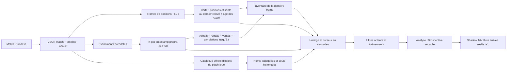

# Rejouer les parties indexées

Le tableau de bord local propose désormais un **rejeu analytique** de chaque partie classée indexée. Il suit l'horloge de la partie en secondes, affiche les dix joueurs à leur dernière position présente dans la timeline Riot et révèle les événements quand leur timestamp est atteint. Il ne reconstruit ni vidéo, ni clics, ni déplacement continu, ni point de vue de Faker.


Le fond est la minimap de la Faille du **Data Dragon 16.20.1**, la version épinglée pour les portraits du tableau de bord. Les anneaux bleu/rouge encadrent les portraits des champions, le halo pointillé centré sur Faker mesure **2 500 unités de carte** et les repères de fosses Baron/Dragon sont des coordonnées approximatives de terrain, sans statut « vivant ». Les croix, losanges et yeux représentent respectivement combats, objectifs et wards **déjà arrivés**. Un lieu sans coordonnées Riot reste dans le flux, sans marqueur de carte. Les traits en pointillés relient seulement des frames passées et ne décrivent pas le chemin réellement suivi.




## Utilisation

```bash
PYTHONPATH=src .venv/bin/python scripts/serve_dashboard.py --host 127.0.0.1 --port 8008
```

Ouvrir [le lecteur local](http://127.0.0.1:8008/#replay), choisir un ID dans les 465 parties du catalogue, puis **Ouvrir la partie**. Chaque nouvelle partie repart à `t=0`. Le bouton lecture, le curseur et les vitesses 1×, 5×, 20× et 60× contrôlent l'horloge. Celle-ci affiche les millisecondes du timestamp Riot ; les boutons **Événement précédent/suivant** et les moments marquants sautent à ce timestamp exact. Un filtre isole Faker, combats, objectifs, vision ou économie ; des cases masquent alliés, adversaires, lieux d'événement et traces. **Suivre** choisit Faker seul par défaut ou les dix joueurs ; **Frames** montre deux, quatre ou huit derniers relevés ; **Sur la carte** conserve les événements des 15, 60 ou 180 dernières secondes. Un clic sur une ligne du flux revient à son timestamp exact. La liste des dix joueurs indique le **dernier** niveau, pourcentage de vie, distance géométrique à Faker et inventaire reconstruit, avec l'âge de la frame. La frise commune suit la minute entière atteinte dans le rejeu ; déplacer la frise repositionne aussi le rejeu sur une frame observée.

Le panneau **BLEU / ROUGE** additionne uniquement les événements déjà survenus à l'instant affiché : kills, structures détruites, dragons par type, Baron, Héraut, larves, balises posées/détruites. Il montre aussi le K/D/A observable de Faker. Le flux précise la victime et les assistants d'un kill, le type de dragon, la voie et le type de bâtiment, ainsi que la catégorie de ward lorsque Riot la fournit. « Type non précisé » reste inconnu ; l'absence de coordonnées ne crée pas de point sur la carte. Un bâtiment détruit appartient au `teamId` de l'événement ; le camp qui bénéficie de sa chute est **déduit** comme camp opposé, à la différence du `killerTeamId` explicitement fourni pour un monstre. Cette distinction est vérifiée par test.

Le panneau **Objets, vision et potions · Faker** suit trois familles : équipement, wards/trinkets et potions/autres consommables. Les icônes représentent les **objets reconstitués à l'instant choisi**, alors que positions et santé restent au dernier relevé Riot. Entre deux frames, achats, retraits, ventes et annulations sont appliqués dans l'ordre de leur timestamp. Par exemple, dans la partie locale de démonstration, les deux Health Potions apparaissent à `00:02.700` et il n'en reste qu'une à `01:47.644`, sans attendre la frame suivante. Le panneau compte aussi les poses et destructions de wards alliées/adverses sur les trois minutes précédentes ; ses quatre derniers événements permettent de sauter à l'instant précis. Une ward sans coordonnées garde « lieu inconnu ». Le nombre affiché pour une potion est le **nombre d'objets déduits**, jamais ses charges ni la preuve qu'elle a été bue ; `ITEM_DESTROYED` peut aussi correspondre à une combinaison d'objets.

Le bandeau de source précise le **patch joué** et la version du catalogue d'objets [Riot Data Dragon](https://developer.riotgames.com/docs/lol#data-dragon) utilisée. Noms et coûts de l'inventaire ou d'un achat proviennent du catalogue local correspondant au patch ; si cette version manque, le lecteur le signale et utilise les noms de l'atlas iconographique. Le coût affiché est le prix catalogue, **pas** la dépense effective du joueur à cet instant. Les icônes et la minimap restent épinglées au patch 16.20.1 : une icône historique peut donc différer.

La fiche contenant résultat et objets finaux est pliée pour éviter un spoiler involontaire. L'analyse du modèle historique est aussi pliée : elle affiche **l'arrivée réelle à la frame suivante**, donc du futur par rapport à l'horloge du lecteur. Les filtres ne changent ni les fichiers d'entraînement ni les prévisions historiques.

Les parties sont servies depuis les fichiers privés du Mac. L'endpoint `/api/replay?match=KR_…` n'accepte qu'un match ID présent dans le dataset traité. Les traces JSON **version 11** et images générées sont cachées sous `artifacts/replays/` et `artifacts/replay_frames/`. Chaque événement conserve `xy` si Riot donne une position, son horodatage, l'acteur, la victime, les assistants, le bénéficiaire attribuable, le sous-type d'objectif ou de ward et la provenance de l'attribution d'équipe. Les événements d'objets gardent `itemId`, `beforeId` et `afterId` quand présents ; le catalogue du patch fournit `kind`, nom, tags et prix. `cell64` reste un repli pour les anciennes traces. Les événements d'objet et points de compétence sans participant valide sont exclus du flux. Le cache est repris uniquement si le checkpoint, la limite de frames, le NPZ traité, le match et la timeline bruts, le manifeste d'identité, la méta du split et le catalogue Data Dragon utilisé ont la même empreinte SHA-256 et si chaque image existe. Un changement de source reconstruit la trace sans refetch Riot. Rien de cela n'est publié dans Git.

## Ce que montre chaque couche

| Couche | Source | Temps | Interprétation |
| --- | --- | --- | --- |
| Portraits des dix joueurs et halo Faker | `participantFrames.position` | Frames ~60 s | Dernière position **observée** ; âge affiché, absence tolérée. Halo de 2 500 unités géométriques, sans signification de vision. Vue omnisciente. |
| Traits pointillés | Paires de `participantFrames.position` déjà observées | Frames ~60 s | Lien graphique entre relevés, profondeur choisie ; jamais une trajectoire, une vitesse ou un clic. Une position absente coupe le trait. |
| Symboles sur la carte | `events[].position` | Timestamp de l'événement | Lieu du combat, objectif, ward ou autre événement s'il existe ; jamais la position de Faker déduite de ce lieu. |
| Flux d'événements | `events[].timestamp` | Millisecondes Riot, affichées en `mm:ss.mmm` | Achats, retraits, ventes, annulations, compétences, wards, kills, monstres, bâtiments. Les événements de `t=0` apparaissent d'emblée ; ceux rangés dans la frame suivante gardent leur propre timestamp. Les champs acteur manquants restent inconnus. |
| Score par camp | Événements `<= t` et champs `killerTeamId`, `teamId`, `killerId` | Seconde de l'événement | Kills, bâtiments, monstres, wards ; le camp bénéficiaire d'un bâtiment est déduit du camp propriétaire détruit. Pas de prédiction de victoire. |
| Inventaire et étiquette d'objet | Achats/ventes/destructions/annulations dans la timeline + catalogue Data Dragon du patch | Dernière frame plus événements jusqu'à `t` | Proxy d'objets portés par les dix joueurs à la seconde choisie, noms et coûts catalogue historiques. Peut manquer les trinkets/évolutions automatiques et les charges. |
| Vision récente | `WARD_PLACED` et `WARD_KILL` | Fenêtre `(t−180 s, t]` | Compte par camp et quatre événements récents ; ne mesure ni durée de vie, ni couverture effective, ni visibilité de Faker. |
| Carte des dix joueurs | `participantFrames` | Dernière frame `<= t` | Niveau, santé et distance avec Faker à la frame observée ; vue omnisciente, même si un adversaire est caché en jeu. |
| Case Shadow | Modèle spatial historique | Prochaine frame ~60 s | Prévision 16×16 à partir de l'état passé, distincte des coordonnées observées. |
| Analyse rétrospective | Frame suivante | t+1 | Vérification après coup ; ne doit pas être lue comme une information disponible à t. |

**Limites de l'observabilité.** Le fond vient de [Riot Data Dragon](https://developer.riotgames.com/docs/lol#data-dragon) au patch 16.20.1 et n'est pas une capture du terrain au patch de chaque match. Les repères de fosses sont approximatifs. Les positions des joueurs viennent des coordonnées normalisées de la timeline ; elles peuvent révéler un ennemi que Faker ne voyait pas. L'API Riot ne fournit pas ici les pings, la communication vocale, les clics, la vision réelle ni une trajectoire par seconde. L'affichage d'événements à la seconde ne doit donc pas devenir une précision de position ou un score de prédiction à la seconde. Un `.rofl`/une VOD liée à un match précis serait un travail d'alignement séparé, décrit dans [REPLAY_FEASIBILITY.md](REPLAY_FEASIBILITY.md).

## Vérification

Le [rapport agrégé](docs/data/public_replay_audit.json) est régénéré par `PYTHONPATH=src .venv/bin/python scripts/audit_replay.py --limit 5 --output /tmp/replay-pilot.json`, puis sans `--limit` pour tout le corpus. Le pilote de trois matches train et deux validation compte **130 frames**, **6 106 événements bruts**, **20 événements présents à la première frame** et **3 rangés au-delà de leur intervalle de conteneur**. Sur les **465 parties**, il y a **12 975 frames**, **129 750 positions de joueurs présentes**, **563 198 événements**, **1 794 à la première frame** et **30 sur une frontière du conteneur suivant**. Aucune frame n'a un horodatage non croissant. Ces chiffres portent sur les événements bruts, y compris ceux que le flux du lecteur ne montre pas, par exemple certains événements système ; le lecteur ne promet pas 563 198 marqueurs visibles.

Le [nouvel audit du contexte](docs/data/public_replay_context.json) se régénère avec `PYTHONPATH=src .venv/bin/python scripts/audit_replay_context.py --limit 5 --output /tmp/context-pilot.json`, puis sans `--limit` pour les 465 parties. Il compte **471 154 événements affichables**, dont seulement **33 329 avec position fournie**. Ce total inclut **110 087 retraits**, **4 739 ventes** et **4 207 annulations** d'objets. Sur **137 553 événements de wards**, **38 004** ont un type non précisé. Les **114 315 achats attribués à un joueur** ont tous un ID présent dans le catalogue d'objets de leur patch, réparti sur 12 versions Data Dragon. On compte **21 127 événements d'objets « potion »** et **60 575 événements d'objets « vision »** d'après les tags/noms statiques du patch ; ces compteurs ne mesurent pas les charges consommées ni la vision effectivement disponible. Ce sont des volumes et une couverture de champs, **pas** une mesure d'exactitude de la prédiction.

Les tests synthétiques vérifient frontière exacte, absence de futur, cache de source, attribution des camps, cycle d'achat/retrait/vente/annulation et réponse du simulateur. Le pilote sur cinq parties a généré **5 607 événements affichables**, zéro erreur ; cinq traces v11 à cinq frames ont été construites. Dans le navigateur, les deux Health Potions de Faker apparaissent à **00:02.700** et leur compte descend à un à **01:47.644** ; le Control Ward acheté à **04:51.379** rejoint aussitôt la famille vision. Les wards sans coordonnées restent dans la liste horodatée. FR/EN et écran mobile 390 px vérifiés. Le lecteur est descriptif : il ne modifie ni l'entraînement ni les scores de Shadow.
