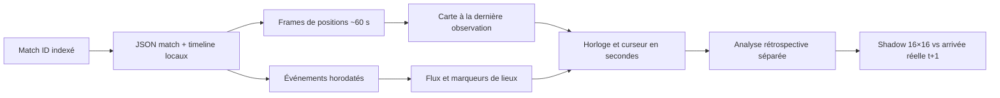

# Rejouer les parties indexées

Le tableau de bord local propose désormais un **rejeu analytique** de chaque partie classée indexée. Il suit l'horloge de la partie en secondes, affiche les dix joueurs à leur dernière position présente dans la timeline Riot et révèle les événements quand leur timestamp est atteint. Il ne reconstruit ni vidéo, ni clics, ni déplacement continu, ni point de vue de Faker.




## Utilisation

```bash
PYTHONPATH=src .venv/bin/python scripts/serve_dashboard.py --host 127.0.0.1 --port 8008
```

Ouvrir [le lecteur local](http://127.0.0.1:8008/#replay), choisir un ID dans les 465 parties du catalogue, puis **Ouvrir la partie**. Le bouton lecture, le curseur et les vitesses 1×, 5×, 20× et 60× contrôlent l'horloge. Les raccourcis des moments marquants sautent à leur timestamp. La fiche contenant résultat et objets finaux est pliée pour éviter un spoiler involontaire. L'analyse du modèle historique est aussi pliée : elle affiche **l'arrivée réelle à la frame suivante**, donc du futur par rapport à l'horloge du lecteur.

Les parties sont servies depuis les fichiers privés du Mac. L'endpoint `/api/replay?match=KR_…` n'accepte qu'un match ID présent dans le dataset traité. Les traces JSON version 6 et images générées sont cachées sous `artifacts/replays/` et `artifacts/replay_frames/`; un redémarrage ou un nouveau choix de partie reprend ces fichiers lorsque le checkpoint et le nombre de frames coïncident. Rien de tout cela n'est publié dans Git.

## Ce que montre chaque couche

| Couche | Source | Temps | Interprétation |
| --- | --- | --- | --- |
| Points des dix joueurs | `participantFrames.position` | Frames ~60 s | Dernière position **observée** ; âge affiché, absence tolérée. Vue de données omnisciente, pas minimap de Faker. |
| Anneau sur la carte | `events[].position` | Timestamp de l'événement | Lieu du kill ou autre événement s'il existe ; jamais la position de Faker déduite de ce lieu. |
| Flux d'événements | `events[].timestamp` | Millisecondes Riot, affichées en secondes | Achats, compétences, wards, kills, monstres, bâtiments. Les champs acteur manquants restent inconnus. |
| Case Shadow | Modèle spatial historique | Prochaine frame ~60 s | Prévision 16×16 à partir de l'état passé, distincte des coordonnées observées. |
| Analyse rétrospective | Frame suivante | t+1 | Vérification après coup ; ne doit pas être lue comme une information disponible à t. |

**Limites de l'observabilité.** La carte n'est pas le terrain exact de League of Legends. La bande bleue et les lignes sont des repères visuels ; seul le point des joueurs vient des coordonnées normalisées de la timeline. L'API Riot ne fournit pas ici les pings, la communication vocale, les clics, la vision réelle ni une trajectoire par seconde. L'affichage d'événements à la seconde ne doit donc pas devenir une précision de position ou un score de prédiction à la seconde. Un `.rofl`/une VOD liée à un match précis serait un travail d'alignement séparé, décrit dans [REPLAY_FEASIBILITY.md](REPLAY_FEASIBILITY.md).

## Vérification

Un pilote sur trois matches d'entraînement et deux de validation contrôle l'ordre des frames, l'appartenance des événements à `(t,t+1]` et la présence de dix acteurs même lorsque des coordonnées manquent. Le test synthétique `tests/test_replay_clock.py` vérifie les timestamps exacts, l'exclusion des événements futurs et les positions manquantes. L'interface a été vérifiée avec une transition de frame autour de 05:00, la lecture, les moments marquants, le changement de partie et le mode mobile. Le lecteur est descriptif : il ne modifie ni l'entraînement ni les scores de Shadow.
