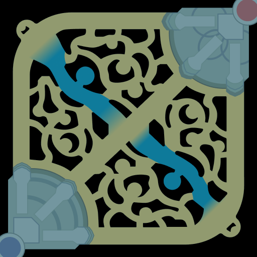
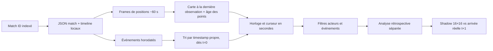

# Rejouer les parties indexées

Le tableau de bord local propose désormais un **rejeu analytique** de chaque partie classée indexée. Il suit l'horloge de la partie en secondes, affiche les dix joueurs à leur dernière position présente dans la timeline Riot et révèle les événements quand leur timestamp est atteint. Il ne reconstruit ni vidéo, ni clics, ni déplacement continu, ni point de vue de Faker.



Le fond est la minimap de la Faille du **Data Dragon 16.20.1**, la version épinglée pour les portraits du tableau de bord. Les anneaux bleu/rouge encadrent les portraits des champions, le halo pointillé centré sur Faker mesure **2 500 unités de carte** et les repères de fosses Baron/Dragon sont des coordonnées approximatives de terrain, sans statut « vivant ». Les croix, losanges et yeux représentent respectivement combats, objectifs et wards **déjà arrivés**. Un lieu sans coordonnées Riot reste dans le flux, sans marqueur de carte. Les traits en pointillés relient seulement des frames passées et ne décrivent pas le chemin réellement suivi.




## Utilisation

```bash
PYTHONPATH=src .venv/bin/python scripts/serve_dashboard.py --host 127.0.0.1 --port 8008
```

Ouvrir [le lecteur local](http://127.0.0.1:8008/#replay), choisir un ID dans les 465 parties du catalogue, puis **Ouvrir la partie**. Chaque nouvelle partie repart à `t=0`. Le bouton lecture, le curseur et les vitesses 1×, 5×, 20× et 60× contrôlent l'horloge. Celle-ci affiche les millisecondes du timestamp Riot ; les boutons **Événement précédent/suivant** et les moments marquants sautent à ce timestamp exact. Un filtre isole Faker, combats, objectifs, vision ou économie ; des cases masquent alliés, adversaires, lieux d'événement et traces. **Suivre** choisit Faker seul par défaut ou les dix joueurs ; **Frames** montre deux, quatre ou huit derniers relevés ; **Sur la carte** conserve les événements des 15, 60 ou 180 dernières secondes. Un clic sur une ligne du flux revient à son timestamp exact. La liste des dix joueurs indique le **dernier** niveau, pourcentage de vie et distance géométrique à Faker, avec l'âge de la frame. La frise commune suit la minute entière atteinte dans le rejeu ; déplacer la frise repositionne aussi le rejeu sur une frame observée.

La fiche contenant résultat et objets finaux est pliée pour éviter un spoiler involontaire. L'analyse du modèle historique est aussi pliée : elle affiche **l'arrivée réelle à la frame suivante**, donc du futur par rapport à l'horloge du lecteur. Les filtres ne changent ni les fichiers d'entraînement ni les prévisions historiques.

Les parties sont servies depuis les fichiers privés du Mac. L'endpoint `/api/replay?match=KR_…` n'accepte qu'un match ID présent dans le dataset traité. Les traces JSON **version 9** et images générées sont cachées sous `artifacts/replays/` et `artifacts/replay_frames/`. Cette version ajoute `events[].xy`, position normalisée depuis `events[].position` quand elle existe ; `cell64` reste un repli pour les anciennes traces. Les achats et points de compétence sans participant valide sont exclus du flux. Le cache est repris uniquement si le checkpoint, la limite de frames, le NPZ traité, le match et la timeline bruts, le manifeste d'identité et la méta du split ont la même empreinte SHA-256 et si chaque image existe. Un changement de source reconstruit la trace sans refetch Riot. Rien de cela n'est publié dans Git.

## Ce que montre chaque couche

| Couche | Source | Temps | Interprétation |
| --- | --- | --- | --- |
| Portraits des dix joueurs et halo Faker | `participantFrames.position` | Frames ~60 s | Dernière position **observée** ; âge affiché, absence tolérée. Halo de 2 500 unités géométriques, sans signification de vision. Vue omnisciente. |
| Traits pointillés | Paires de `participantFrames.position` déjà observées | Frames ~60 s | Lien graphique entre relevés, profondeur choisie ; jamais une trajectoire, une vitesse ou un clic. Une position absente coupe le trait. |
| Symboles sur la carte | `events[].position` | Timestamp de l'événement | Lieu du combat, objectif, ward ou autre événement s'il existe ; jamais la position de Faker déduite de ce lieu. |
| Flux d'événements | `events[].timestamp` | Millisecondes Riot, affichées en `mm:ss.mmm` | Achats, compétences, wards, kills, monstres, bâtiments. Les événements de `t=0` apparaissent d'emblée ; ceux rangés dans la frame suivante gardent leur propre timestamp. Les champs acteur manquants restent inconnus. |
| Carte des dix joueurs | `participantFrames` | Dernière frame `<= t` | Niveau, santé et distance avec Faker à la frame observée ; vue omnisciente, même si un adversaire est caché en jeu. |
| Case Shadow | Modèle spatial historique | Prochaine frame ~60 s | Prévision 16×16 à partir de l'état passé, distincte des coordonnées observées. |
| Analyse rétrospective | Frame suivante | t+1 | Vérification après coup ; ne doit pas être lue comme une information disponible à t. |

**Limites de l'observabilité.** Le fond vient de [Riot Data Dragon](https://developer.riotgames.com/docs/lol#data-dragon) au patch 16.20.1 et n'est pas une capture du terrain au patch de chaque match. Les repères de fosses sont approximatifs. Les positions des joueurs viennent des coordonnées normalisées de la timeline ; elles peuvent révéler un ennemi que Faker ne voyait pas. L'API Riot ne fournit pas ici les pings, la communication vocale, les clics, la vision réelle ni une trajectoire par seconde. L'affichage d'événements à la seconde ne doit donc pas devenir une précision de position ou un score de prédiction à la seconde. Un `.rofl`/une VOD liée à un match précis serait un travail d'alignement séparé, décrit dans [REPLAY_FEASIBILITY.md](REPLAY_FEASIBILITY.md).

## Vérification

Le [rapport agrégé](docs/data/public_replay_audit.json) est régénéré par `PYTHONPATH=src .venv/bin/python scripts/audit_replay.py --limit 5 --output /tmp/replay-pilot.json`, puis sans `--limit` pour tout le corpus. Le pilote de trois matches train et deux validation compte **130 frames**, **6 106 événements bruts**, **20 événements présents à la première frame** et **3 rangés au-delà de leur intervalle de conteneur**. Sur les **465 parties**, il y a **12 975 frames**, **129 750 positions de joueurs présentes**, **563 198 événements**, **1 794 à la première frame** et **30 sur une frontière du conteneur suivant**. Aucune frame n'a un horodatage non croissant. Ces chiffres portent sur les événements bruts, y compris ceux que le flux du lecteur ne montre pas, par exemple certains événements système ; le lecteur ne promet pas 563 198 marqueurs visibles.

Les tests synthétiques vérifient frontière exacte, absence de futur, cache de source et réponse du simulateur. Dans le navigateur, l'événement **02:21.024** est absent à **02:21.023**, présent à **02:21.024** ; l'horloge de la frise passe à **2 MIN**, la position date de **02:00.043**. Filtres, masquage des adversaires, navigation et largeur mobile 390 px ont été vérifiés. Le lecteur est descriptif : il ne modifie ni l'entraînement ni les scores de Shadow.
