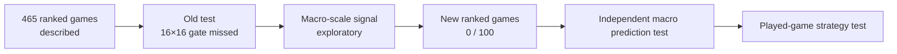

# Measured results (updated 2026-10-11)

## M16: Faker-attributed events in the next ten seconds

On **373 KR training games**, a 13,575-parameter multilabel head learned seven explicitly Faker-attributed event families. A five-game pilot preceded the full cache build. On **46 development validation games / 7,480 ten-second windows**, model log loss is **0.19427**, versus **0.20481** for a train-only phase-frequency rule; paired match-bootstrap gain **0.01054 [0.00906, 0.01211]**. Macro average precision is **0.12110** versus **0.06600**. Purchase AP is **24.09%** versus **8.68%**; kill-outcome AP is **7.67%** versus **5.01%**, still weak for individual events. An AP is a threshold-free ranking measure, not exact accuracy. Kills/deaths/assists are observed outcomes, not intentions. The old test and new-game lockbox remain untouched; no position at ten seconds has been inferred. [Labels, every class, reproduction and limits](FAKER_ACTIONS.md).

## M15: seconds are timestamped, Faker's positions are not

An audit of **465 cached KR ranked games** found **563,198 timestamped raw events**, **60,554 valid event loci**, and **12,975 sampled Faker positions**. The median gap between his position observations is **60.02 seconds**. Of **12,447 windows** spanning 10 seconds after a known position, **12,297** contain some event, **5,169** involve Faker, and **zero** contain a new sampled Faker position. At 1, 5, and 30 seconds the new-position count is also zero. These are source-availability counts, **not predictions**. Event loci can refer to victims, objectives or structures; they must not become Faker's position labels. [Continuous target, full audit table and reproduction](SECOND_SCALE.md).

The research target is now action, time and optional continuous location at horizons measured in seconds. Render-grid size is a display choice. The following M14 score remains an archived next-minute benchmark and cannot validate a second-scale claim.

## M14 archive: one exact next-minute 8×8 cell — gate not reached

The selected M3 full-context checkpoint, with its recorded role/phase prior, is correct on **223/1,275 = 17.49%** of next-minute transitions in the 46-game development validation set. Sorting by its maximum cell probability and answering only the **64 most confident transitions (5.02%)** yields **31/64 = 48.44% exact**, Wilson lower 95% bound **36.63%**. At 10% served coverage it is **48/128 = 37.50%**; at 20%, **95/255 = 37.25%**. No match-half calibration threshold met the predeclared 90% lower-bound and minimum-coverage gate. Confidence helps a little but is far from reliable enough for an exact 90% claim.

This is **exploratory**, because checkpoint epoch and prior weight were already selected on this same validation cohort. No old historical test or prospective lockbox match was scored in M14. A fresh `20261011` Riot snapshot failed with **HTTP 401: expired or unauthorized local key**, so the M0 future cohort remains **0/100** and its score unopened. [Protocol and next data gate](NINETY_GATE.md). This 90% target refers to **one exact destination cell**, never a top-k list or a dominant no-action class.

The screenshot shows the **interactive research chapter**, not an additional model result. The six-star identity and the separate 25-game Worlds-finals archive are explained in [WORLD_FINALS.md](WORLD_FINALS.md); public match summaries from that archive have not entered the ranked training or evaluation cohorts.

## 512×512 development atlas and prediction

The new target is the account's **next observed position at the 512×512 spatial resolution**, still about one minute later. It has 262,144 possible cells, each about 29 map units wide. A 25,280-parameter conditional head chooses an 8×8 subcell inside a frozen 64×64 parent; inference compares the joint scores of the top 16 parent candidates. This is a genuinely finer label and prediction, not a resized 64×64 plot. Inputs use only state at or before `t`. A five-match pilot (four train, one validation) checked that every 512 target maps back to its stored 64 parent before the full 373-train / 46-validation run. CPU was faster than MPS on the mini-benchmark, so the small adapter trained on CPU. The existing 16/64 checkpoints and prospective protocol were not replaced.

| Validation metric, 46 matches / 1,275 transitions | 512 adapter | Simple reference |
|---|---:|---:|
| Exact 512 cell | **0.00%** | Copy position at `t`: **0.63%**; train frequent cell: **0.31%** |
| Within 16 fine cells | **8.94%** | Copy position at `t`: **7.29%** |
| Exact parent 64 cell chosen by joint 512 decision | **0.94%** | Different from the separate 64 model's original top-1 |
| Subcell correct *if given the true 64 parent* | **2.12%** | Diagnostic with an oracle parent, not deployable accuracy |

The paired match-bootstrap interval for exact-cell gain against the better simple baseline is **−1.04 to −0.32 percentage points**. The model fails the exact-location gate. The near-location result uses a wide radius and is exploratory; it does not rescue exact precision. Phase counts are **460 early, 443 middle and 372 late** (sum 1,275). The historical test and future-game lockbox remain unscored for this adapter. With so many cells and minute-spaced observations, reaching 90% exact accuracy is not supported by these data. More pixels do not create intermediate observations.

The **local** atlas contains sparse 512-cell counts for destinations, allies, enemies and event positions across 465 ranked games. Event timestamps are finer than player-position frames. Events without position are counted but unplaced. The public event figure bins exact cells into 16×16 blocks, hides bins with fewer than three events and smooths only for display; it cannot be used as a precise event replay. The raw Riot JSON, match IDs, local sparse atlas, checkpoint and per-game traces are excluded from Git. [Public aggregate metrics](docs/data/public_grid512.json) and [the implementation plan](PLAN.md#extension-512512--2026-10-10) make the cohort and limits explicit.

## New development experiment — a decision-shaped Shadow (2026-10-10)

The new policy predicts the observed account's **next broad location** as a coherent `8×8 → 16×16 → 64×64` probability tree. It also predicts five *observable* movement types: nearby hold, return to base, approach a live Dragon, approach a live Baron, or another move. Those categories come from the next observed position and existing geometric movement tags. They are **not clicks, thoughts, communication, or causal influence**. Each input comes from the current or earlier minute. All four ablations have the same 732,782-parameter transformer and were trained on **373 matches / 10,038 pairs**, then selected and calibrated on the same **46-match / 1,275-pair validation split**. The pilot used five real games first. The previously inspected historical test and future-game lockbox were not scored for this experiment.

| Available context | Input channels | Raw 8×8 top-1 | Train-prior calibrated 8×8 top-1 | 16×16 / 64×64 top-1 | Decision macro F1 |
|---|---:|---:|---:|---:|---:|
| Target account only | 24 | 15.14% | 17.10% | 9.96% / 0.86% | 24.5% |
| Account + allies | 73 | 14.98% | 16.86% | 10.12% / 1.10% | 24.2% |
| Visibility proxy, without global resource fields | 109 | 16.71% | 16.86% | 10.12% / 0.94% | 42.5% |
| Proxy + global timeline fields | 147 | **16.86%** | **17.49%** | 9.65% / 1.18% | **44.9%** |

The strongest 8×8 simple rule in this experiment, a train-only role/phase prior, gets **15.29%**. The calibrated full model's gain is **+2.20 percentage points**, but the match-bootstrap 95% interval is **[−0.16, +4.56]** points. Its raw gain over the Faker-only ablation is **+1.73 points** [**+0.08, +3.34**] on the same validation matches. These are exploratory intervals: model epoch, context variant, and prior strength were all chosen using that very validation split, so even a positive raw interval is not independent evidence that opponent context helps on future games. **All four use the saved `x` enemy-position proxy, not the complete `x_oracle` positions.** The full variant additionally retains global gold/XP and enemy statistics from the server timeline. It measures predictive information in this constructed state, not Faker's actual vision or a causal teammate/opponent effect. Adding allies alone did not help the raw 8×8 score.

The full model's five-class decision accuracy is **68.6%**, below **70.0%** from always saying “other move,” despite macro F1 rising to **44.9%** from the majority rule's **16.5%**. The rare return-to-base class has F1 **5.8%** on just **50 validation examples**. This model begins to distinguish different kinds of move, but cannot be described as a dependable reset predictor. Accuracy drops sharply across phases: **29.8%** early, **13.1%** middle, **7.5%** late at 8×8. The old frozen model's 8×8 validation point was **17.33%**; the new calibrated point is only **0.16 points** higher, with multiple selection steps and no independent comparison. Neither result is a confirmed improvement in play.

The complete private per-match report and checkpoints remain under ignored `artifacts/hierarchical/` and `models/hierarchical/`. The [public aggregate summary](docs/data/hierarchical_summary.json) has no match IDs or raw timeline data. Reproduce the pilot and full validation run with `.venv/bin/python -m shadowfaker.hierarchical --pilot-only --epochs 2` and `.venv/bin/python -m shadowfaker.hierarchical --epochs 25`; regenerate this figure from the public summary with `.venv/bin/python scripts/render_hierarchical.py --from-summary`. The existing M0 checkpoint keeps SHA-256 `869c468880650a556ad4f31d1297daba410e842fb06ff38bc6b80e9e81c780f7`. The M3 full-context development checkpoint has local SHA-256 `39abb02c5791531beff5b12bd6a0d82137575061a0e57c885af3b81bf93e9d05` and is **not** substituted into [M0's prospective protocol](BENCHMARK_PROTOCOL.md).

## Predictability and visibility audit (2026-10-10)

An independent geometry audit found **zero current-position/previous-label mismatches** in all **10,038 training and 1,275 validation** examples. A smoothed start-cell/direction transition rule selected inside the training matches reaches **15.69% top-1 and 39.76% top-5** on validation, below the hierarchical model's **17.49% top-1**. The low score is therefore not explained by a simple saved-cell offset in these examples. The transition rule's and neural model's choices were both developed on this corpus.

A fourth, visibility-proxy ablation removes exact global gold/XP and opponent resource fields while keeping last-seen enemy positions from the existing **proximity heuristic**. It reaches **16.86%** calibrated 8×8 accuracy versus **17.49%** for the all-channel proxy. The paired difference is **+0.63 points [−0.73, +1.90]** in favour of all channels; this interval does not establish that global fields add real predictive value. The proxy is not a reconstruction of Faker's fog of war. [VISIBILITY.md](VISIBILITY.md) lists each feature and its provenance.

For the selected model, **one exact 8×8 cell is right 17.49%** of the time. Giving the model **41 of 64 cells** reaches **90.12% coverage** on this same validation set. That shortlist covers **64.1% of the map** and must never be called 90% exact accuracy. The next-cell exact score falls from **29.8%** early to **13.1%** in the middle and **7.5%** late. This phase gap persists after masking global fields. Public aggregate values and chart reproduction are in [public_predictability.json](docs/data/public_predictability.json) and `scripts/render_predictability.py`.

We also trained a **751,406-parameter phase-expert variant** with a shared encoder and three phase-dependent 8×8 residual heads. A five-game pilot passed; the full model selected epoch 21 using the mean of early/middle/late accuracy on validation. It reached **16.39% overall** versus **17.49%** for the standard model; the paired match difference is **−1.10 points [−2.49, +0.38]**. Late-game accuracy fell to **5.91%**, below the standard model's **7.53%**. This targeted architectural change **did not help and was not promoted**. Its checkpoint remains local and the old test remains unscored for it. The next research step needs better observations and a genuinely fresh evaluation cohort, not another claim based on this same validation split.

## A third dimension: how concentrated are the next moves?

Both surfaces aggregate the same **1,197 next-minute observations from 46 historical test matches**. The ground is the 16×16 grid; each bar's height is the percentage of next positions in that cell. The teal surface shows the account's observed destinations; pink shows Shadow's hard choices. This is a visualization of **model concentration**, not LoL terrain, a single match, or all possible futures. Explore the local [interactive dashboard](README.md#visual-dashboard) for rotation, cell readouts and minute-by-minute replay.

## Read this first: where Faker went, what Shadow guessed

The current model studies the next **one-minute position of the account resolved as `Hide on bush#KR1`**. In the 46-match historical test, it saw 1,197 minute-to-minute examples. Each square below is one of 256 regions. Both maps use the same color scale.

**What the picture says:** the real next positions spread across the map, while Shadow repeatedly chooses one central cell. That cell contains **11.28% of the real next positions**, yet receives **39.43% of Shadow's hard predictions**. This concentration helps explain why the model does not beat a simple location prior at exact 16×16 resolution. The heatmaps show aggregate *where*, not whether each minute was predicted correctly; the accuracy chart below answers that separately. Neither panel is Faker's actual screen or vision.

## Are our predictions better than simple guesses?

At **16×16**, Shadow predicts the correct next cell **11.28%** of the time; the best baseline reaches **11.61%**. At broader **8×8**, Shadow reaches **17.54%** versus **15.37%**; at **4×4**, **23.64%** versus **19.80%**. Pooling means summing the 16×16 probabilities into larger squares, not training a new model. Those broader targets were investigated **after viewing the old test**, so their positive intervals are exploratory. The [frozen future-game protocol](BENCHMARK_PROTOCOL.md) is the independent check, currently **pending at 0/100 new games**. No claim of superior play follows from these numbers.

## How the team's movement changes with game tempo

The colored lines describe the **observed account**, not a model prediction. A tag is counted when its next location is at least 1,200 game units closer to a currently positioned ally and finishes within 4,500 units. The bot-carry approach rate rises through the middle of games and peaks around minutes 20–25. The eligible sample gets smaller late in games; the counts printed below the chart show that. A move toward bot or jungle may be a lane visit, shared objective setup, escape or coincidence. It is not direct evidence of help, voice calls or causation.

The broader phase view shows that top cannot be discarded just because jungle/bot/support are strategically interesting: its observed approach rate also changes substantially with time. The role of each ally must be learned as a function of state, rather than assigned a constant percentage.

## What about radically different formations, such as five around bot?

We counted teammates within **2,500 map units of the allied bot carry** after minute 3, only when all five allied positions existed. This is a *proximity* proxy, not a detector of actually playing bot lane. In 3,255 eligible early frames across 465 matches, **one frame in one match** had all five close to the carry; four or more occurred in 46 frames. Later grouping is common because teams naturally converge for fights and objectives. This corpus therefore has essentially no support for estimating whether a deliberate five-bot opening would work, especially in professional play or with five Silver players. That idea remains a [counterfactual research question](GAME_THEORY_LAB.md), not a result.

## Evidence ladder

**Current position:** descriptions of movement and an exploratory coarse prediction signal. Shadow Faker is **not yet** a proven better predictor on untouched future games, and certainly not a proven stronger League player. The [roadmap](ROADMAP.md) gives the gates and the [progress log](PROGRESS.md) records what was actually run.

## Exact figures and audit

The account-v1 response resolved `Hide on bush#KR1`. Match-v5 supplied 470 queue-420 KR IDs. Five were remakes; 465 matches yielded valid timelines and 12,510 one-minute supervised observations. The fixed seed-42 match split has 373 train, 46 validation, and 46 test matches. The account name and API response do not independently establish a person's identity.

**Count audit:** the ID pages contained 100 + 100 + 100 + 100 + 70 IDs. Five matched games had duration below 300 seconds and were excluded. For the remaining 465, the sum of `(timeline frames − 1)` is 12,510, with **zero missing next-frame target positions**. Per match there are 13–47 examples (median 27). An example is one adjacent-minute pair, so adjacent observations from a game are dependent. This snapshot is the available API history for one PUUID, not a census of a player's professional or lifetime games.

The primary metric is exact next-region top-1 accuracy on a 16×16 grid. Scores below are **per observation**, with a paired match-level bootstrap interval for the difference from the strongest baseline. The role/phase prior is fitted on training matches only. All model and calibration choices use validation; the test set was first consulted before the later iterations, so its later scores are exploratory rather than a pristine final confirmatory result.

| Question | Current answer |
|---|---|
| Does it beat the strongest baseline for the original 16×16 target? | **No:** 11.28% vs 11.61%. |
| Is there a possible broader macro signal? | **Yes, exploratory:** 8×8 and 4×4 gains in the existing test. |
| Has that signal been independently confirmed? | **No:** the [future-game benchmark](BENCHMARK_PROTOCOL.md) is `pending` at 0/100 new matches. |

| Configuration | Validation region top-1 | Test region top-1 | Interpretation |
|---|---:|---:|---|
| Compact transformer, raw logits | 9.41% | 9.77% | First full run; test is below the most-frequent-region baseline. |
| Compact transformer + train-only role/phase prior | **10.59%** | 11.28% | Selected over the larger candidate on validation. |
| Wider transformer, 192 wide / 3 layers / LR 0.001, calibrated | 10.20% | Not evaluated | Lower validation score; early stopping at epoch 15. |
| Explicit spatial movement head, calibrated | 10.51% | Not evaluated | Lower validation score; early stopping at epoch 20. |
| Auxiliary 8×8 loss, separate development candidate | 10.51% | **Not evaluated** | Full 25-epoch run; its validation 8×8 score is 17.10%, below the frozen candidate's 17.33%; it was not promoted. |

On the compact model's test split, the most frequent region reaches 11.28%, copying the current region 6.93%, staying at map center 8.94%, and the role/phase prior alone 11.61%. The model's top-5 region accuracy is 33.58%. Its gain over the best baseline is **−0.33 percentage points**, with a paired 95% bootstrap interval of **[−1.51, +0.87]** points. Mean grid distance is 4.37 cells for the model versus 3.99 for the frequent-region baseline and 3.97 for the role/phase prior. This does **not** meet the requested clear improvement for region prediction.

Validation-selected no-event bias calibration improved other heads on test: item accuracy 58.81% versus 55.30% for predicting no purchase, and skill accuracy 55.30% versus 47.03% for predicting no upgrade. Accuracy **when a purchase actually occurs** is only 10.09%, so the overall item gain mainly concerns event timing. The auxiliary outcome head's test Brier score is 0.2242 against 0.2505 for a constant training-win-rate forecast. It is an association with final outcome, not an estimate of the causal value of a decision.

The test set contains 82% mid-lane observations versus 65% in validation. This shift and the sparse 256-class target are plausible contributors to the region gap. They are diagnoses, not permission to redraw the test split or claim a win. See [PROGRESS.md](PROGRESS.md) for the full chronology and [SHADOW_PLUS.md](SHADOW_PLUS.md) for what would be needed to assess playing strength.

An exploratory train-only spatial transition table conditioned on current region, role and phase reached 10.75% on validation alone. A wide search of transition/model interpolation reached at most 10.82% on that same split, a three-sample difference from the selected compact model. This tiny, multiply searched gain was **not** promoted to a model result or checked on test. More independent games would be needed for a trustworthy selection.

## Exploratory macro-scale diagnostic

The same frozen 16×16 model was evaluated after pooling its **probabilities** into larger cells. Frequent-region and role/phase-prior baselines were pooled and recomputed at each resolution; the model was not retrained or selected for these metrics. These scales were examined after seeing the 16×16 test failure, so their test intervals describe this sample and are **not independent confirmation**.

| Grid | Validation model / best baseline | Test model / best baseline | Test gain, paired 95% bootstrap |
|---|---:|---:|---:|
| 8×8 | 17.33% / 15.45% | 17.54% / 15.37% | +2.17 pp [0.09, 4.22] |
| 4×4 | 24.78% / 22.51% | 23.64% / 19.80% | +3.84 pp [0.25, 6.13] |

Both validation intervals include zero (8×8: [−0.39, 4.02] pp; 4×4: [−0.40, 4.79] pp). This suggests the model may capture a coarse rotation signal that exact one-minute 16×16 accuracy misses, but it is insufficient to change the original performance verdict. The next confirmatory study needs a **new untouched set of Faker matches** and prespecified macro-action metrics before inspecting its results.

## Observable team movement, not intent

An additional pass over all 465 matches labels a minute when Faker's **next observed position** moves at least 1,200 game units closer to an ally whose position was known at time `t`, ending within 4,500 units. Rates use only minutes with valid positions; labels can overlap. Dragon/Baron approach additionally requires a live objective flag at `t`; entering the base radius is another tag. These labels do not tell us whether Faker communicated, assisted, or caused a win.

The bot approach proxy rises from 5.5% of eligible early minutes to 17.7% after minute 20; support rises from 6.1% to 16.1%; jungle from 7.7% to 14.1%. Top rises from 4.1% to 14.1%, so it cannot simply be dropped from the model. These are **descriptive frequencies**, not performance differences or proof of relative role importance. The exact aggregate numerators and denominators are in [docs/data/public_summary.json](docs/data/public_summary.json); private per-match data remains excluded from Git.

Regenerate both charts using `.venv/bin/python scripts/render_results.py --from-summary`. The public summary supports figure regeneration without the Riot JSON. See [ROADMAP.md](ROADMAP.md) for the pre-registered next test and later policy work.
# 64×64 extension: accuracy, coverage, and observed interaction

The **separate 64×64 transformer** was prepared and trained on the same 465 usable ranked matches, with a five-game pilot and a match-level train/validation/test split (373/46/46). Its historical test has 1,197 next-minute decisions. It is a development result on a **previously inspected** test cohort, not fresh confirmation.

| Measure | Shadow | Comparison | Reading |
|---|---:|---:|---|
| Exact 64×64 cell | **1.09%** | Most frequent train cell **1.92%** | Fails the exact-location baseline gate. |
| Within four 64×64 cells | **22.89%** | Copy current location **16.88%** | Better near-location hit rate, exploratory. |
| Top 5 candidate cells | **4.26%** | — | A five-cell shortlist still misses most moves. |
| 90% target prediction set | **91.90% empirical coverage** | **43.72% mean map area** | Validation-calibrated; average 1,791/4,096 cells, not a pinpoint forecast. |
| Raw 90% probability-mass set | **66.33% empirical coverage** | **15.05% mean map area** | Model probabilities are not calibrated for 90% coverage. |

The coverage threshold was fitted on the **46 validation matches** and applied to the historical test. Coverage without set size is a misleading success criterion. These scores do not show that Shadow plays like or better than Faker.

The local state warehouse records **12,975 observed frames, 12,510 transitions and 353,409 categorized events**. Enemy proximity around Faker is measured as a phase-dependent observation, not attention or resources spent. A separate training candidate appends 13 causal-at-time-t interaction proxies. Its selection is based on validation; see [STATE_ECOSYSTEM.md](STATE_ECOSYSTEM.md). A memory-mapped 128-D state vector index covers all 12,510 examples; k=25 retrieval reaches **0.94% exact 64×64 validation accuracy**, below a **1.25%** frequent-cell baseline. Completed-game vectors contain future information and are excluded from prediction inputs.

The [selectable pressure-zone audit](PRESSURE.md) recomputed proximity for five map-unit radii over **all 465 games and 12,975 positional frames**. Mean nearby opponents per frame for early/middle/late are **0.37/0.36/0.53 at 1,000 units**, **0.88/1.15/1.75 at 2,500**, and **1.58/2.06/3.03 at 5,000**. These are observed counts, not win rates, predictions or causal estimates. Net entries require known enemy positions outside then inside the circle on consecutive frames; the exact second is unobserved. The 0/1 and 0/2 strata mix game times and contexts.

The interaction candidate (540,196 parameters, seed 42, 25 epochs, CPU chosen after a 0.108 s versus 0.631 s MPS mini-benchmark) obtained **8.71% exact 16×16 on 46 validation matches**, versus its most-frequent-region baseline **8.08%**. The frozen 16×16 model scores **10.59% on that validation split**. The interaction candidate was **not promoted or evaluated on test**. This establishes a trained feature path, not an improvement; further work needs better visibility, objectives, history and an independent future evaluation.

The first same-PUUID all-queue audit found **519 match IDs**: 470 queue-420 ranked and 49 other-mode games. The latter are excluded from ranked model scores. The published event atlas and chart use only aggregate ranked counts; raw match detail and per-game traces remain local.

## New ten-second event target and added games (2026-10-10)

The follow-up [equal-capacity role-context ablation](NEXT_RESEARCH.md#first-completed-experiment-role-context-ablation) uses the same 46 KR development-validation games: full model log loss **1.3923**, without allied distances **1.3903**, without opponent distances **1.3914**, and without the six jungle/bot/support distances **1.3919**. The full KR model's class F1 is **0** for Faker kills (119 labels), Faker deaths (90) and objectives (135), despite 53.98% global accuracy; 3,934 of 7,480 validation windows are ward-placement targets. The [interactive site](dashboard/index.html#research) now displays all nine class scores from the published aggregate, with the cohort named explicitly. None establishes that these roles are unimportant to Faker; the proxies are minute-spaced and the event target is dominated by wards. The test was not read for this comparison.

The renewed KR snapshot still has **470 ranked IDs / 465 usable games**, with zero additional matches. A [Worlds 2024 EUW account attribution](https://www.sheepesports.com/de/all/articles/lol-2024-worlds-players-accounts-on-euw-server/en) led to **31/31 queue-420 EUW timelines**. Three other community-listed EUW/NA aliases resolved by Riot but yielded zero available ranked IDs. A separately labelled, unverified [public mirror of professional match summaries](https://github.com/twodotone/finalLOL/tree/main/data/csv) supplied **671 Faker/T1/mid game rows** from 2022–2026; its 2026 file ends in April and contains no trajectory. The private local catalog stores source hashes and dates. The corresponding [source and identity audit](DATA_EXPANSION.md) explains why these domains are not pooled as 1,167 spatial games.

### Professional team history — descriptive, 2026-10-11

The [separate Faker/team matrix](TEAM_MATRIX.md) expands those 671 summaries into **3,355 five-role rows**, with **645** complete 10/15-minute scoreboard snapshots. One bot player name is missing in the mirror and recorded as `UNKNOWN`. All **187 calendar-2025** games in this mirror have Faker, Doran, Oner and Keria together. Before the final available match in April 2026, this corpus records **216 previous Faker–Doran**, **668 Faker–Oner** and **670 Faker–Keria** games. These are prior co-play counts, not a synergy score. In the 187 complete 2025 games, Faker mid's mean gold difference to the opposing mid is **−78 at 10 minutes** and **−103 at 15**; bot's is **+123 → +224**. The per-game 10→15 gold-gap swing correlation is **+0.06 for mid↔bot**, **+0.39 for Faker↔jungle**, **+0.55 for bot↔support**. Opponents, picks and patches confound any causal interpretation. **Spatial and event prediction scores above remain unchanged.**

### Professional team-history probe — chronological retrospective, 2026-10-11

The [locked protocol](TEAM_PROBE.md) uses **534 train / 39 validation / 72 test professional games**, split by calendar day. Its primary target is Faker's mid-lane gold gap at 15 minutes from information available by minute 10. Persistence scores **412.64 gold MAE** on test, context ridge **442.17**, context plus prior co-play **441.88**. The paired history-minus-context error is **−0.29 gold [−2.89, +2.10]**, with a day-cluster bootstrap interval. Bot history is worse than context by **+4.73 gold [−16.75, +26.32]**. Prior shared-game counts therefore show **no confirmed incremental signal in this test**; the simplest mid baseline wins. The source lacks Faker POV and actions, and no ranked model was changed or promoted.

A new 22,537-parameter model predicts the **first marked macro event during the next 10 seconds** using only the latest available player frame and past event timestamps. The task has **73,482 KR windows** (58,974 train / 7,480 validation / 7,028 historical test, with test **unread** here), plus **5,383 EUW training-only windows**. Event locations can refer to a victim, monster or structure and are **not** extra measurements of Faker's position. The original 512×512 destination model is unchanged.

| Same 46 KR validation matches | 10 s log loss ↓ | Top-1 | Macro F1 |
|---|---:|---:|---:|
| Train-only phase frequency | 1.4472 | 52.59% | 7.66% |
| KR-only event model | 1.3923 | 53.98% | 12.33% |
| KR + EUW auxiliary training | **1.3847** | **54.44%** | **13.16%** |

The 2024 EUW supplement improves development log loss by **0.00765**, match-bootstrap 95% interval **[0.00294, 0.01264]**. This interval uses the same validation matches that selected epochs and compared models; it is not prospective confirmation. **37,171 KR windows (50.6%)** have `ward_placed` as their first marked event, so a 54.44% top-1 number alone says little about kills or objective timing. The figure shows observed versus predicted event risk in two-minute bins; it is a population aggregate, not a live Faker POV or play-by-play.

### Time-linked visual audit

The public 64×64 test histograms are now split by starting minute: **460** decisions at 0–10 min, **437** at 10–20 min, and **300** at 20+ min. They sum to the same 1,197 test decisions and reproduce the original observed and predicted all-phase histogram **cell by cell**. The sticky dashboard scrubber synchronizes these aggregates with observed opponent pressure, five-minute tempo, one selected game and a clearly synthetic scenario marker. These are different cohorts and resolutions, so a cursor at minute 13 means *the 10–20 minute aggregate* on the atlas and *the nearest available frame* in the open game. It is not a second-by-second reconstruction.

## Item-aware index of context — development only (2026-10-10)

### Faker Memory: episodic challenger on the same validation cohort

The [private episodic database](FAKER_MEMORY.md) contains **10,038 train decisions in 373 matches** and **1,275 validation decisions in 46 matches**. Configuration was selected by a further **298/75-match train partition**, never by frame mixing. The winning retrieval rule uses 15 neighbours and current-position emphasis, without the 50 item IoC fields; calibration top-1 was **13.41%**. On reused validation it reaches **11.53% exact 8×8**, below the train-only role/phase prior (**15.29%**) and the separate Shadow IoC transformer (**17.41%**). Nearest-case transfer gets **0.63% exact 64×64** and **0% exact 512×512**. No historical test match was read; this is a failed challenger and no model was promoted. The repeated validation cohort and model-selection history preclude a confirmatory claim.

The new [IoC matrix](IOC_VISION.md) preserves the same Faker target and 373/46/46 match split. It adds 350 time-causal held-item channels from four item lifecycle events, then 120 static properties from official Data Dragon catalogs matched to the **12 played patches**. Five-game pilots passed before all **465 games / 12,510 transitions** were cached separately; zero parsing errors. All three variants use the same 777,902-parameter encoder, seed and 25-epoch budget, with early stopping and a validation-selected prior weight. This is a development experiment on the **same 46 validation games / 1,275 observations** used for earlier model design.

| Candidate on reused validation | Input channels active | Exact 8×8 top-1 | Exact 16×16 | Exact 64×64 |
|---|---:|---:|---:|---:|
| No **added** item channels, same-capacity ablation | 147 | 16.94% | 9.80% | 1.25% |
| + timestamped item lifecycle | 497 | 17.18% | 9.96% | 1.10% |
| + played-patch item descriptors | 617 | **17.41%** | 9.80% | 1.18% |
| Best simple train-only rule | — | 15.29% | — | — |
| Previous hierarchical candidate, separate run | 147 | **17.49%** | — | — |

For the 617-channel model, the paired match-bootstrap gain over the 147-channel ablation is **+0.47 percentage points, 95% interval [−0.16, +1.13]**. The older core already contains a recent-purchase count and unspent gold; this ablation removes the **new held-item channels**, not every item-related signal. The added static descriptors alone give **+0.24 points [−0.15, +0.63]**. Both intervals cross zero; the overall candidate does not beat the prior development model's 17.49%. The best 8×8 simple baseline is the role/phase prior at 15.29%. Validation-selected calibration means its positive comparison is exploratory, not a future-game guarantee. No historical test or prospective match was scored for this new candidate.

The 617-channel model's exact **top-1 is 17.41%**. Naming **40 of 64 8×8 cells** covers **90.75%** of observed destinations, but names **62.5% of the map**. The line plot displays that tradeoff explicitly. These numbers do not establish 90% exact prediction, true player-visible decision making or improved win probability. The event inventory is noisy: a [retrospective aggregate audit](docs/data/public_ioc_quality.json) matches only **1,351/4,650 (29.05%)** final actor item-ID sets exactly, despite **0.839 mean Jaccard** overlap. This is a candidate explanation for the small uncertain ablation lift, not proof of its cause. CPU won the local micro-benchmark for this small network (0.0418 s vs 0.5685 s MPS probe); the training code selects the faster backend. Raw Riot games and per-match scores stay local; [only aggregate JSON](docs/data/public_ioc_challenge.json) is published.
