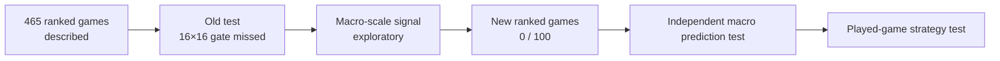

# Measured results (2026-10-09)

## A third dimension: how concentrated are the next moves?

Both surfaces aggregate the same **1,197 next-minute observations from 46 historical test matches**. The ground is the 16×16 grid; each bar's height is the percentage of next positions in that cell. The teal surface shows the account's observed destinations; pink shows Shadow's hard choices. This is a visualization of **model concentration**, not LoL terrain, a single match, or all possible futures. Explore the local [interactive dashboard](README.md#visual-dashboard) for rotation, cell readouts and minute-by-minute replay.

## Read this first: where Faker went, what Shadow guessed

The current model studies the next **one-minute position of the account resolved as `Hide on bush#KR1`**. In the 46-match historical test, it saw 1,197 minute-to-minute examples. Each square below is one of 256 regions. Both maps use the same color scale.

**What the picture says:** the real next positions spread across the map, while Shadow repeatedly chooses one central cell. That cell contains **11.28% of the real next positions**, yet receives **39.43% of Shadow's hard predictions**. This concentration helps explain why the model does not beat a simple location prior at exact 16×16 resolution. The heatmaps show aggregate *where*, not whether each minute was predicted correctly; the accuracy chart below answers that separately. Neither panel is Faker's actual screen or vision.

## Are our predictions better than simple guesses?

At **16×16**, Shadow predicts the correct next cell **11.28%** of the time; the best baseline reaches **11.61%**. At broader **8×8**, Shadow reaches **17.54%** versus **15.37%**; at **4×4**, **23.64%** versus **19.80%**. Pooling means summing the 16×16 probabilities into larger squares, not training a new model. Those broader targets were investigated **after viewing the old test**, so their positive intervals are exploratory. The [frozen future-game protocol](BENCHMARK_PROTOCOL.md) is the independent check, currently **pending at 0/100 new games**. No claim of superior play follows from these numbers.

## How the team's movement changes with game tempo

The colored lines describe the **observed account**, not a model prediction. A tag is counted when its next location is at least 1,200 game units closer to a currently positioned ally and finishes within 4,500 units. The bot-carry approach rate rises through the middle of games and peaks around minutes 20–25. The eligible sample gets smaller late in games; the counts printed below the chart show that. A move toward bot or jungle may be a lane visit, shared objective setup, escape or coincidence. It is not direct evidence of help, voice calls or causation.

The broader phase view shows that top cannot be discarded just because jungle/bot/support are strategically interesting: its observed approach rate also changes substantially with time. The role of each ally must be learned as a function of state, rather than assigned a constant percentage.

## What about radically different formations, such as five around bot?

We counted teammates within **2,500 map units of the allied bot carry** after minute 3, only when all five allied positions existed. This is a *proximity* proxy, not a detector of actually playing bot lane. In 3,255 eligible early frames across 465 matches, **one frame in one match** had all five close to the carry; four or more occurred in 46 frames. Later grouping is common because teams naturally converge for fights and objectives. This corpus therefore has essentially no support for estimating whether a deliberate five-bot opening would work, especially in professional play or with five Silver players. That idea remains a [counterfactual research question](GAME_THEORY_LAB.md), not a result.

## Evidence ladder

**Current position:** descriptions of movement and an exploratory coarse prediction signal. Shadow Faker is **not yet** a proven better predictor on untouched future games, and certainly not a proven stronger League player. The [roadmap](ROADMAP.md) gives the gates and the [progress log](PROGRESS.md) records what was actually run.

## Exact figures and audit

The account-v1 response resolved `Hide on bush#KR1`. Match-v5 supplied 470 queue-420 KR IDs. Five were remakes; 465 matches yielded valid timelines and 12,510 one-minute supervised observations. The fixed seed-42 match split has 373 train, 46 validation, and 46 test matches. The account name and API response do not independently establish a person's identity.

**Count audit:** the ID pages contained 100 + 100 + 100 + 100 + 70 IDs. Five matched games had duration below 300 seconds and were excluded. For the remaining 465, the sum of `(timeline frames − 1)` is 12,510, with **zero missing next-frame target positions**. Per match there are 13–47 examples (median 27). An example is one adjacent-minute pair, so adjacent observations from a game are dependent. This snapshot is the available API history for one PUUID, not a census of a player's professional or lifetime games.

The primary metric is exact next-region top-1 accuracy on a 16×16 grid. Scores below are **per observation**, with a paired match-level bootstrap interval for the difference from the strongest baseline. The role/phase prior is fitted on training matches only. All model and calibration choices use validation; the test set was first consulted before the later iterations, so its later scores are exploratory rather than a pristine final confirmatory result.

| Question | Current answer |
|---|---|
| Does it beat the strongest baseline for the original 16×16 target? | **No:** 11.28% vs 11.61%. |
| Is there a possible broader macro signal? | **Yes, exploratory:** 8×8 and 4×4 gains in the existing test. |
| Has that signal been independently confirmed? | **No:** the [future-game benchmark](BENCHMARK_PROTOCOL.md) is `pending` at 0/100 new matches. |

| Configuration | Validation region top-1 | Test region top-1 | Interpretation |
|---|---:|---:|---|
| Compact transformer, raw logits | 9.41% | 9.77% | First full run; test is below the most-frequent-region baseline. |
| Compact transformer + train-only role/phase prior | **10.59%** | 11.28% | Selected over the larger candidate on validation. |
| Wider transformer, 192 wide / 3 layers / LR 0.001, calibrated | 10.20% | Not evaluated | Lower validation score; early stopping at epoch 15. |
| Explicit spatial movement head, calibrated | 10.51% | Not evaluated | Lower validation score; early stopping at epoch 20. |
| Auxiliary 8×8 loss, separate development candidate | 10.51% | **Not evaluated** | Full 25-epoch run; its validation 8×8 score is 17.10%, below the frozen candidate's 17.33%; it was not promoted. |

On the compact model's test split, the most frequent region reaches 11.28%, copying the current region 6.93%, staying at map center 8.94%, and the role/phase prior alone 11.61%. The model's top-5 region accuracy is 33.58%. Its gain over the best baseline is **−0.33 percentage points**, with a paired 95% bootstrap interval of **[−1.51, +0.87]** points. Mean grid distance is 4.37 cells for the model versus 3.99 for the frequent-region baseline and 3.97 for the role/phase prior. This does **not** meet the requested clear improvement for region prediction.

Validation-selected no-event bias calibration improved other heads on test: item accuracy 58.81% versus 55.30% for predicting no purchase, and skill accuracy 55.30% versus 47.03% for predicting no upgrade. Accuracy **when a purchase actually occurs** is only 10.09%, so the overall item gain mainly concerns event timing. The auxiliary outcome head's test Brier score is 0.2242 against 0.2505 for a constant training-win-rate forecast. It is an association with final outcome, not an estimate of the causal value of a decision.

The test set contains 82% mid-lane observations versus 65% in validation. This shift and the sparse 256-class target are plausible contributors to the region gap. They are diagnoses, not permission to redraw the test split or claim a win. See [PROGRESS.md](PROGRESS.md) for the full chronology and [SHADOW_PLUS.md](SHADOW_PLUS.md) for what would be needed to assess playing strength.

An exploratory train-only spatial transition table conditioned on current region, role and phase reached 10.75% on validation alone. A wide search of transition/model interpolation reached at most 10.82% on that same split, a three-sample difference from the selected compact model. This tiny, multiply searched gain was **not** promoted to a model result or checked on test. More independent games would be needed for a trustworthy selection.

## Exploratory macro-scale diagnostic

The same frozen 16×16 model was evaluated after pooling its **probabilities** into larger cells. Frequent-region and role/phase-prior baselines were pooled and recomputed at each resolution; the model was not retrained or selected for these metrics. These scales were examined after seeing the 16×16 test failure, so their test intervals describe this sample and are **not independent confirmation**.

| Grid | Validation model / best baseline | Test model / best baseline | Test gain, paired 95% bootstrap |
|---|---:|---:|---:|
| 8×8 | 17.33% / 15.45% | 17.54% / 15.37% | +2.17 pp [0.09, 4.22] |
| 4×4 | 24.78% / 22.51% | 23.64% / 19.80% | +3.84 pp [0.25, 6.13] |

Both validation intervals include zero (8×8: [−0.39, 4.02] pp; 4×4: [−0.40, 4.79] pp). This suggests the model may capture a coarse rotation signal that exact one-minute 16×16 accuracy misses, but it is insufficient to change the original performance verdict. The next confirmatory study needs a **new untouched set of Faker matches** and prespecified macro-action metrics before inspecting its results.

## Observable team movement, not intent

An additional pass over all 465 matches labels a minute when Faker's **next observed position** moves at least 1,200 game units closer to an ally whose position was known at time `t`, ending within 4,500 units. Rates use only minutes with valid positions; labels can overlap. Dragon/Baron approach additionally requires a live objective flag at `t`; entering the base radius is another tag. These labels do not tell us whether Faker communicated, assisted, or caused a win.

The bot approach proxy rises from 5.5% of eligible early minutes to 17.7% after minute 20; support rises from 6.1% to 16.1%; jungle from 7.7% to 14.1%. Top rises from 4.1% to 14.1%, so it cannot simply be dropped from the model. These are **descriptive frequencies**, not performance differences or proof of relative role importance. The exact aggregate numerators and denominators are in [docs/data/public_summary.json](docs/data/public_summary.json); private per-match data remains excluded from Git.

Regenerate both charts using `.venv/bin/python scripts/render_results.py --from-summary`. The public summary supports figure regeneration without the Riot JSON. See [ROADMAP.md](ROADMAP.md) for the pre-registered next test and later policy work.
# 64×64 extension: accuracy, coverage, and observed interaction

The **separate 64×64 transformer** was prepared and trained on the same 465 usable ranked matches, with a five-game pilot and a match-level train/validation/test split (373/46/46). Its historical test has 1,197 next-minute decisions. It is a development result on a **previously inspected** test cohort, not fresh confirmation.

| Measure | Shadow | Comparison | Reading |
|---|---:|---:|---|
| Exact 64×64 cell | **1.09%** | Most frequent train cell **1.92%** | Fails the exact-location baseline gate. |
| Within four 64×64 cells | **22.89%** | Copy current location **16.88%** | Better near-location hit rate, exploratory. |
| Top 5 candidate cells | **4.26%** | — | A five-cell shortlist still misses most moves. |
| 90% target prediction set | **91.90% empirical coverage** | **43.72% mean map area** | Validation-calibrated; average 1,791/4,096 cells, not a pinpoint forecast. |
| Raw 90% probability-mass set | **66.33% empirical coverage** | **15.05% mean map area** | Model probabilities are not calibrated for 90% coverage. |

The coverage threshold was fitted on the **46 validation matches** and applied to the historical test. Coverage without set size is a misleading success criterion. These scores do not show that Shadow plays like or better than Faker.

The local state warehouse records **12,975 observed frames, 12,510 transitions and 353,409 categorized events**. Enemy proximity around Faker is measured as a phase-dependent observation, not attention or resources spent. A separate training candidate appends 13 causal-at-time-t interaction proxies. Its selection is based on validation; see [STATE_ECOSYSTEM.md](STATE_ECOSYSTEM.md). A memory-mapped 128-D state vector index covers all 12,510 examples; k=25 retrieval reaches **0.94% exact 64×64 validation accuracy**, below a **1.25%** frequent-cell baseline. Completed-game vectors contain future information and are excluded from prediction inputs.

The interaction candidate (540,196 parameters, seed 42, 25 epochs, CPU chosen after a 0.108 s versus 0.631 s MPS mini-benchmark) obtained **8.71% exact 16×16 on 46 validation matches**, versus its most-frequent-region baseline **8.08%**. The frozen 16×16 model scores **10.59% on that validation split**. The interaction candidate was **not promoted or evaluated on test**. This establishes a trained feature path, not an improvement; further work needs better visibility, objectives, history and an independent future evaluation.

The first same-PUUID all-queue audit found **519 match IDs**: 470 queue-420 ranked and 49 other-mode games. The latter are excluded from ranked model scores. The published event atlas and chart use only aggregate ranked counts; raw match detail and per-game traces remain local.

### Time-linked visual audit

The public 64×64 test histograms are now split by starting minute: **460** decisions at 0–10 min, **437** at 10–20 min, and **300** at 20+ min. They sum to the same 1,197 test decisions and reproduce the original observed and predicted all-phase histogram **cell by cell**. The sticky dashboard scrubber synchronizes these aggregates with observed opponent pressure, five-minute tempo, one selected game and a clearly synthetic scenario marker. These are different cohorts and resolutions, so a cursor at minute 13 means *the 10–20 minute aggregate* on the atlas and *the nearest available frame* in the open game. It is not a second-by-second reconstruction.
