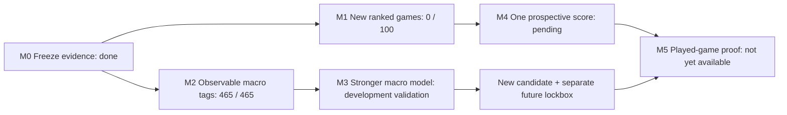

# Shadow Faker: next-level roadmap

Updated 2026-10-09. This roadmap preserves the original objective: model **Faker's macro decisions** and eventually test whether a policy can improve team outcomes. The 465-match development corpus has already influenced model and metric choices. Its test split must never be presented as a fresh confirmation again.



The two paths protect the evidence: new model ideas may use **development** matches, while the frozen candidate waits for untouched future matches. [Measured figures](RESULTS.md) show why coarse map planning is worth testing; they do not establish a stronger player. The [decision diamond](DIAMOND.md) expands this into space, tempo, team, vision, execution and consequence.

## What is known

- Exact next 16×16 region: 11.28% on the previously inspected test set, below the 11.61% role/phase prior.
- Pooling the frozen model's probabilities to 8×8 and 4×4 reveals a possible macro signal, but these resolutions were selected **after** test inspection. See [RESULTS.md](RESULTS.md).
- The current Riot ID returned 470 ranked-solo match IDs, of which 465 produced usable timelines. The API, match timeline, and public broadcasts do not expose Faker's full vision or team communications.

## Milestones and gates

| Milestone | Work | Gate to advance |
|---|---|---|
| **M0 — lock the evidence** | Freeze the current checkpoint, data split, latest source-match timestamp, primary metric, baselines, and minimum fresh sample in a local protocol. Keep all current matches as development data. | Protocol hashes verified; no overlap between development and prospective matches. |
| **M1 — collect new Faker games** | Refresh the match-ID listing in a named snapshot, reuse cached match/timeline JSON, fetch only new games, and parse only games strictly newer than the freeze cutoff. Preserve queue 420, KR region, match PUUID and remake checks. | A fresh lockbox of at least **100 usable matches**. If fewer exist, report `pending` without computing accuracy. |
| **M2 — macro action ontology** | On development matches, define movement toward jungle, bot/support, Dragon/Baron, reset/base and lane pressure as *observable proxies*. A label means where Faker moved, not why he intended to move. Measure annotation agreement on replay/VOD samples when available. | Versioned labels, five-game parser test, missing-position handling and no future information in `state_t`. |
| **M3 — improve the policy** | Train a hierarchical 8×8→16×16 location head, compare short/long history and phase-dependent ally signals, and test high-elo pretraining followed by Faker fine-tuning. All model selection remains on development validation. Professional VODs stay in a separate domain. | One candidate chosen and hashed under a **new** protocol before its own later untouched matches. It cannot replace the checkpoint already frozen in M0. |
| **M4 — one prospective score** | Evaluate the currently frozen M0 candidate once on fresh ranked Faker matches. Primary metric: 8×8 next-region top-1 gain against the strongest frozen baseline (frequent region, previous region, map center, role/phase prior), with paired match bootstrap. Always report 16×16 top-1, 4×4, item, skill, mid-only, patch and role slices. | At least 100 matches and lower 95% bootstrap bound above zero on the **prespecified** 8×8 gain. Passing this supports macro prediction, not playing strength. |
| **M5 — Shadow Plus** | Validate action-conditioned outcome models against state-only controls; restrict offline improvement to actions covered by data. Use a legitimate playable evaluation environment for head-to-head results. | Better outcomes in comparable played games with uncertainty, robustness, and style retention. No “110% Faker” claim before this. |

## Decision rules

1. The old 16×16 target remains a separately reported legacy gate. Improving 8×8 does not retroactively satisfy it.
2. The prospective lockbox is evaluated only after the minimum fresh sample arrives. A score seen too early becomes development evidence and needs another lockbox.
3. New games are defined by `gameStartTimestamp`/`gameCreation` **strictly later** than the frozen maximum. A later API listing of an old game is not prospective data.
4. Match-level bootstrap resamples whole matches, because adjacent minutes within a game are correlated. Report the absolute accuracy, all baseline accuracies, gain in percentage points, interval and number of matches.
5. Public Reddit/X/YouTube analysis informs hypotheses and manual annotations only when game, timestamp, language and perspective are recorded. Broadcasts and edited voice clips cannot silently become Faker POV or communication labels.
6. A positive one-step metric is evidence of prediction, not a causal claim that an action helped the team win. Outcome models need state-only comparisons and full-game evaluation.
7. The current frozen model is already registered in [BENCHMARK_PROTOCOL.md](BENCHMARK_PROTOCOL.md). A new model must not be swapped into that protocol or tuned after reading its score.

## Current execution status

M0 is frozen locally with 465 source matches, a cutoff of **2026-10-01 13:22:43 UTC**, and a 100-match minimum. M1's first live named snapshot (`20261009-freeze1`) returned the same 470 IDs and **0 new usable matches**; the prospective scorer correctly remains `pending`. M2's observable movement-tag parser ran on five games and then all 465, yielding eight labels and validity masks without parse errors. These tags are geometry, not verified intent or causal help. An M3 auxiliary 8×8-loss variant was trained on the full development set: validation 8×8 was **17.10%**, below the frozen candidate's **17.33%**, so it was not promoted or evaluated on the old test. A dedicated hierarchical model and a fresh prospective score (M3–M4) have not yet been produced. No raw Riot JSON, keys, models or prospective match files are committed to Git.

The sub-minute goal is a separate data milestone: align lawful replay/POV material, verify timestamps and perspective, create higher-frequency causal labels, and define a new later-game benchmark. The current API timeline and dashboard replay advance about once per minute; rendering more frames would not create new evidence.

## Reproduce the current stage

```bash
.venv/bin/python -m shadowfaker.macro_actions --limit 5
.venv/bin/python -m shadowfaker.macro_actions
.venv/bin/python scripts/run_prospective.py --offline
# On a later UTC date, with a renewed Riot key if needed:
.venv/bin/python scripts/run_prospective.py --snapshot 20261010
```

The snapshot name caches each match-ID page. Reuse a name to resume a crash; choose a **new** name for a genuinely fresh listing. `--offline` verifies the local freeze and reports the current pending count without contacting Riot. The protocol and frozen model are in ignored `data/prospective/`; the actual checkpoint copy is not published.
