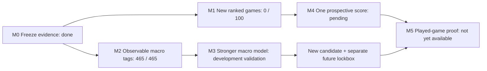
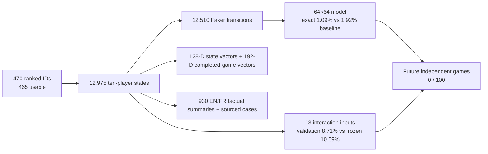

# Shadow Faker: next-level roadmap

Updated 2026-10-11. This roadmap preserves the original objective: model **Faker's macro decisions** and eventually test whether a policy can improve team outcomes. The 465-match development corpus has already influenced model and metric choices. Its test split must never be presented as a fresh confirmation again.

**M15 course correction:** [the second-scale source audit](SECOND_SCALE.md) makes the research target an action, its time and optional continuous location. Grid sizes are adjustable representations. All 465 cached games were audited: 563,198 timestamped events and 12,975 Faker position anchors, separated by a median 60.02 seconds. No new Faker position is observed in the 1/5/10/30-second windows after an anchor. The existing 10-second event model remains an event predictor; a second-scale movement policy requires aligned, perspective-labeled observations. The M14 8×8 result below is now an archived development benchmark.

**M14 evidence gate:** [the exact 90% audit](NINETY_GATE.md) finds **17.49%** correct over all validation transitions and **48.44%** on the 5% most confident. No useful abstention threshold reaches 90%; the same validation has already influenced model selection. The `20261011` Riot refresh received HTTP 401, so no new future-game score exists. The next material gain requires a renewed key for a fresh queue-420 lockbox and authorized match-aligned, player-visible evidence at finer time resolution. The current result is a diagnostic, not a revised model score.

## Next evidence gate: trainable Faker memory

The [Faker Memory database and challenger](FAKER_MEMORY.md) are operational: a five-game pilot, 10,038 train episodes, 125 causal fields, match-disjoint calibration and an anonymous quiz. Retrieval scores **11.53%** 8×8 on reused validation, below the **15.29%** role/phase baseline and **17.41%** Shadow IoC. Next: annotate a new matched replay/player-view cohort, retain source timestamps and visibility masks, freeze a future-match lockbox, then train an action policy or reranker only on the training partition. A text LLM may retrieve sourced explanations; it has no basis yet for a claim of superior play or 90% exact cells.



The two paths protect the evidence: new model ideas may use **development** matches, while the frozen candidate waits for untouched future matches. [Measured figures](RESULTS.md) show why coarse map planning is worth testing; they do not establish a stronger player. The [decision diamond](DIAMOND.md) expands this into space, tempo, team, vision, execution and consequence.

## What is known

- Exact next 16×16 region: 11.28% on the previously inspected test set, below the 11.61% role/phase prior.
- Pooling the frozen model's probabilities to 8×8 and 4×4 reveals a possible macro signal, but these resolutions were selected **after** test inspection. See [RESULTS.md](RESULTS.md).
- The current Riot ID returned 470 ranked-solo match IDs, of which 465 produced usable timelines. The API, match timeline, and public broadcasts do not expose Faker's full vision or team communications.

## Milestones and gates

| Milestone | Work | Gate to advance |
|---|---|---|
| **M0 — lock the evidence** | Freeze the current checkpoint, data split, latest source-match timestamp, primary metric, baselines, and minimum fresh sample in a local protocol. Keep all current matches as development data. | Protocol hashes verified; no overlap between development and prospective matches. |
| **M1 — collect new Faker games** | Refresh the match-ID listing in a named snapshot, reuse cached match/timeline JSON, fetch only new games, and parse only games strictly newer than the freeze cutoff. Preserve queue 420, KR region, match PUUID and remake checks. | A fresh lockbox of at least **100 usable matches**. If fewer exist, report `pending` without computing accuracy. |
| **M2 — macro action ontology** | On development matches, define movement toward jungle, bot/support, Dragon/Baron, reset/base and lane pressure as *observable proxies*. A label means where Faker moved, not why he intended to move. Measure annotation agreement on replay/VOD samples when available. | Versioned labels, five-game parser test, missing-position handling and no future information in `state_t`. |
| **M3 — improve the policy** | Train a hierarchical 8×8→16×16 location head, compare short/long history and phase-dependent ally signals, and test high-elo pretraining followed by Faker fine-tuning. All model selection remains on development validation. Professional VODs stay in a separate domain. | One candidate chosen and hashed under a **new** protocol before its own later untouched matches. It cannot replace the checkpoint already frozen in M0. |
| **M4 — one prospective score** | Evaluate the currently frozen M0 candidate once on fresh ranked Faker matches. Primary metric: 8×8 next-region top-1 gain against the strongest frozen baseline (frequent region, previous region, map center, role/phase prior), with paired match bootstrap. Always report 16×16 top-1, 4×4, item, skill, mid-only, patch and role slices. | At least 100 matches and lower 95% bootstrap bound above zero on the **prespecified** 8×8 gain. Passing this supports macro prediction, not playing strength. |
| **M5 — Shadow Plus** | Validate action-conditioned outcome models against state-only controls; restrict offline improvement to actions covered by data. Use a legitimate playable evaluation environment for head-to-head results. | Better outcomes in comparable played games with uncertainty, robustness, and style retention. No “110% Faker” claim before this. |

## Decision rules

1. The old 16×16 target remains a separately reported legacy gate. Improving 8×8 does not retroactively satisfy it.
2. The prospective lockbox is evaluated only after the minimum fresh sample arrives. A score seen too early becomes development evidence and needs another lockbox.
3. New games are defined by `gameStartTimestamp`/`gameCreation` **strictly later** than the frozen maximum. A later API listing of an old game is not prospective data.
4. Match-level bootstrap resamples whole matches, because adjacent minutes within a game are correlated. Report the absolute accuracy, all baseline accuracies, gain in percentage points, interval and number of matches.
5. Public Reddit/X/YouTube analysis informs hypotheses and manual annotations only when game, timestamp, language and perspective are recorded. Broadcasts and edited voice clips cannot silently become Faker POV or communication labels.
6. A positive one-step metric is evidence of prediction, not a causal claim that an action helped the team win. Outcome models need state-only comparisons and full-game evaluation.
7. The current frozen model is already registered in [BENCHMARK_PROTOCOL.md](BENCHMARK_PROTOCOL.md). A new model must not be swapped into that protocol or tuned after reading its score.

## Current execution status

M0 is frozen locally with 465 source matches, a cutoff of **2026-10-01 13:22:43 UTC**, and a 100-match minimum. M1's first live named snapshot (`20261009-freeze1`) returned the same 470 IDs and **0 new usable matches**; the prospective scorer correctly remains `pending`. M2's observable movement-tag parser ran on five games and then all 465, yielding eight labels and validity masks without parse errors. These tags are geometry, not verified intent or causal help. The early M3 auxiliary 8×8-loss variant reached **17.10%** validation versus the frozen candidate's **17.33%**. The coherent hierarchical M3 policy reaches **17.49%** after validation calibration using the `x` enemy-position proxy plus global timeline fields, against a **15.29%** role/phase rule; its match-bootstrap gain interval still includes zero. The 109-channel visibility proxy reaches **16.86%**; the 0.63-point difference is inconclusive. Epoch, context variant and prior weight all used that validation split. Neither M3 variant has been evaluated on the old test or independently confirmed. No raw Riot JSON, keys, models or prospective match files are committed to Git.

The second live snapshot (`20261010`) again returned **470 unique ranked-solo IDs across five pages, 465 usable cached games and 0/100 genuinely new matches**. The key worked; this is a data-availability constraint, not a failed API call. The development track can continue on training/validation while the frozen prospective test remains untouched.

### Research sequence after the M3 ablation

1. **Fix the visible failure modes with new evidence.** The M3 full model's early 8×8 accuracy is **29.8%**, middle **13.1%**, late **7.5%**; reset-class F1 is **5.8%** on 50 validation examples. A three-head phase expert was trained and **fell to 5.9% late / 16.4% overall**, so it was not promoted. Add event-aware temporal windows, wave state, objective timing and actual visibility annotations, then compare on a *new* development split or cross-validation by match. Keep old test out of selection.
2. **Get actual player-visible evidence.** The four-variant ablation and [feature matrix](VISIBILITY.md) now separate own, ally, heuristic last-seen enemy, and global timeline resource channels. The `x` proxy is **not** Faker POV, and the global-field advantage is inconclusive. Lawful replay/player-view alignment and missingness labels are needed before a true visibility-conditioned model.
3. **Expand with provenance, not duplicates.** Keep collecting verified new queue-420 games for the frozen M0 prospective lockbox. For additional development data, build a separately identified high-elo/professional source with patch, player, perspective, rights and match alignment. Pretrain there, fine-tune on Faker ranked, and evaluate cross-domain shift before claiming transfer.
4. **Build a distinct M3 future gate.** Freeze candidate weights, prior weight, metric and a later-game cutoff before any new-game evaluation. Do not insert M3 into the M0 lockbox after seeing M0's result. At least 100 eligible future games and a positive match-level lower bound are needed for a predictive claim.
5. **Then address sub-minute prediction.** Source lawful replay/player-view evidence with precise timestamps and visibility provenance; align it to match events and quantify annotation error. Interpolating one-minute Riot positions is not a substitute.

The next model is a **development candidate**; it cannot replace the M0 frozen checkpoint in the existing prospective protocol. Its own later-game confirmation requires a new untouched lockbox. No claim of stronger play follows from offline imitation accuracy.

### 512×512 resolution gate (2026-10-10)

The sparse local atlas, five-game pilot, frozen-parent conditional model, validation report and public figures are implemented. The 512 candidate scores **0.00% exact** on **1,275 transitions / 46 validation games**; copying the current position scores **0.63%**. Its match-bootstrap exact gain interval is **−1.04 to −0.32 percentage points**. The historical test and future lockbox were not opened for this candidate. The 512-cell atlas is useful for *inspecting where* positions and events concentrate, but this candidate fails as an exact predictor.

Next gate: obtain lawfully sourced observations materially faster than 60 seconds and a verified player-visible perspective, align them to the same game and timestamps, and test a predeclared target on later **independent games**. More grid cells with the same 12,510 minute transitions cannot manufacture sub-minute labels. Keep the 512 candidate as a negative control and the 64/16 results as separate archived cohorts. [Measured 512 result](RESULTS.md#512512-development-atlas-and-prediction).

The sub-minute goal is a separate data milestone: align lawful replay/POV material, verify timestamps and perspective, create higher-frequency causal labels, and define a new later-game benchmark. The current API timeline and dashboard replay advance about once per minute; rendering more frames would not create new evidence.

## Reproduce the current stage

```bash
.venv/bin/python -m shadowfaker.macro_actions --limit 5
.venv/bin/python -m shadowfaker.macro_actions
.venv/bin/python -m shadowfaker.hierarchical --pilot-only --epochs 2
.venv/bin/python -m shadowfaker.hierarchical --epochs 25
.venv/bin/python -m shadowfaker.hierarchical --phase-gate --pilot-only --epochs 2
.venv/bin/python -m shadowfaker.hierarchical --phase-gate --epochs 25
.venv/bin/python -m shadowfaker.transition_probe --pilot-only
.venv/bin/python -m shadowfaker.transition_probe
.venv/bin/python scripts/render_hierarchical.py --from-summary
.venv/bin/python scripts/render_predictability.py --from-summary
.venv/bin/python scripts/run_prospective.py --offline
# On a later UTC date, with a renewed Riot key if needed:
.venv/bin/python scripts/run_prospective.py --snapshot 20261010
```

The snapshot name caches each match-ID page. Reuse a name to resume a crash; choose a **new** name for a genuinely fresh listing. `--offline` verifies the local freeze and reports the current pending count without contacting Riot. The protocol and frozen model are in ignored `data/prospective/`; the actual checkpoint copy is not published.

## Next level delivered locally: ecosystem, retrieval and 64×64



The all-queue PUUID listing reached **519 IDs**, but the 49 additional matches are other modes. Their timelines are cached for local study and excluded from the ranked predictor. The event atlas, ten-player warehouse, five-radius pressure audit, local geometric field, multilingual index, synthetic formation simulator and fan-made dashboard are implemented. A private 465-game facts index makes timestamp, K/D/A, damage, vision, compositions and final items searchable with local champion/item sprites; the final-game fields cannot enter a time-`t` model. `scripts/run_next_level.py` reproduces the five-game pilot and full extension from the cached ranked pipeline; `scripts/refresh_catalog.py` refreshes cards, static art, search and the public inventory without retraining. See [CORPUS.md](CORPUS.md), [PRESSURE.md](PRESSURE.md), [DESIGN.md](DESIGN.md) and [RESULTS.md](RESULTS.md).

| Next research gate | Required evidence | Current status |
|---|---|---|
| Comparable game growth | New verified queue-420 games for the same PUUID or separately evaluated accounts/domains | Same KR PUUID has **0 fresh ranked**; **31 EUW** historically attributed ranked timelines are isolated; **671 pro summaries** have no trajectories; 49 other modes remain separate. |
| Observed opponent response | Enemy trajectories, objective trades and exposure at matched states | Proximity and arrivals indexed; no causal resource-spend claim. |
| Better predictive interactions | Validation gain over frozen model, followed by a new future lockbox | First 13-channel candidate is **8.71%** 16×16 validation versus frozen **10.59%**. Hierarchical global-field proxy: **17.49%** 8×8 validation, versus old frozen **17.33%** on the same split; visibility proxy **16.86%**. Differences are tiny and adaptively selected. No M3 test score. |
| Sub-minute temporal model | Lawfully sourced replay/POV positions and timestamps with perspective provenance | Riot timelines still sample positions about every 60 seconds. Events alone cannot infer every-second positions. |
| Strategy challenge | A calibrated environment or comparable played-game outcomes, with opponent adaptation and uncertainty | Five formation curves are synthetic, not win probabilities. |

Future high-elo pretraining, professional match annotation, video transcription and multilingual public analysis require source rights, domain labels, match alignment and separate validation. The 2013 Nidalee–Kha'Zix debut case is a **professional spring game**, not a Worlds sample; it is a documented historical study, not an extra ranked training observation. An offline state vector or full-match summary may aid retrieval but cannot be silently injected into `state_t` when it contains later information.

### M4 delivered: event clock and three-domain catalog

See [DATA_EXPANSION.md](DATA_EXPANSION.md) for the source table, 10-second causal target, validation chart and reproducibility command. The event model has **73,482 KR** and **5,383 attributed EUW** ten-second windows, versus **12,510 KR minute-to-minute spatial targets**. On the development KR validation set, KR+EUW reaches **1.3847 log loss** versus **1.4472** for a train-only phase-frequency rule. The 671 professional records contribute **metadata only**. No new exact spatial labels were created by interpolation.

### M13: team-history scoreboard probe — completed, no confirmed gain

The [Faker/team warehouse](TEAM_MATRIX.md) indexes Doran, Oner and Keria by match date and prior shared games. The [chronological M13 probe](TEAM_PROBE.md) tested its incremental value for a **professional scoreboard target**, with 534/39/72 train/validation/test games. Adding prior co-play changes Faker mid's test error by **−0.29 gold [−2.89, +2.10]** versus 10-minute context; copying the 10-minute score remains stronger. This does **not** confirm useful added signal and does not affect the ranked spatial model. Next, obtain authorized, aligned pro replays with player-visible context, freeze a new Faker action target, split by series and date, and compare with an otherwise identical model that omits past-only history. The current mirror cannot reveal voice, clicks, positions or who drew opponent pressure.

The next gates are (1) a provider-original professional feed or legally sourced, time-aligned replay with exact positions and visibility; (2) a fresh event-model test cohort frozen before collection; (3) rare-event precision/recall and phase-slice analysis after the completed equal-capacity role-distance ablation; (4) a [When Agents Rule-inspired](https://github.com/asp67/when-agents-rule) challenge protocol with identical scenarios, explicit action budget, latency, legal-action validator and JSONL transcript. A scenario harness must remain labelled synthetic until calibrated against played League matches. Multi-region account attribution must be refreshed when an alias changes hands; PUUID equality and dates are logged locally, and an external source is still needed to link a person to an account.

The [next research gate](NEXT_RESEARCH.md) now orders those tasks by evidence gain: one matched replay alignment pilot, the completed equal-capacity role-context ablation, rare-event failure analysis, player-visible observation audit and a reproducible scenario contract. It records why public older replay tools and the current GRID offer cannot silently become fresh Faker trajectories.

The local [dashboard](dashboard/index.html#research) now has a research gate showing the **nine class counts and F1 scores** for the KR-only validation ablation from aggregate JSON. It highlights the 52.6% ward-placement share and zero F1 on Faker kills, deaths and objectives. Direct `file://` opening serves as a launcher for the required localhost dashboard; it is not an offline data viewer. This surface changes the clarity of the evidence, not the model or the locked test status.

### M6 delivered: public Worlds finals catalogue

The dashboard now has chapter tabs and a [Finals BO5 tab](dashboard/index.html#finals). It carries **six winning series, 25 final games and three landmark semifinal games**, with a public source on each game and a separate multilingual local search index. [WORLD_FINALS.md](WORLD_FINALS.md) and the animated tour show the exact scope. These professional match facts add **zero** spatial or event labels to the ranked model. The next acquisition step is a rights-cleared, matched replay or POV record for one of these games, with clock/map alignment tested before any training use.

### M9 delivered: IoC is richer, evidence is still limited

The [IoC matrix](IOC_VISION.md) now reconstructs timestamped item inventories for all ten players across **465 ranked games**, adds official Data Dragon item descriptors matched to **12 played patches**, and exposes ten-player maps with toggles in Pressure, Atlas and 3D. Its 617-channel candidate reaches **17.41% exact 8×8** on the 46 reused validation games; item ablations have uncertain small differences and the earlier 147-channel candidate remains higher at **17.49%**. [The visual ablation](docs/figures/ioc_challenge.png) also shows why **90.75% coverage of the next destination needs 40 of 64 cells**. This milestone improves observability and reproducibility, not proven predictive superiority. The next gate stays a match-aligned, rights-cleared player-visible replay and a genuinely later ranked cohort for confirmation.
