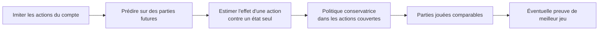

# Shadow Faker → Shadow Plus

La [courbe de précision actuelle](RESULTS.md) est à l'étape A : elle n'établit pas encore une victoire claire en 16×16. Les tags de mouvement donnent un langage pour étudier *où* Faker se déplace auprès de l'équipe ; leurs fréquences ne sont pas des points de victoire. Le [test futur figé](BENCHMARK_PROTOCOL.md) vise B et reste `pending` à 0/100 nouvelles parties.

## Deux critères distincts

1. **Fidélité** : sur des parties tenues à part, le modèle prédit mieux que les baselines où Faker se rend, ce qu'il achète et ce qu'il améliore. C'est mesurable avec les timelines actuelles.
2. **Supériorité de jeu** : une politique choisit des décisions qui augmentent réellement sa probabilité de victoire face à des adversaires comparables, tout en conservant des propriétés du style de Faker. Cette affirmation exige des parties jouées ou un simulateur validé, pas uniquement des replays historiques.

## Chemin expérimental

| Étape | Action vérifiable | Garde-fou de mesure |
|---|---|---|
| 1. Prior de Faker | Modèle BC actuel ; entrées au temps `t`, actions du compte cible à `t+1`. | Train/validation/test séparés par match ; baselines triviales ; vue proxy comparée à la vue omnisciente. |
| 2. Conséquences observées | Mesurer, par phase et rôle, les changements d'avantage or/XP après une rotation et l'issue de la partie. | Comparaison descriptive agrégée par match ; ne jamais interpréter une corrélation comme la contribution causale de Faker. `faker_rotations.json` réalise ce premier étage. |
| 3. Valeur conditionnée à l'action | Sur les **actions réellement observées**, entraîner un estimateur d'avantage local et sa calibration sur validation, avec incertitude et contrôle du patch/champion/état. | Rejeter l'estimateur s'il ne prédit pas les conséquences tenues à part mieux qu'un modèle état seul ; ne jamais extrapoler librement aux 256 régions. |
| 4. Politique conservatrice | Évaluer un ajustement du prior sur les actions bien couvertes par les données, par exemple une imitation pondérée par avantage ou une méthode hors ligne à support explicite. | Comparer la fidélité au prior et la couverture ; l'estimation de valeur hors ligne est un **proxy**, jamais un taux de victoire prouvé. |
| 5. Épreuve de jeu | Construire/obtenir un environnement LoL autorisé qui restitue vision, actions, réactions des coéquipiers et récompense ; jouer des parties comparables contre clone et baselines. | Mesurer le taux de victoire, intervalles d'incertitude, capacité à aider jungle/bot/support et robustesse par patch/champion. « 110 % » n'est annoncé qu'après cette épreuve. |

L'[Implicit Q-Learning](https://arxiv.org/abs/2110.06169) évite d'évaluer directement les actions absentes des données, puis extrait une politique par imitation pondérée par avantage. [Conservative Q-Learning](https://arxiv.org/abs/2006.04779) traite la surestimation des actions hors distribution. [Advantage-Weighted Regression](https://arxiv.org/abs/1910.00177) donne une voie simple d'amélioration depuis des trajectoires observées. Leur performance dans d'autres environnements ne garantit rien ici : notre action est une région à 60 s, nos observations ont une vision partielle approximative et l'action d'un seul joueur est confondue par celles de neuf autres.

**État actuel :** étapes 1 et 2 implémentées. La tête auxiliaire de victoire prédit une association état–issue ; elle n'est pas une valeur d'action. Les étapes 3–5 demandent de meilleurs labels et une évaluation adaptée avant toute affirmation de supériorité. Le corpus Riot présent ne contient ni simulateur, ni vision réelle de Faker, ni communications d'équipe.
