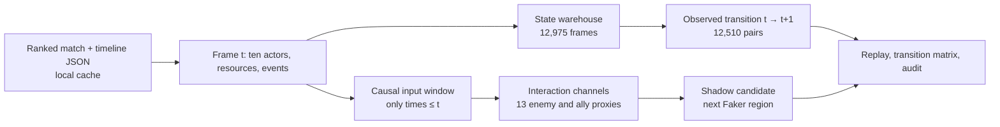

# Faker-centred game-state ecosystem

The unit of evidence is an **observed transition**, not a mouse click. Riot match-v5 frames sample player positions about once per minute. A timestamped event may fall between two frames, but the timeline does not reveal Faker's camera, pings, team voice, precise fog of war, cursor, or every skill cast. The local database keeps the ten players and their next observed positions while preserving Faker as the only behavioural target.

## Local warehouse and observed matrix

`python -m shadowfaker.state_matrix --limit 5` checks a pilot, then `python -m shadowfaker.state_matrix` builds `data/processed64/faker_states.sqlite` and `observed_transitions.npz`. All are ignored by Git. The full run indexed **465 ranked matches, 12,975 frames, 12,510 valid next-position transitions, 353,409 recognized events, and 11,450 distinct occupied transition cells**. Each `states` row has match/frame/time, Faker position, own and team resources. Each frame has up to ten `actors` rows with side, role, champion, position, gold, XP, level and CS. `events` retain timestamp, type, optional map cell and actor identifiers. `transitions` retain Faker's observed start/destination, displacement, first purchase and first skill upgrade in the next frame. A missing coordinate is SQL `NULL`; it is never fabricated. The 4096×4096 transition count matrix is stored as sparse CSR, never allocated as a dense 16.8-million-entry Python table.

The matrix describes observed movement frequency. It does not record clicks, intentions, counterfactual outcomes or causal effects. The first and last frame explain why there are more states than supervised transitions.

## Interaction variables that enter training

`shadowfaker.interaction_core` appends **13 channels per input frame** to a separate model candidate: visible enemy count, enemy count within 2,500 and 5,000 map units, enemies that moved toward Faker's *prior* observed location, close allied cover, nearby enemy gold, nearest enemy distance and level gap, visible enemy jungler distance to Dragon and Baron, opponent presence near those pits, and allied jungler cover while an enemy is near. These are normalized, imperfect proxies. They derive from the already constructed `x` minimap proxy or `x_oracle` at or before the decision time. The next frame and transition label never enter `state_t`. The default proxy does **not** recreate real fog of war: its enemy visibility is proximity based and team gold/XP remain omniscient.

The separate pressure analysis follows **all five opponents** in the full timeline. For the 12,975 valid Faker-position frames, the mean enemy count within 2,500 units was 0.94 across 736 frames at 0/1, 1.05 across 350 at 0/2, and 1.25 across 11,889 other frames. Timing and phase confound those comparisons. Nearby opponents and approach rates can encode an observed **reaction**; they cannot establish that Faker caused a resource diversion. A real influence estimate would need matched states, action alternatives, objectives traded elsewhere, and a credible outcome design. `pressure.py` provides a descriptive starting point; `interaction_core.py` is the actual neural feature path.

The dashboard now lets the reader select **five radii from 1,000 to 5,000 map units**; `pressure.py` recomputes each profile from actor positions in the warehouse. A reported entry requires that the same enemy had known coordinates outside the circle on the preceding frame and inside on the current one. Missing positions and a game's first frame contribute no entries. The chart is still a minute-sampled *net transition*, not a continuous movement trace. [Definitions, phase denominators and figure](PRESSURE.md).

The next [`hierarchical.py`](src/shadowfaker/hierarchical.py) experiment makes this comparison explicit: the same 732,782-parameter policy is trained four times with 24 Faker-only channels, 73 Faker-plus-allies channels, 109 visibility-proxy channels, or all 147 `x` channels. Its 8×8→16×16→64×64 location probabilities sum coherently at every scale. On 46 *development-validation* matches, calibrated 8×8 accuracy is 17.10%, 16.86%, 16.86%, and 17.49%. The `x` input in **every** variant uses heuristic last-seen enemy positions, **not** full oracle positions. The 147-channel variant still contains global resource and opponent statistics from the server timeline. Its calibrated gain over the 109-channel proxy is only 0.63 points, with paired bootstrap [−0.73, +1.90] points. These ablations measure association in a constructed state, not actual fog-of-war visibility, causal influence or response. [Feature provenance](VISIBILITY.md) and [full metrics](RESULTS.md#new-development-experiment--a-decision-shaped-shadow-2026-10-10).

## State and game vectors

`shadowfaker.pvectors` stores 128-dimensional state embeddings from the frozen training-only 16×16 encoder in a memory-mapped array. It builds a separate 192-dimensional **completed-game** vector by averaging state embeddings and adding an 8×8 final destination histogram. The latter includes future information and may be used only to retrieve and compare **finished** games, never as a prediction input. All 465 games and 12,510 state vectors are indexed locally. A k=25 nearest-state predictor obtained **0.94% exact 64×64 validation accuracy**, below a 1.25% train-mode baseline; retrieval alone is not promoted as a model improvement.

## What the two 3D visuals mean

The aggregate 64×64 surface sets height to **frequency of a predicted or observed destination** over historical matches. It is a distribution, not real terrain. The per-match ten-player isometric view sets height to each actor's **observed level**; lines and rings show the sampled next position, and a diamond shows Shadow's choice. The full transition is retrospectively visible for explanation, but the model never receives the next actors' coordinates before predicting.

The adjacent-cell colour field around Faker uses a symmetric positive-definite 2×2 metric oriented by **his past movement and currently nearby allies**. It is a local geometric hypothesis about anisotropic adjacency, inspired by Riemannian geometry. It is not a solution to the Riemann hypothesis, a learned geodesic, the game's true reachable-state manifold, or the neural model's probability output. See `geometry64.py` for the exact tensor and eigenvalue floor.

## Reproduction and limitations

Run five-game pilots before full indexing. Match-level splitting, source hashes, atomic outputs and per-game exception logging support safe resume. `data/raw/`, the SQLite database, neural vectors, individual summaries, replay frames, models, and credentials remain local. Public `docs/data/*.json` contains only aggregate counts and synthetic challenge parameters. The UI's notable moments are timestamped events from one private locally served match; they are not uploaded.

For historical context, the documented Nidalee–Kha'Zix solo kill is **Faker's 2013 professional debut versus CJ Entus Blaze**, not a Worlds match. [Riot's account of Faker's beginnings](https://nexus.leagueoflegends.com/en-us/2018/08/13-ways-of-looking-at-success/) supports that pairing and match context. The exact spell sequence and ability evolution are not labeled from a verified original-frame transcription here; the local case study records that limit.
