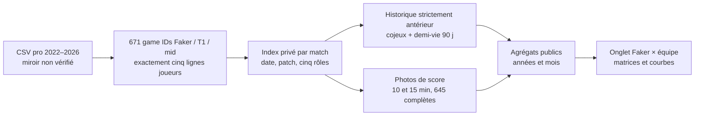

# Faker × équipe — mémoire de jeu mesurée

**Épreuve prédictive suivante :** l'[ablation chronologique de l'historique commun](TEAM_PROBE.md) sur 645 manches à score complet ne confirme pas de gain pour le score de Faker mid à 15 minutes ; la copie du score à 10 minutes reste meilleure. Les matrices ci-dessous demeurent descriptives.


## La question

Faker décide dans une équipe qui change avec le temps. Doran, Oner et Keria possèdent chacun une histoire commune différente avec lui. Cette première matrice rend cette histoire **observable et datée** : qui a joué avec qui, combien de fois avant une manche, et comment les écarts de ressources des cinq rôles évoluent de 10 à 15 minutes. La [page T1 de LoL Esports](https://lolesports.com/en-US/teams/t1) confirme les noms du roster affiché en octobre 2026 ; les chiffres historiques ci-dessous proviennent d'un [miroir public tiers](https://github.com/twodotone/finalLOL/tree/main/data/csv) non vérifié directement contre chaque feuille de match officielle.



## Ce qui est effectivement indexé

| Mesure | Définition | Résultat local |
|---|---|---:|
| Manches | ID distinct avec Faker mid et exactement top/jng/mid/bot/sup T1 | 671 |
| Lignes joueurs | Une ligne par rôle et manche | 3 355 |
| Noms de joueurs absents dans le miroir | Une ligne bot 2023 conservée comme `UNKNOWN` | 1 |
| Photos complètes | Les sept champs d'or, XP, kills/assists/deaths à 10/15 exigés pour **les cinq** joueurs | 645 |
| Paires temporelles | Quatre coéquipiers par manche, avec historique préalable | 2 684 |
| Fenêtre | Première date → dernière date du miroir | 2022-01-12 → 2026-04-10 |

Les manches par **année civile de la date du match** sont 144 (2022), 134 (2023), 176 (2024), 187 (2025) et 30 (2026). Le champ de saison `year` du CSV est conservé séparément : 18 manches datées de décembre 2025 y portent déjà `2026`. Les 187 manches datées de 2025 contiennent toutes Faker, Doran, Oner et Keria. Le fichier 2026 s'arrête le 10 avril : il **ne décrit pas la saison entière**.

## L'expérience préalable, sans connaître le futur

Pour Faker et un coéquipier `p`, juste avant la manche `g` de date `t`, les valeurs locales sont :

```text
parties_passées(p,t) = nombre de manches communes dont la date est strictement < t
mémoire_90j(p,t)    = Σ 2 ^ (−jours_écoulés/90) sur ces manches passées
récence(p,t)        = jours depuis leur dernière manche commune antérieure
```

Une manche à l'instant `t` ne compte pas dans sa propre entrée ; un match futur non plus. La courbe du site échantillonne la valeur **avant la dernière manche de chaque mois**, donc son dernier point n'est pas le total après cette manche. Exemple au dernier match disponible d'avril 2026 : Doran avait 216 matchs communs antérieurs, Oner 668 et Keria 670 dans ce corpus. La « mémoire 90 j » est un **choix de décroissance descriptif**, non un mécanisme psychologique appris ou calibré.

## La matrice de gameplay

Le tableau de bord propose trois lectures :

1. **Cojeu 4×4** Faker/Doran/Oner/Keria : chaque case compte les manches de la période où les deux apparaissent. La diagonale compte la présence du joueur. Ce n'est pas un score de synergie.
2. **Ressources 5 rôles × 4 mesures** : écart moyen d'or contre l'adversaire du même rôle à 10 et 15 minutes, puis variation de cet écart et variation de l'écart d'XP entre ces instants. Une valeur positive signifie un avantage de scoreboard pour T1 sur ce rôle. La variation est `moyenne(diff15) − moyenne(diff10)` sur les mêmes manches complètes, avec le dénominateur affiché.
3. **Co-mouvements 5×5** : corrélation de Pearson entre les variations `diff_or15 − diff_or10` de deux rôles, calculée **manche par manche** dans la même période. `+1` signifie variations alignées, `0` absence de relation linéaire, `−1` variations opposées. La diagonale vaut 1 lorsque la variance existe. Cette matrice ne mesure ni trajectoire, ni transfert d'or entre joueurs, ni direction d'influence.

En 2025, sur 187 manches complètes, l'écart d'or moyen de Faker mid va de **−78** à 10 minutes à **−103** à 15 minutes, tandis que le bot passe de **+123** à **+224**. Pourtant la corrélation des variations mid↔bot n'est que **+0,06** ; bot↔support atteint **+0,55** et Faker↔jungle **+0,39**. Ces chiffres décrivent des co-mouvements de scoreboard ; ils **ne démontrent pas** que Faker a transféré de l'or, attiré l'ennemi ou causé un gain bot. Un exemple contextualisé devrait contrôler composition, adversaire, patch, état initial et sélection des manches.

## Stockage et reprise

```bash
.venv/bin/python scripts/build_pro_team_matrix.py
.venv/bin/python scripts/render_pro_team_matrix.py
.venv/bin/python scripts/serve_dashboard.py --port 8008
```

La première commande effectue le pilote cinq manches, construit `data/processed/pro_team_matrix.sqlite` et produit [l'agrégat public](docs/data/public_team_matrix.json). L'index SQLite, les CSV et les IDs de match restent locaux et ignorés par Git. Elle vérifie les SHA-256 des CSV, le contenu du catalogue sélectionné et la version du schéma pour reprendre sans travail inutile. Pour reprendre tout le volet acquisition/événements et cette matrice en une commande après la configuration du pipeline, lancer `.venv/bin/python scripts/run_expansion.py` ; `--skip-pro` réutilise le catalogue pro déjà local. `run_next_level.py` reconstruit aussi cette vue si ce catalogue existe. Le PNG et le JSON publics ne contiennent ni ID de manche ni ligne joueur.

## Limites et expérience suivante

- Les CSV contiennent des **résumés de score**, pas des trajectoires de joueurs, leurs clics, leur vision, la minimap effectivement vue, les pings ou les communications vocales. Ils ne peuvent donc pas attribuer une réaction ou une influence de Faker à une seconde donnée.
- La composition change selon les années ; comparer les moyennes d'une année à l'autre mélange patchs, adversaires et sélection de match. Les scores finaux (dégâts, vision, K/D/A) sont conservés **après match** dans SQLite, jamais injectés dans un état à 10 minutes.
- Ces parties professionnelles forment un domaine distinct des timelines ranked KR/EUW. **Aucune ligne pro n'entraîne actuellement Shadow IoC ni n'améliore son score de prédiction.** L'objectif de 90 % exact n'est pas atteint par cette indexation.
- Prochaine épreuve : trouver des replays autorisés et horodatés du même roster, annoter visibilité et réponses ennemies, définir une cible de décision à quelques secondes, séparer les manches par série et date, puis comparer une politique avec/sans historique de cojeu à une baseline forte. Une différence sur test prospectif pourrait être étudiée ; elle ne suffirait pas à prouver une « chimie » causale.
