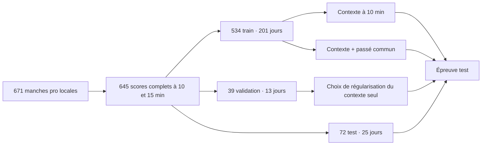

# Faker × équipe — est-ce que la mémoire commune prédit mieux ?


## Question et résultat

La [matrice d'équipe](TEAM_MATRIX.md) compte les manches précédemment jouées par Faker avec Doran, Oner et Keria. **M13 teste si ces comptes apportent un signal mesurable** à une prédiction modeste : l'écart d'or de Faker contre le mid adverse à **15 minutes**, connaissant le score à **10 minutes**. La même épreuve est répétée pour bot. Il s'agit de scores de parties professionnelles issus d'un miroir public non vérifié, séparés des parties ranked et des décisions spatiales de Shadow.

| Cible test | Copier le score de 10 min | Contexte de 10 min | Contexte + historique | Différence historique − contexte, IC 95 % |
|---|---:|---:|---:|---:|
| Faker mid, erreur absolue moyenne | **412,64 or** | 442,17 or | 441,88 or | **−0,29** [−2,89 ; +2,10] |
| Bot, erreur absolue moyenne | 477,72 or | **460,08 or** | 464,81 or | **+4,73** [−16,75 ; +26,32] |

Une erreur plus petite est meilleure. L'écart de **−0,29 or** est pratiquement nul et son intervalle traverse zéro. La copie du score courant fait **29,24 or de mieux** que le modèle avec historique pour Faker mid. **Le signal incrémental n'est pas confirmé et aucun modèle Shadow n'est promu.** La précision du côté positif/négatif est publiée dans le [JSON agrégé](docs/data/public_team_probe.json), mais la cible primaire préenregistrée ici est l'erreur absolue en or, pas une accuracy choisie après coup.

## Protocole reproductible



Les coupures portent sur des **jours calendaires entiers** : entraînement jusqu'au 31 juillet 2025, validation du 1er août au 30 septembre, test à partir du 1er octobre. Toutes les manches d'un même jour restent dans le même split. Les 25 jours test sont rééchantillonnés 5 000 fois pour l'intervalle apparié ; cela ne neutralise pas toutes les dépendances de série, d'adversaire ou de patch.

Les **63 variables de contexte** comprennent les écarts or/XP, kills, assists et morts à 10 minutes pour cinq rôles ; la date, la ligue, les coéquipiers par rôle et le champion mid sont encodés avec un vocabulaire appris sur le train seulement. Les **neuf variables supplémentaires** donnent, pour chaque Doran/Oner/Keria, le nombre de manches *antérieures*, l'exposition antérieure avec demi-vie 90 jours et la récence. L'index de cojeu est construit dans l'ordre date puis identifiant ; une manche ne compte jamais pour elle-même. Les champs à 15 minutes et les scores finaux ne sont que des cibles ou éléments d'audit. Le test automatisé modifie leurs valeurs et vérifie que les entrées ne changent pas.

Deux régressions ridge multi-sorties, même pénalité, même seed 42 et mêmes manches sont comparées. La pénalité parmi `0.1, 1, 10, 100, 1000` est choisie uniquement sur l'erreur mid **du modèle sans historique en validation** ; le choix est 100. La baseline « persistance » copie simplement l'écart d'or observé à 10 minutes. Le test chronologique est ouvert une fois après ce choix. Le modèle enrichi a 72 variables contre 63 : la comparaison mesure l'apport de ces variables à cette famille de modèles, pas une vérité universelle sur la cohésion de T1.

Reproduire depuis les CSV et l'index pro locaux :

```bash
.venv/bin/python scripts/build_pro_team_matrix.py
.venv/bin/python scripts/run_team_probe.py --pilot-only
.venv/bin/python scripts/run_team_probe.py
```

La commande complète `scripts/run_expansion.py` exécute aussi le pilote et l'épreuve après avoir mis en cache les sources. `data/processed/pro_team_probe.npz` garde la matrice détaillée et les identifiants de parties **uniquement en local** ; le dépôt contient le score agrégé et le PNG. Les sources du miroir sont listées dans [TEAM_MATRIX.md](TEAM_MATRIX.md).

## Ce que ce test ne démontre pas

- Un score pro à 10 minutes résume une vue omnisciente. Il ne contient ni la minimap réellement visible par Faker, ni ses clics, pings, voix, émotions, décisions ou trajectoires.
- Un écart d'or à 15 minutes est un résultat intermédiaire de cinq joueurs et des adversaires, pas la qualité ou l'influence de Faker. Les variables de cojeu ne mesurent pas la « chimie » ; patch, opposition, calendrier et roster sont des facteurs confondants.
- Les 72 manches test partagent un historique d'équipe et des patches avec le train ; c'est une rétrospective chronologique, **pas une validation prospective indépendante**. Le miroir s'arrête en avril 2026.
- Même un gain positif ici ne serait pas transférable directement à la prédiction de la prochaine région 8×8 ou 512×512 des parties ranked. Aucun score de Shadow ou objectif de 90 % ne change.

**Épreuve suivante.** Enrichir des manches pro avec des replays ou VOD autorisés, horodatés, et des annotations de visibilité, pings et mouvements. Geler une nouvelle cible de décision de Faker et un split par série, jour et patch avant entraînement. Comparer à une baseline de persistance forte, avec ablation de l'historique ; ne réévaluer sur un nouveau test qu'après gel du protocole.
