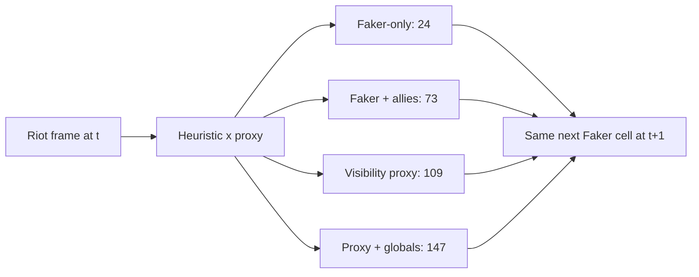

# What Shadow can know at decision time

**Target:** the next observed 8×8 map cell of the account `Hide on bush#KR1`, about one minute after the current frame. The model's input window ends at `t`; the destination and movement tags belong to `t+1`. A Riot match timeline is a server record, **not Faker's camera, minimap, pings or team voice**. The account API resolves an ID, not a human identity proof.

## Four controlled inputs, one target

| Variant | Channels | What remains | Main blind spot |
|---|---:|---|---|
| Faker only | 24 | Own position, level, XP, gold, CS, kills/deaths, role, time | No team or opposing context. |
| Faker + allies | 73 | Above plus allied frame values and distances | Some exact ally resource values may not be visible to a player. |
| Visibility proxy | 109 | Own state, allied map context, last-seen enemy positions from a proximity heuristic, public event/objective proxies | **Not actual fog of war**; no verified ward coverage or pings. |
| Proxy + globals | 147 | All `x` channels, including global gold/XP, enemy resource and level fields | Server information a player may not know. Enemy *positions* still use the `x` visibility heuristic. |

The precise yes/no matrix for all **147 fields** is in [feature_visibility.json](docs/data/feature_visibility.json), generated by `scripts/export_feature_visibility.py`. The input is always the saved **`x` proxy**, never `x_oracle`. In `features.py`, an enemy farther than 1,600 game units from every ally loses its current position in `x`; the last observed proxy position and its age remain. This rule is a convenient approximation and can both hide visible opponents and expose unseen ones. Global resource values and player statistics are still taken from the timeline until explicitly masked in the visibility-proxy ablation. Zeroing a channel is an ablation, not a reconstructed player view.

## What the ablation measured

All four models have **732,782 parameters**, use the same 373 training matches and the same 46 historical development-validation matches. Their 8×8 top-1 accuracies after a train-derived role/phase prior with validation-chosen weight are **17.10%, 16.86%, 16.86%, and 17.49%** in table order. Before calibration, visibility proxy is **16.71%** and proxy plus globals **16.86%**. The calibrated full-minus-visibility difference is **+0.63 percentage points**, with a paired match-bootstrap interval **[−0.73, +1.90]**. It does **not** establish that the extra global fields improve prediction. The five-class movement macro F1 is **42.5%** for the visibility proxy and **44.9%** for the global-field variant; reset remains a weak class. Epoch, variant and prior weight were all chosen on the development validation set, so these are exploratory comparisons.

The geometry audit independently recomputed the current 64×64 cell from `x` and compared it with the saved previous-cell label: **0 mismatches across 10,038 training and 1,275 validation observations**, with no missing current positions. A separate smoothed transition prior was selected on 75 matches taken from *training* and then refitted on all 373 training matches. It reaches **15.69% top-1 and 39.76% top-5** on validation, below the hierarchical model's **17.49% top-1**. This rules out a simple off-by-one cell error in these saved examples; it does not verify unobserved game information.

## The 90% question

On the same development validation set, the selected global-field model puts the real next cell in its **top 1** guess 17.49% of the time, **top 5** 42.98%, **top 20** 71.22%, and **top 41** 90.12%. Forty-one cells cover **64.1% of the 8×8 map**. That is a very wide prediction set, **not 90% exact-location accuracy**. These k values and the model have already been inspected on this validation set. A future lockbox must recheck both coverage and area before either can be called reliable.

The full variant's exact 8×8 accuracy by starting minute is **29.8% at 0–10 min**, **13.1% at 10–20 min**, and **7.5% at 20+ min**. The visibility proxy follows almost the same pattern. The later map has more plausible destinations and the present input lacks minion waves, cooldowns, actual ward coverage, pings, player POV and sub-minute transitions. This is a diagnosis of missing evidence, not a proven explanation of Faker's decisions.

One targeted capacity experiment added **three phase-dependent 8×8 residual heads** to the shared encoder. Despite selecting on average accuracy across early/middle/late validation phases, its late accuracy **fell to 5.91%** and overall accuracy to **16.39%**, compared with **7.53% late / 17.49% overall** for the simpler global-field proxy. A paired match-bootstrap interval for the overall difference is **[−2.49, +0.38] percentage points** around −1.10. More phase-specific parameters alone did not close the gap; this candidate was retained only as a negative development result. [RESULTS.md](RESULTS.md) records the full comparison.

## Next evidence to acquire

1. Obtain lawful, timestamped replay or player-view material aligned to match IDs and patches. Store each source's rights, language, observer/player perspective and synchronization uncertainty.
2. Annotate a **small five-game pilot** for actual visible enemies, allied waves, objective setup, wards, pings if available and 5–10 second movement. Keep unknown facts explicitly unknown; never interpolate a minute-long trajectory into claimed ground truth.
3. Train a temporal model on that distinct observation schema, compare against the 60-second model and trivial geometry, and hold out matches by game and time. Professional broadcasts remain a separate domain from solo queue.
4. Freeze a later-game candidate and evaluate it once on enough **new** ranked matches. The current M0 prospective protocol remains pending at 0/100; M3 needs its own future gate. Predictive accuracy cannot by itself prove a stronger player or a causal team benefit.

Regenerate the aggregate figures with `.venv/bin/python scripts/render_hierarchical.py --from-summary` and `.venv/bin/python scripts/render_predictability.py --from-summary`. Private per-match rows, model weights and Riot JSON stay in ignored local directories.
