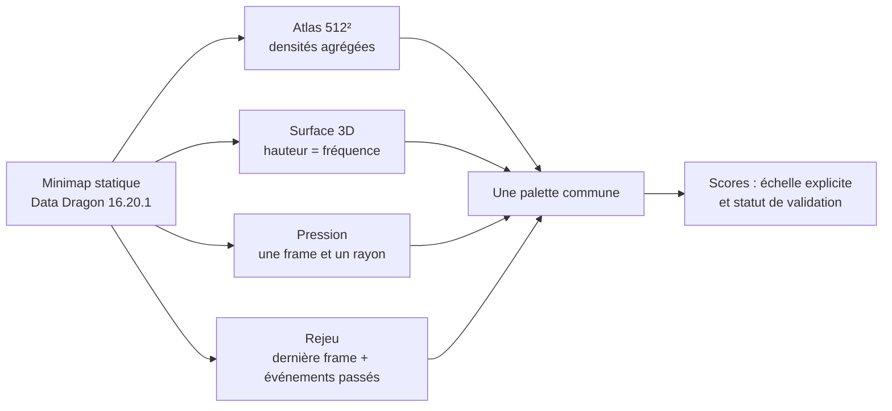

# Shadow Faker — système visuel des preuves

Le même terrain relie les cartes du site. Le fond de la Faille est l'image `map11.png` de [Riot Data Dragon](https://developer.riotgames.com/docs/lol#data-dragon), version **16.20.1**. Il sert de repère spatial et d'identité visuelle ; ce n'est pas le terrain enregistré au patch exact de chaque partie. Les positions et événements restent des couches de données distinctes.

## Lire chaque vue

| Vue | Ce qui change | Ce que signifie la couleur ou la forme | Ce que la vue ne prouve pas |
| --- | --- | --- | --- |
| Atlas « pixels » | Couche, phase, filtres IoC | Densité de positions ou d'événements sur plusieurs parties ; le survol lit le compte exact de la case | Pas la vision de Faker, ni une partie unique |
| Surface 3D | Observé/Shadow, angle, phase | Hauteur = fréquence de destination agrégée ; plan = coordonnées de carte | Pas le relief du jeu ni une issue de partie |
| Rejeu | Partie, horloge, filtres, fenêtre, traces | Portrait = dernier relevé ; croix = combat ; losange = objectif ; œil = vision ; trait pointillé = lien entre relevés passés | Pas de clics, de trajet continu, ni d'information de Faker sur les ennemis cachés |
| Pression | Partie, minute, rayon | Cercle = distance géométrique ; portrait et couleur = joueur observé à une frame | Pas une mesure de peur, de sorts consommés ou d'attention adverse |
| Scores | Cohorte et métrique documentées | Barre rose = précision historique exacte 8×8 à la minute ; repère or = seuil 90 % | Pas un score à la seconde ni une promesse atteinte |

Palette : **or** pour Faker et les repères de lecture, **bleu** pour les alliés, **corail** pour les adversaires et le danger, **turquoise** pour l'observé agrégé, **rose** pour Shadow, **violet/or** pour des objectifs distincts. Les cartes et graphiques conservent une légende textuelle : la couleur ne porte jamais seule le sens.

Le rejeu ne montre un nouvel emplacement de joueur qu'à une frame Riot, généralement après environ 60 secondes. Ses événements sont placés au timestamp de l'événement, si un lieu existe. Un lien entre deux frames est volontairement pointillé. Dans l'atlas et la surface, les points d'une partie individuelle sont une **surimpression** sur un fond statistique d'autres parties ; l'interface le dit explicitement. La jauge 90 % se trouve dans l'archive 8×8/min et ne se substitue pas à la cible de recherche à l'échelle de la seconde.

## Suite de design vérifiable

1. Aligner une VOD ou un `.rofl` autorisé sur un match ID et comparer événements, wards et positions pour une à cinq parties.
2. Si une vue joueur est disponible, offrir un basculement « timeline omnisciente / écran joueur » avec un masque de vision vérifié, plutôt qu'une fausse brume de guerre.
3. Ajouter un mode comparaison de deux instants observés, avec pertes/gains de position et ressources, sans flèche causale automatique.

Les visuels ne changent pas le modèle, ses features ni ses scores. [Contrat du rejeu](REPLAY.md) · [protocole 90 %](MODEL_90_ROADMAP.md) · [limites de replay](REPLAY_FEASIBILITY.md).
