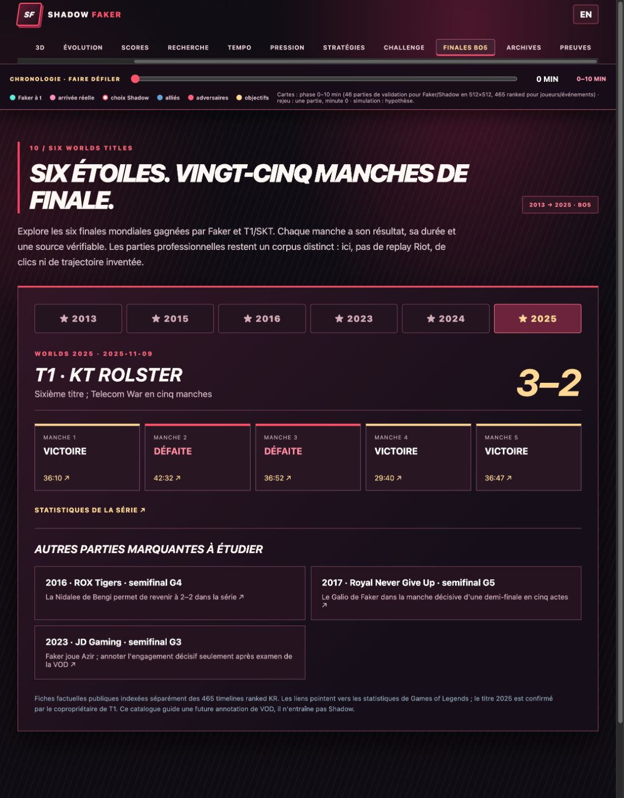

# Six Worlds finals · a separate professional-game archive

**Scope.** Faker played in T1/SK Telecom T1's six winning Worlds finals. [T1 co-owner Comcast Spectacor confirms that the 2025 victory was the organization's sixth title](https://comcastspectacor.com/news/2025/12/t1-entertainment-sports-wins-2025-league-of-legends-world-championship/). The [dashboard's Finals BO5 tab](dashboard/index.html) makes the series browsable. The six series contain **25 games**. Three additional landmark semifinal games are indexed as research leads. This archive is independent of the **465 KR ranked timelines** used by the spatial model.

| Year | Final | Series | T1 game sequence | Source |
|---|---|---:|---|---|
| 2013 | SK Telecom T1 vs Royal Club | 3–0 | W W W | [Match summary](https://gol.gg/game/stats/383/page-summary/) |
| 2015 | SK Telecom T1 vs KOO Tigers | 3–1 | W W L W | [Match summary](https://gol.gg/game/stats/2257/page-summary/) |
| 2016 | SK Telecom T1 vs Samsung Galaxy | 3–2 | W W L L W | [Match summary](https://gol.gg/game/stats/4701/page-summary/) |
| 2023 | T1 vs Weibo Gaming | 3–0 | W W W | [Match summary](https://gol.gg/game/stats/53622/page-summary/) |
| 2024 | T1 vs Bilibili Gaming | 3–2 | L W L W W | [Match summary](https://gol.gg/game/stats/62816/page-summary/) |
| 2025 | T1 vs KT Rolster | 3–2 | W L L W W | [Match summary](https://gol.gg/game/stats/72980/page-summary/) |

## Indexed landmark games beyond the finals

| Game | Why it is in the queue | Public source |
|---|---|---|
| 2016 Worlds semifinal vs ROX, game 4 | Bengi's Nidalee, with SKT down 1–2 before the game | [Game statistics](https://gol.gg/game/stats/4696/page-game/) |
| 2017 Worlds semifinal vs RNG, game 5 | Faker's Galio in the deciding game | [Game statistics](https://gol.gg/game/stats/9070/page-game/) |
| 2023 Worlds semifinal vs JDG, game 3 | Faker's Azir, pending direct VOD annotation of the decisive engage | [Game statistics](https://gol.gg/game/stats/53620/page-fullstats/) |

These are **curated match facts and links**, not copied VODs or raw third-party pages. `docs/data/world_finals.json` stores a source URL for every final game; `scripts/build_world_finals.py` rebuilds it. The local multilingual SQLite text index adds **56 documents** (28 game records in French and English) via `.venv/bin/python -m shadowfaker.text_index finals`. It is searchable through the existing Archives tab. Re-running the import replaces the same keys.

We have **not** linked these professional games to Riot match IDs, player-view replays, click streams, exact vision, communications or a causal decision trace. The public summaries therefore **do not enter model training or evaluation**. To move one game into a replay experiment, verify a licensed VOD and match identity, align its clock and map with independent event anchors, annotate only what is visible, then pilot one game before extending to five. This is the [next research gate](NEXT_RESEARCH.md).

The animation consists of six browser captures of the public-only Finals tab. Rebuild it with `.venv/bin/python scripts/render_finale_gif.py` from the checked-in frames in `docs/figures/finals_frames/`. No per-game Riot timeline or private replay image appears in those frames.
